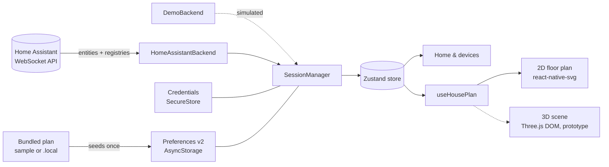

<div align="center">


# MAURICE

### Your home. His rules.

<i>Module Autonome Universel de Régulation Intelligente et de Contrôle Électrique.</i>

<b>« Maurice s’occupe de tout. Vous, de rien. »</b>

Meet Maurice: a 1970s French butler with a moustache, a three-piece suit, a Gitane at the corner of his mouth and a deeply disapproving look. He keeps an eye on every room of your home through Home Assistant: rooms, floor plans and device state, in one dark, quiet app for the phone in your pocket.

[](https://docs.expo.dev/)
[](https://reactnative.dev/)
[](https://www.typescriptlang.org/)
[](https://www.home-assistant.io/)


[](docs/README.md#latest-verification-checkpoint)


[Features](#-features) · [Quick start](#-quick-start) · [Home Assistant](#-connect-home-assistant) · [Architecture](#-architecture) · [Project status](docs/README.md) · [Roadmap](#-roadmap)

</div>

<br />

**Current scope:** Android-first and read-only. Kasa HS103 and Petlibro PLAF103 pass real HA/backend checks. Profile plans are implemented; the 3D scene is an experiment awaiting native measurements. See [current status, evidence and next steps](docs/README.md).

<table>
  <tr>
    <td align="center" width="33%"></td>
    <td align="center" width="33%"></td>
    <td align="center" width="33%"></td>
  </tr>
  <tr>
    <td align="center"><sub><b>Your home at a glance</b><br />attention first, then rooms</sub></td>
    <td align="center"><sub><b>Room filters</b><br />one tap per room</sub></td>
    <td align="center"><sub><b>Honest device detail</b><br />where each value came from</sub></td>
  </tr>
</table>

<p align="center"><sub>Screenshots from the built-in offline <b>demo home</b>. No real household data.</sub></p>

## ✨ Features

|     | Feature                     | What it does                                                                                                                                                                                                                  |
| :-: | --------------------------- | ----------------------------------------------------------------------------------------------------------------------------------------------------------------------------------------------------------------------------- |
| 🏠  | **Home overview**           | Attention items first (an unlocked door, an unavailable favorite), then favorites and a device grid you can filter by room. "Unknown" and "unavailable" never count as all-clear.                                             |
| 🗺️  | **Floor plans**             | Offline 2D plans, several floors, rooms you can tap, the dimensions printed on the source plan, and rough furniture footprints to help you find your way around.                                                              |
| 🧭  | **A plan for each profile** | Each Home Assistant origin and the demo keep their own copy of the plan. App updates never overwrite it; resetting it is a deliberate action in Diagnostics.                                                                  |
| 🔌  | **Live Home Assistant**     | Official WebSocket client, compressed entity stream, registries, foreground resync and automatic recovery after network loss or an HA restart.                                                                                |
| 🔐  | **Private configuration**   | Tokens stay in native SecureStore; personal source files stay outside Git. Bundles contain the prepared plan, so shared artifacts must use the public sample. Preferences store neither tokens, observed states nor commands. |
| 🧪  | **Offline demo home**       | Simulated locks, sensors, cameras and switches with no account at all.                                                                                                                                                        |
| 🩺  | **Diagnostics**             | Session and registry health, unresolved identities, floor-plan status and reset, with no secrets on screen.                                                                                                                   |

> [!NOTE]
> Maurice is **read-only** today: he observes Home Assistant and never sends a device command. Controls come in Stage 2, with command tracking that cannot replay an unlock after a reconnect.

## 🚀 Quick start

> **Requirements:** Node 24 and the locked dependency versions.

```sh
npm ci
npm run web        # interface preview in the browser
```

Open **Settings → Explore demo home**. The demo runs entirely on simulated data inside the app. The browser preview is for the interface only; token storage needs native SecureStore.

<details>
<summary><b>📱 Run on Android</b></summary>

<br />

Install an Android SDK and JDK 17 (Android Studio or the command-line tools). Configure `ANDROID_HOME`, `JAVA_HOME` and `adb`, enable USB debugging, connect and authorize the phone, then build and install the development client:

```sh
npm run android
```

Later sessions with the client already installed:

```sh
npm start
```

This workspace keeps an SDK and JDK 17 under `.local/android/`, with their paths in the ignored `.env.local` that Expo loads automatically. JDK 25 fails in the native Prefab/CMake step, so use JDK 17. Tool versions, the direct Gradle build and the APK location are in [Android validation](docs/stage0/android-validation.md).

The development APK loads its JavaScript from Metro; the recorded Pixel sessions use USB forwarding (`adb reverse tcp:8081 tcp:8081`) to a localhost Metro server. Expo Go is not a supported target; iOS runtime validation is deferred.

</details>

<details>
<summary><b>🗺️ Use your own floor plan</b></summary>

<br />

Put a private plan in the ignored `.local/home-plan.json`. `npm run house:prepare`, which runs before `start`, `web`, `android`, `test` and `typecheck`, validates it and bundles an ignored local module. Fresh checkouts and demo mode use the [public sample](src/spatial/sample-plan.json).

Coordinates are meters on the X/Z plane. Rooms may be concave, and each floor can also list rough furniture footprints. A connected profile keeps the copy it was first given: after editing the local plan, use **Diagnostics → Reset plan to default** to pick up the new version.

Format, privacy of build artifacts and the path to 3D: [local floor plans](docs/design/floor-plans.md).

</details>

## 🏡 Connect Home Assistant

Maurice needs **HA 2026.10 or newer** (tested with `2026.10.1`). Use an existing instance, or start the pinned local container (Docker Desktop required):

```sh
npm run ha:up      # seeds .local/home-assistant/ and serves http://localhost:8123
npm run ha:logs
```

1. Complete onboarding and create a dedicated **Maurice** user.
2. Signed in as that user, create a long-lived token under **Profile → Security**.
3. In Maurice's **Settings**, enter the HA origin and the token.

> [!IMPORTANT]
> On the phone, use the Mac's **LAN address** (for example `http://192.168.1.20:8123`), not `localhost`. The URL must have no path, query or fragment. Plain HTTP requires the _trusted local network_ option, and the token then travels unencrypted.

The bundled HA configuration enables HA's `demo` integration. Its simulated devices exercise the real HA API but do not prove vendor compatibility. They are separate from Maurice's own offline demo.

<details>
<summary><b>🔎 Check an HA instance from the command line</b></summary>

<br />

```sh
mkdir -p .local && touch .local/ha-token && chmod 600 .local/ha-token
# paste only the raw token into .local/ha-token, then:
HA_ALLOW_INSECURE_HTTP=1 npm run proof:ha
```

| Variable                 | Default                 | Purpose                         |
| ------------------------ | ----------------------- | ------------------------------- |
| `HA_URL`                 | `http://127.0.0.1:8123` | HA origin to test               |
| `HA_TOKEN_FILE`          | `.local/ha-token`       | Local file containing the token |
| `HA_ALLOW_INSECURE_HTTP` | unset                   | `1` explicitly allows HTTP      |

The proof authenticates, loads a snapshot and the registries, pings, refreshes, simulates a return to the foreground and reconnects. It prints the version, timings, aggregate counts and metadata freshness. It never prints tokens, URLs or entity details, and it sends no device service calls. The token file is never bundled into the app.

</details>

## 🧱 Architecture



- **The backend owns recovery.** Transport reconnections use the official client's retry loop; failures during the initial connection and synchronization get backend retries. Authentication and version errors are terminal.
- **No stale truth.** A refresh keeps the committed entity stream until its replacement succeeds. Values stay marked as cached until the session is ready, and optional registry failures show up in Diagnostics.
- **Credentials are journaled.** Operations are serialized, and an interrupted save or cleanup is recovered. _Forget_ removes the token from the phone; revoke it in HA separately.
- **Preferences are per origin.** Demo and each HA origin never share favorites, overrides, plans or placements. Schema migrations are ordered and validated, and data written by a newer app version is backed up rather than lost. Moving HA to a dedicated host creates a new profile unless preferences are explicitly migrated.

## 🛣️ Roadmap

[Project status](docs/README.md) is the delivery reference; the [backlog](docs/BACKLOG.md) contains the implementation contracts. Stages in the specification describe the broader scope, not a claim every feature is available.

| Track                       | Status                              | Next step                                                                                                          |
| --------------------------- | ----------------------------------- | ------------------------------------------------------------------------------------------------------------------ |
| Read-only HA foundation     | Implemented, native checks recorded | Broader sensor attention semantics remain U04                                                                      |
| Native 2D and profile plans | F01 / P01 / P02 done                | **P03** link plan rooms to HA areas; **P04** placements later                                                      |
| Household integrations      | H01 partial                         | Kasa HS103 and Petlibro PLAF103 read-only proven; native presentation and remaining hardware still need acceptance |
| Useful device overview      | Planned, priority                   | **U03** physical-device summaries, starting with the feeder/lamp; **U04** battery/problem/connectivity rules       |
| 3D scene                    | S01 in progress                     | Existing fixture lab needs a Pixel measurement report; **S02** requires S01 pass and P04                           |
| Controls                    | Planned                             | **C01 → C02 → C03 → C04 → C07a**, first Kasa lamp; locks/climate/fans follow verified capabilities                 |
| Camera images               | Planned                             | **I01** image-path/transport isolation proof, then **I02** display and polling                                     |
| Internal daily trial        | Planned                             | **R03a** standalone Android APK without Metro, dependency assessment and enabled-feature acceptance                |
| Public release              | Planned                             | **R01** maintenance, **R02** CI and **R03b** hardening; HA always-on hosting is separate **H02** work              |

Finish S01 alongside independent work. P03 is the next bounded code task. A read-only internal APK can advance before all controls or production 3D. The [CEO review](docs/superpowers/specs/2026-10-15-maurice-ceo-review.md) explains the priorities; the [specification](docs/superpowers/specs/2026-10-14-home-cockpit-design.md) and [interface direction](docs/design/2026-10-15-interface-direction.md) preserve the contracts and visual intent inspired by [House Control](https://github.com/0xProbabillity/house-control).

## 🧰 Development

```sh
npm run typecheck        # TypeScript
npm run lint             # ESLint
npm test                 # latest recorded results: docs/README.md
npm run format:check     # Prettier
npm run proof:protocol   # real compressed HA protocol against a loopback server, no credentials
npm run export:android   # Hermes JS bundle (not an APK; use npm run android)
```

Maurice's portrait lives in [`assets/source/maurice.png`](assets/source/maurice.png). [`scripts/generate-icons.py`](scripts/generate-icons.py) (Pillow + NumPy) derives the app icon, the Android adaptive foreground, the web favicon and a transparent-corner portrait from it, extending the navy background where the artwork has white corners.

<details>
<summary><b>📋 Validation record</b></summary>

<br />

- The configured HA `2026.10.1` passes authenticated synchronization, registry loading, ping, a fresh refresh, a simulated return to the foreground and a forced reconnect.
- Protocol tests cover a disconnect during the first synchronization, continued updates after a refresh timeout, and automatic recovery.
- The ARM64 development APK runs on a Pixel 9 Pro (Android 17, Hermes). Native checks pass for HA over Wi-Fi, token persistence across process restarts, foreground resync, pull-to-refresh, terminal authentication errors, Forget, demo navigation, recovery after a cold start without Wi-Fi, and HA restarts.
- Native floor-plan interaction, including offline floor switching, passes on the Pixel. P01/P02 have migration/regression coverage; native profile seeding and reset cancellation were observed. Full reset preservation is covered by automated tests.

Details: [Stage 0 results](docs/stage0/results.md) · [HA proof report](docs/stage0/ha-proof-2026-10-15.json) · [Android validation](docs/stage0/android-validation.md) · [Floor-plan validation](docs/stage0/floor-plan-validation.md). The dependency audit remains an open release gate.

</details>

<div align="center">
<br />

<br />
<sub>Maurice is currently on his lunch break. Please try again.</sub>
</div>
