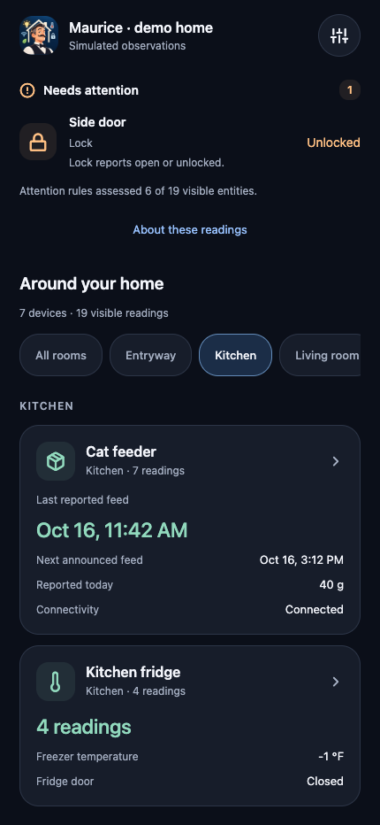
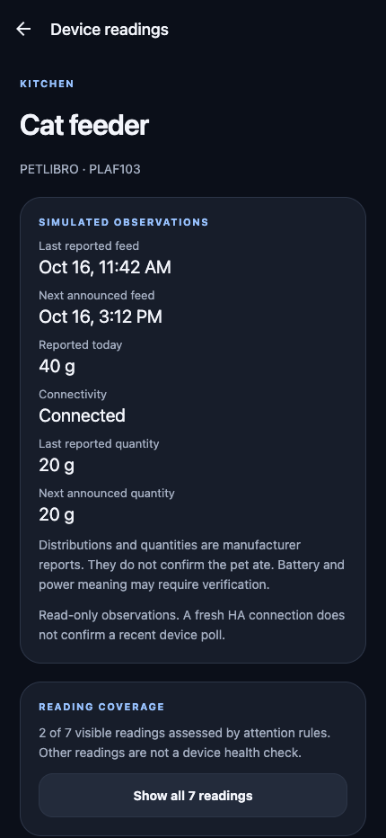
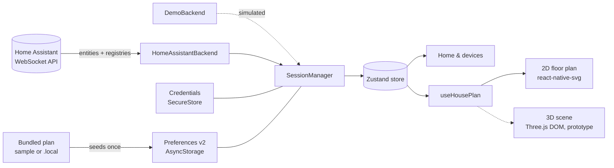

<div align="center">


# MAURICE

### Your home. His rules.

<i>Module Autonome Universel de Régulation Intelligente et de Contrôle Électrique.</i>

<b>« Maurice s’occupe de tout. Vous, de rien. »</b>

Meet Maurice: a 1970s French butler with a moustache, a three-piece suit, a Gitane at the corner of his mouth and a deeply disapproving look. He keeps an eye on every room of your home through Home Assistant: rooms, floor plans and device state, in one dark, quiet app for the phone in your pocket.

[](https://docs.expo.dev/)
[](https://reactnative.dev/)
[](https://www.typescriptlang.org/)
[](https://www.home-assistant.io/)


[](docs/README.md#latest-verification-checkpoint)


[Features](#-features) · [Quick start](#-quick-start) · [Home Assistant](#-connect-home-assistant) · [Architecture](#-architecture) · [Project status](docs/README.md) · [Roadmap](#-roadmap)

</div>

<br />

**Current scope:** Android-first, with scoped On/Off controls in the entity-detail screen. Demo lamp control is enabled. [M01](docs/design/power-enrollment.md) adds explicit household power permissions and direct summary controls; its new Pixel candidate and physical acceptance are recorded separately. Kasa HS103 and Petlibro PLAF103 have physical-device summaries, verified read-only against real HA and on Seeker. Profile plans and 2D/3D switching use saved placements; [S02 validation](docs/stage0/spatial-view-validation.md) records target-phone acceptance. The standalone **Maurice Trial** build is accepted on Seeker and Pixel 9 Pro with a 2D/read-only scope and the public sample; [trial guide and evidence](docs/stage0/internal-trial-validation.md). See [current status, evidence and next steps](docs/README.md).

<table>
  <tr>
    <td align="center" width="50%"></td>
    <td align="center" width="50%"></td>
  </tr>
  <tr>
    <td align="center"><sub><b>Your devices at a glance</b><br />global attention, then room summaries</sub></td>
    <td align="center"><sub><b>Useful readings together</b><br />explicit coverage and observation details</sub></td>
  </tr>
</table>

<p align="center"><sub>Screenshots from the built-in offline <b>demo home</b>. No real household data.</sub></p>

## ✨ Features

|     | Feature                     | What it does                                                                                                                                                                                                                                                          |
| :-: | --------------------------- | --------------------------------------------------------------------------------------------------------------------------------------------------------------------------------------------------------------------------------------------------------------------- |
| 🏠  | **Home overview**           | Attention items first (an unlocked door, an unavailable favorite), then favorites and physical-device summaries you can filter by room. "Unknown" and "unavailable" never count as all-clear.                                                                         |
| 📋  | **Device summaries**        | One card per actual HA device, with all eligible readings accessible. The feeder summarizes reported feed times, quantities and connectivity while preserving uncertainty.                                                                                            |
| 🗺️  | **Floor plans**             | Offline 2D/3D plans, shared floor/room selection, room links to HA areas and saved device markers, with a native fallback. Place, reposition or remove a marker; tap it to open the existing device details. Approximate geometry remains separate from device state. |
| 🧭  | **A plan for each profile** | Each Home Assistant origin and the demo keep their own copy of the plan. App updates never overwrite it; resetting it is a deliberate action in Diagnostics.                                                                                                          |
| 🔌  | **Live Home Assistant**     | Official WebSocket client, compressed entity stream, registries, foreground resync and automatic recovery after network loss or an HA restart.                                                                                                                        |
| 🔐  | **Private configuration**   | Tokens stay in native SecureStore; personal source files stay outside Git. Bundles contain the prepared plan, so shared artifacts must use the public sample. Preferences store neither tokens, observed states nor commands.                                         |
| 🧪  | **Offline demo home**       | Simulated locks, sensors, cameras, switches and a feeder with no account. Deterministic offline command services are ready for the future controls.                                                                                                                   |
| 🩺  | **Diagnostics**             | Session and registry health, unresolved identities, floor-plan status and reset, with no secrets on screen.                                                                                                                                                           |

> [!NOTE]
> **C07a switch UI is implemented.** Explicit On/Off actions preserve the observed value until a matching report; sending, accepted and unconfirmed results remain separate. The demo lamp is enabled. M01 adds default-denied, per-profile/device permission and direct summary access; physical HS103 acceptance is separate. Other devices remain read-only. See [scope and validation](docs/design/switch-controls.md).

## 🚀 Quick start

> **Requirements:** Node 24 and the locked dependency versions.

```sh
npm ci
npm run web        # interface preview in the browser
```

Open **Settings → Explore demo home**. The demo runs entirely on simulated data inside the app. The browser preview is for the interface only; token storage needs native SecureStore.

<details>
<summary><b>📱 Run on Android</b></summary>

<br />

Install an Android SDK and JDK 17 (Android Studio or the command-line tools). Configure `ANDROID_HOME`, `JAVA_HOME` and `adb`, enable USB debugging, connect and authorize the phone, then build and install the development client:

```sh
npm run android
```

Later sessions with the client already installed:

```sh
npm start
```

This workspace keeps an SDK and JDK 17 under `.local/android/`, with their paths in the ignored `.env.local` that Expo loads automatically. JDK 25 fails in the native Prefab/CMake step, so use JDK 17. Tool versions, the direct Gradle build and the APK location are in [Android validation](docs/stage0/android-validation.md).

The development APK loads its JavaScript from Metro; the recorded Pixel sessions use USB forwarding (`adb reverse tcp:8081 tcp:8081`) to a localhost Metro server. Expo Go is not a supported target; iOS runtime validation is deferred.

</details>

<details>
<summary><b>🗺️ Use your own floor plan</b></summary>

<br />

Put a private plan in the ignored `.local/home-plan.json`. `npm run house:prepare`, which runs before `start`, `web`, `android`, `test` and `typecheck`, validates it and bundles an ignored local module. Fresh checkouts and demo mode use the [public sample](src/spatial/sample-plan.json).

Coordinates are meters on the X/Z plane. Rooms may be concave, and each floor can also list rough furniture footprints. A connected profile keeps the copy it was first given: after editing the local plan, use **Diagnostics → Reset plan to default** to pick up the new version.

In the plan screen, **Link rooms** associates spaces with existing HA areas. **Place device** lets you choose an entity, floor and optional room, tap a position, then explicitly save it. Positions stay with that profile, work offline with cached observations and do not change HA assignments. **Manage placements** and Diagnostics retain missing or hidden references so they can be reviewed or removed.

Format, privacy of build artifacts and the path to 3D: [local floor plans](docs/design/floor-plans.md).

</details>

## 🏡 Connect Home Assistant

Maurice needs **HA 2026.10 or newer** (tested with `2026.10.1`). Use an existing instance, or start the pinned local container (Docker Desktop required):

```sh
npm run ha:up      # seeds .local/home-assistant/ and serves http://localhost:8123
npm run ha:logs
```

1. Complete onboarding and create a dedicated **Maurice** user.
2. Signed in as that user, create a long-lived token under **Profile → Security**.
3. In Maurice's **Settings**, enter the HA origin and the token.

> [!IMPORTANT]
> On the phone, use the Mac's **LAN address** (for example `http://192.168.1.20:8123`), not `localhost`. The URL must have no path, query or fragment. Plain HTTP requires the _trusted local network_ option, and the token then travels unencrypted.

The bundled HA configuration enables HA's `demo` integration. Its simulated devices exercise the real HA API but do not prove vendor compatibility. They are separate from Maurice's own offline demo.

<details>
<summary><b>🔎 Check an HA instance from the command line</b></summary>

<br />

```sh
mkdir -p .local && touch .local/ha-token && chmod 600 .local/ha-token
# paste only the raw token into .local/ha-token, then:
HA_ALLOW_INSECURE_HTTP=1 npm run proof:ha
```

| Variable                 | Default                 | Purpose                         |
| ------------------------ | ----------------------- | ------------------------------- |
| `HA_URL`                 | `http://127.0.0.1:8123` | HA origin to test               |
| `HA_TOKEN_FILE`          | `.local/ha-token`       | Local file containing the token |
| `HA_ALLOW_INSECURE_HTTP` | unset                   | `1` explicitly allows HTTP      |

The proof authenticates, loads a snapshot and the registries, pings, refreshes, simulates a return to the foreground and reconnects. It prints the version, timings, aggregate counts and metadata freshness. It never prints tokens, URLs or entity details, and it sends no device service calls. The token file is never bundled into the app.

</details>

## 🧱 Architecture



- **The backend owns recovery.** Transport reconnections use the official client's retry loop; failures during the initial connection and synchronization get backend retries. Authentication and version errors are terminal.
- **Commands stay semantic.** The C01 facade validates the latest session, entity identity, availability and capabilities, then projects one supported service request. C02 tracks observations, deadlines and qualified outcomes separately from HA acceptance. C03 serializes requests and cancels unsent work across lifecycle changes. C04 simulates the same command path offline with independent acknowledgements and observations. C07a adds explicit On/Off UI, guarded targets and qualified outcomes for the demo lamp and the acceptance-gated HS103. Other control UI remains future work.
- **No stale truth.** A refresh keeps the committed entity stream until its replacement succeeds. Values stay marked as cached until the session is ready, and optional registry failures show up in Diagnostics.
- **Credentials are journaled.** Operations are serialized, and an interrupted save or cleanup is recovered. _Forget_ removes the token from the phone; revoke it in HA separately.
- **Preferences are per origin.** Demo and each HA origin never share favorites, overrides, plans or placements. Schema migrations are ordered and validated, and data written by a newer app version is backed up rather than lost. Moving HA to a dedicated host creates a new profile unless preferences are explicitly migrated.

## 🛣️ Roadmap

[Project status](docs/README.md) is the delivery reference; the [backlog](docs/BACKLOG.md) contains the implementation contracts. Stages in the specification describe the broader scope, not a claim every feature is available. The [household MVP review](docs/reviews/2026-10-19-household-mvp-review.md) now prioritizes one real Kasa action, the personal house/device setup, a polished Home, accepted spatial presentation and seven days of use. Its return-focus finding is addressed by [M00](docs/stage0/return-focus-validation.md), with browser and exact-phone acceptance kept separate.

| Track                       | Status                              | Next step                                                                                                                                 |
| --------------------------- | ----------------------------------- | ----------------------------------------------------------------------------------------------------------------------------------------- |
| Read-only HA foundation     | Implemented, native checks recorded | U04 attention rules and honest coverage delivered                                                                                         |
| Native 2D and profile plans | F01 / P01 / P02 / P03 / P04 done    | U01 diagnostics, readable labels and guarded focus implemented; remaining native acceptance and U02 measurements tracked                                    |
| Household integrations      | H01 partial                         | Kasa/Petlibro read-only summaries pass on Seeker; proprietary meanings and remaining hardware stay open                                   |
| Useful device overview      | U03 delivered                       | [Grouping, related readings and verified feeder roles](docs/design/device-summaries.md), preserving U04 uncertainty/coverage              |
| 3D scene                    | S02 implemented                     | [Production spatial view and phone-acceptance ledger](docs/stage0/spatial-view-validation.md); S01 evidence remains a separate checkpoint |
| Controls                    | C07a UI implemented; hardware gated | R03a accepted on Seeker and Pixel; C07a scoped activation/physical acceptance remains separate                                              |
| Camera images               | Planned                             | **I01** image-path/transport isolation proof, then **I02** display and polling                                                            |
| Internal daily trial        | R03a accepted on Seeker and Pixel   | **Maurice Trial build 1002** runs without Metro, with the public sample and HA observations; [acceptance and trial plan](docs/stage0/internal-trial-validation.md) |
| Automation                  | F02/R02 implemented; M00 follow-up | [M00](docs/stage0/return-focus-validation.md) reproduces/corrects return focus; extended web smoke and source CI pass; scoped Seeker 1007 acceptance is recorded; R01 uses an expiring private-tooling policy; strict release audit remains blocking |
| Public release              | Planned                             | **R01** maintenance and **R03b** hardening; F02/R02 CI is delivered; HA always-on hosting is separate **H02** work                                     |

Production 2D/3D integration, P03/P04 and U03/U04 are implemented. Keep S02’s phone-acceptance scope explicit; **C01–C04** are implemented ([facade](docs/design/commands.md), [outcomes](docs/design/command-outcomes.md), [scheduling](docs/design/command-scheduling.md), [offline simulation](docs/design/demo-commands.md)); **C07a UI** is implemented ([scope and evidence](docs/design/switch-controls.md)); [M01](docs/design/power-enrollment.md) adds explicit power enrollment while physical Kasa acceptance remains separate. The [source checkpoint and clean-clone verification](docs/stage0/repository-checkpoint.md) are recorded. The [R01 assessment](docs/stage0/dependency-maintenance.md) delivers SDK 57 patches and a runtime decoder fix; three tooling advisories under [expiring private-MVP exceptions](docs/design/dependency-policy.md) and the unreproduced native incident remain tracked. The xcode UUID dependency is corrected. The [global review](docs/reviews/2026-10-17-global-review.md) prioritizes an R03a standalone internal trial before more actuator categories. Maurice Trial build 1002 is accepted on Seeker and Pixel 9 Pro without Metro, using the public sample; the [Pixel battery](docs/stage0/internal-trial-pixel-validation.md) records the Android 17 extension. [F02/R02 automation](docs/stage0/public-ci-validation.md) has a passing foundation checkpoint; M00 corrects the later marker-return-focus regression with passing extended web smoke and CI, while scoped Seeker TalkBack acceptance is recorded on build 1007, and the [R01 policy](docs/design/dependency-policy.md) preserves raw findings with expiring private-tooling exceptions and a strict release audit. [U01 diagnostics/readability and focus](docs/design/diagnostics-accessibility.md) are implemented; [native evidence and remaining TalkBack acceptance](docs/stage0/diagnostics-accessibility-validation.md) stay explicit. The [CEO review](docs/superpowers/specs/2026-10-15-maurice-ceo-review.md) explains the priorities; the [specification](docs/superpowers/specs/2026-10-14-home-cockpit-design.md) and [interface direction](docs/design/2026-10-15-interface-direction.md) preserve the contracts and visual intent inspired by [House Control](https://github.com/0xProbabillity/house-control).

## 🧰 Development

```sh
npm run typecheck        # TypeScript
npm run lint             # ESLint
npm test                 # latest recorded results: docs/README.md
npm run format:check     # Prettier, including workflows
npm run test:tooling     # public staging/privacy/preview process checks
npx --no-install playwright install chromium # once, for browser automation
npm run check:ui         # isolated public smoke at 320/430/768; preserves local plan
npm run check:audit      # reviewed private-tooling policy; expires 2026-11-02
npm run check:audit:strict # no exceptions; public-release gate
npm run proof:dependencies # bounded installed-decoder regression proof
npm run proof:protocol   # real compressed HA protocol against a loopback server, no credentials
npm run export:android   # Hermes JS bundle
npm run build:trial:android -- --build-number 1003 # signed standalone ARM64 APK; see trial guide
```

Maurice's portrait lives in [`assets/source/maurice.png`](assets/source/maurice.png). [`scripts/generate-icons.py`](scripts/generate-icons.py) (Pillow + NumPy) derives the app icon, the Android adaptive foreground, the web favicon and a transparent-corner portrait from it, extending the navy background where the artwork has white corners.

<details>
<summary><b>📋 Validation record</b></summary>

<br />

- The configured HA `2026.10.1` passes authenticated synchronization, registry loading, ping, a fresh refresh, a simulated return to the foreground and a forced reconnect.
- Protocol tests cover a disconnect during the first synchronization, continued updates after a refresh timeout, and automatic recovery.
- The ARM64 development APK runs on a Pixel 9 Pro (Android 17, Hermes). Native checks pass for HA over Wi-Fi, token persistence across process restarts, foreground resync, pull-to-refresh, terminal authentication errors, Forget, demo navigation, recovery after a cold start without Wi-Fi, and HA restarts.
- Native floor-plan interaction, including offline floor switching, passes on the Pixel. P01/P02 have migration/regression coverage; native profile seeding and reset cancellation were observed. Full reset preservation is covered by automated tests.
- U03 physical-device summaries pass real-backend and Seeker navigation/restart checks: one card for the feeder’s 23 visible readings and one for Kasa. Public browser checks cover all readings, favorite persistence, room filtering and responsive widths. See [scope and limits](docs/stage0/device-summary-validation.md).
- P03 links were checked with real HA areas on a Seeker. P04 native demo acceptance covers touch/save, marker detail, persistence after restart, moving between floors and removing; Chrome also checks responsive alignment and offline use after loading.

Details: [Stage 0 results](docs/stage0/results.md) · [HA proof report](docs/stage0/ha-proof-2026-10-15.json) · [Android validation](docs/stage0/android-validation.md) · [Floor-plan validation](docs/stage0/floor-plan-validation.md). [R01 maintenance](docs/stage0/dependency-maintenance.md) records 564 tests, SDK-compatible patches, the decoder correction and twenty passing controlled development starts. [R03a standalone acceptance](docs/stage0/internal-trial-validation.md) records the same signed build 1002 on Seeker and Pixel 9 Pro, including native update, recovery, reinstall and household Wi-Fi checks. The [Pixel report](docs/stage0/internal-trial-pixel-validation.md) keeps its evidence separate. [F02/R02 CI acceptance](docs/stage0/public-ci-validation.md) records the initial clean Linux functional/Android-export and public UI jobs. [U01](docs/stage0/diagnostics-accessibility-validation.md) and [M00](docs/stage0/return-focus-validation.md) add diagnostics, readability and focus recovery. The latest [dependency CI follow-up](docs/stage0/dependency-ci-validation.md) records **608 Jest tests / 39 suites and 17 tooling tests**, the corrected UUID dependency, and passing web/Android runtime checks. Three upstream tooling advisories remain under approved, expiring private-MVP exceptions; the raw and strict audits still fail. The earlier native incident and public-release gates remain open.

</details>

<div align="center">
<br />

<br />
<sub>Maurice is currently on his lunch break. Please try again.</sub>
</div>
