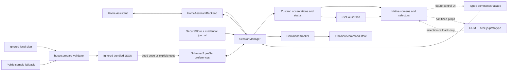

# Implementation backlog and agent handoff

Updated 2026-10-18 through [F02/R02 smoke and verified GitHub Actions](stage0/public-ci-validation.md), R03a acceptance on Seeker and Pixel, C07a switch UI and C01–C04 command foundations and offline simulation, S02 production spatial integration and U03 summaries, with the integrated application/tests checkpointed in `ec6abf0` and public evidence in `3cf13a2` ([clean-clone verification](stage0/repository-checkpoint.md)). This is the execution guide for the next agent, including a smaller model. Work on **one ticket per change**. The [project status](README.md) distinguishes implemented code, native acceptance and future delivery. Read actual source and tests before editing; future requirements are not current APIs.

## 1. Starting point

Implemented: Expo/RN Android development build; HA authentication and authoritative entity synchronization; recovery/lifecycle and credential journals; native persistence; read-only Home/detail/settings/entities/diagnostics; offline simulated home; native SVG plans with multiple floors, concave rooms, dimensions and approximate furniture; schema-2 spatial preferences, profile-owned plans and explicit reset (P01/P02, `81ac459`); explicit HA-area links (P03), entity placement/edit/removal (P04), shared attention/coverage (U04), physical-device summaries (U03) and production 2D/3D switching using saved placements (S02). Maurice branding is in `da62474`. Personal geometry and the public sample remain separate.

Latest source checkpoint: **573 Jest tests / 35 suites plus 6 Node tooling tests**; F02/R02 public UI and Android-export CI pass on clean Linux (`b67ad87`), with dependency findings kept in a separate failing audit check. The [CI ledger](stage0/public-ci-validation.md) owns current automation scope. P03/P04/U03/U04/S01 regressions, TypeScript, lint and formatting pass. C01 adds a typed facade, guarded semantic dispatch, value validation and exact service mapping. C02 adds local observation revisions, code-free outcomes, deadlines, late reconciliation and bounded transient retention. C03 adds actuator guards, debounce, serialization, immediate cancellation and no replay ([scheduling/C04 handoff](design/command-scheduling.md)); see [facade](design/commands.md) and [outcome architecture/C03 handoff](design/command-outcomes.md). C07a adds explicit switch UI with scoped eligibility, rendered target capture, synchronous repeated-press exclusion and qualified outcome presentation; real HS103 acceptance is pending ([switch contract](design/switch-controls.md)). C04 adds closed simulated services, persistent session state, independent acknowledgements/effects and deterministic real-manager acceptance ([simulation/C07a handoff](design/demo-commands.md)). S02 adds production 2D/3D selection, guarded saved-placement navigation, marker/resource diffs, readable billboard labels and fallback. See [S02 validation](stage0/spatial-view-validation.md) for artifact/runtime evidence and target-phone gates. Earlier U03/P04/S01 reports retain their own dated counts and scope; the R03a ledger records standalone household acceptance separately.

S01 feasibility is accepted on Pixel 9 Pro and Seeker using the same embedded public-fixture APK; see [measurements and S02 boundaries](stage0/scene-validation.md). Read-only real-device proofs pass for Kasa HS103 and Petlibro PLAF103; H01 remains partial. The feeder yields 23 visible readings, now grouped into one U03 card with qualified U04 coverage. HA also has built-in demo entities: do not count them as proven household hardware.

Not implemented: verified proprietary-state adapters, lock/climate/fan/feeder controls, authenticated camera display, public distribution, iOS and per-occupant OAuth. A geometry editor is later work; persisted plans and device placement already exist.

Read in this order:

1. [Project status](README.md), then the [root README](../README.md): current scope, setup and commands.
2. [Floor-plan implementation](design/floor-plans.md) and [validation](stage0/floor-plan-validation.md).
3. [Main spec](superpowers/specs/2026-10-14-home-cockpit-design.md): relevant sections are referenced by ticket below.
4. [Native validation](stage0/android-validation.md), [results](stage0/results.md), [household inventory](stage0/inventory.md).
5. The ticket's actual source files and existing tests. The old foundations plan is historical, not an unfinished checklist.

## 2. Architecture to preserve



| Area                | Current implementation                                                                    | Extension rule                                                                                                                                                                                                                                                                                                 |
| ------------------- | ----------------------------------------------------------------------------------------- | -------------------------------------------------------------------------------------------------------------------------------------------------------------------------------------------------------------------------------------------------------------------------------------------------------------- |
| Session owner       | `src/session/homeAssistant/HomeAssistantBackend.ts`                                       | Owns connection/heartbeat/foreground/retry policy. Do not add reconnect timers in screens, scene or manager                                                                                                                                                                                                    |
| Commands            | `src/commands/`, `services/runtime.ts`                                                    | Semantic methods only; capture before dialogs and dispatch through manager guards; C02 tracks observed outcomes; C03 applies actuator guards, serialization, immediate cancellation and no replay; C04 simulates this path offline; C07a switch UI exists; physical HS103 acceptance gates its real activation |
| Session facade      | `src/session/SessionManager.ts`, singleton in `src/services/runtime.ts`                   | Owns backend replacement, generation guards, active profile, persistence and lifecycle forwarding                                                                                                                                                                                                              |
| Command scheduling  | `commands/CommandScheduler.ts`, `SessionManager.ts`                                       | Pending continuous intents only; per-entity promises; eligibility invalidation before publication; never retry/replay a command                                                                                                                                                                                |
| Command outcomes    | `commands/CommandTracker.ts`, `observations.ts`, `predicates.ts`, `store.ts`              | Register before transport; consume snapshots/status before rendering; keep codes out; reuse freshness guards even when an outcome is hidden                                                                                                                                                                    |
| Observations        | `src/core/types.ts`, `store.ts`, `selectors.ts`                                           | HA remains authoritative; full snapshots replace removed entities. Reuse selectors and structural sharing                                                                                                                                                                                                      |
| Identity            | `mapSnapshot.ts`, `preferences/types.ts`                                                  | Stable `entity.key` is distinct from mutable `entityId`; extend alias reconciliation when adding key-indexed preferences                                                                                                                                                                                       |
| Policy/capabilities | `core/policy.ts`, `capabilities.ts`, `presentation.ts`                                    | Reuse `assessEntity(entity, ready)`; `getCondition` delegates to it. Theme colors never prove physical state                                                                                                                                                                                                   |
| Credentials         | `services/credentials.ts`                                                                 | SecureStore secrets, serialized operations, pending-write/deletion journals. Do not replace this with raw URL keys or AsyncStorage tokens                                                                                                                                                                      |
| Preferences         | `preferences/types.ts`, `storage.ts`                                                      | Schema 2 under `prefs`; v1 migration, loaded-profile edit guard and allowlisted persistence including nested plan fields                                                                                                                                                                                       |
| Geometry            | `spatial/model.ts`, `plans.ts`, `sample-plan.json`                                        | Actual `HousePlan` has rooms nested within floors; use this model, not a second copy of the older spec sketch                                                                                                                                                                                                  |
| Profile plan        | `spatial/profilePlan.ts`, `useHousePlan()` in `spatial/plans.ts`                          | Profile owns a seeded copy; bundle changes raise a notice; reset is explicit; selection uses the displayed plan ID/revision                                                                                                                                                                                    |
| Scene prototype     | `CockpitSceneView.tsx`, `SceneLabScreen.tsx`, `web/CockpitScene.tsx`, `web/sceneModel.ts` | Reuse the existing fixture lab and metrics for S01; no production placements or command dispatch in the renderer                                                                                                                                                                                               |
| Plan rendering      | `FloorPlanView.tsx`, `HousePlanCard.tsx`, `HousePlanScreen.tsx`, `app/house.tsx`          | SVG is decorative for screen readers; the native room list supplies named, larger touch targets                                                                                                                                                                                                                |
| Area associations   | `spatial/selectors.ts`, `PlanLinksScreen.tsx`, `app/house-links.tsx`                      | Explicit links only; entity counts remain qualified when area metadata is stale; guard edits against the latest profile/plan identity                                                                                                                                                                          |
| Entity placement    | `spatial/viewport.ts`, `placements.ts`, `placementActions.ts`, `PlacementScreen.tsx`      | X/Z meters, shared SVG projection, explicit save; derive identity/condition in native selectors; missing/hidden references are retained                                                                                                                                                                        |
| Visual language     | `components/ui.tsx`, `EntityIcon.tsx`                                                     | Reuse colors, radii, outline icons and freshness qualifiers; keep functional errors/actions visible                                                                                                                                                                                                            |

Invariants:

- Only the backend decides recovery. Existing transport reconnection belongs to the official HA client; initial-open/resync retries belong to the backend. Auth/version failures are terminal until explicit user action.
- A failed refresh keeps the committed subscription alive. `syncEpoch` advances only after a new authoritative initial snapshot succeeds. Registry events during a refresh trigger another refresh.
- `ready` is required and checked by the implemented C01 command facade before dispatch. A cached value cannot become an all-clear or an enabled actuator.
- Tokens/PINs/authenticated image URLs never enter logs, persisted command records, diagnostics, the scene bridge or plan exports. Scenes never receive raw HA attributes.
- Device keys and HA area IDs are different from plan-room IDs. Do not create/assign HA rooms by guessing from names on the drawing.
- Personal `.local/home-plan.json`, `.local/home-reference.png`, `src/spatial/current-plan.json`, bundles and personal screenshots stay out of Git. The generated JSON is ignored but **is included in app/web exports**. Demo display alone does not sanitize an already prepared personal bundle.
- Controls remain read-only until the command tickets are complete. Tests may actuate fixtures/demo. A physical unlock/open is tested only with the user's specific authorization for that action.

## 3. Setup and validation for each agent

Use Node 24, `npm ci`, and the lockfile. Postinstall prepares the plan; normal start/test/typecheck/export scripts also prepare it. Do not require a personal `.local/` directory for a clean checkout: the public sample is the fallback.

```sh
npm run typecheck
npm run lint
npm test
npm run format:check
npm run export:android
```

Run the relevant checks once after a change. Add behavioral tests for new behavior; do not add snapshots of styling or repeat broad checks without a reason. Protocol changes also require `npm run proof:protocol`; it opens a local WebSocket port. The configured-HA proof is `HA_ALLOW_INSECURE_HTTP=1 npm run proof:ha`; it reads the ignored token file internally and sends no device services.

Native: `npm run android` uses Expo prebuild and the local environment when present. The current machine has SDK/JDK/Gradle under `.local/android/`, with paths in ignored `.env.local`. JDK 17 works; JDK 25 previously failed Prefab/CMake. New native dependencies require a rebuilt client; Metro refresh alone is insufficient. Generated `android/` and `ios/` are ignored: put durable native changes in app config, a local Expo module or a config plugin.

With an already installed client: `npm start -- --localhost --port 8081`, then `adb -d reverse tcp:8081 tcp:8081`. Metro delivery over USB is separate from HA's LAN connection. On a phone, `localhost:8123` is not the Mac. Do not commit the device serial, LAN address or tokens. If the phone is locked, ask the user to unlock it; do not automate authentication. Restore any temporary Wi-Fi/sleep setting after a test.

For a shareable web build:

```sh
COCKPIT_PLAN_FILE=src/spatial/sample-plan.json npm run house:prepare
npx expo export --platform web --output-dir dist-web
npm run house:prepare
```

The final preparation restores local development configuration. Browser storage does not validate native SecureStore. `expo export` produces a JS bundle, not an installable APK.

## 4. Priority and dependency map

`S` means a bounded component/data task; `M` means a module plus integration. Split an M ticket at its numbered boundaries if needed. Hardware tickets can be blocked while independent code work proceeds.

| ID   | Status              | Priority / size        | Delivery                                             | Depends on                                               |
| ---- | ------------------- | ---------------------- | ---------------------------------------------------- | -------------------------------------------------------- |
| F01  | Done                | —                      | Native floor-plan acceptance                         | Recorded Pixel proof                                     |
| F02  | Done                | P1 / S                 | Reproducible sample UI smoke                         | None                                                     |
| H01  | Partial             | P0 / hardware          | Actual household capabilities                        | Kasa/Petlibro read-only proven; remaining hardware/setup |
| P01  | Done                | —                      | Schema-2 spatial preferences and migrations          | `81ac459`, regressions pass                              |
| P02  | Done                | —                      | Profile-aware plan and explicit reset                | P01, `81ac459`                                           |
| P03  | Done                | P1 / M                 | Link plan rooms to HA areas                          | P02                                                      |
| U03  | Done                | P1 / M                 | Physical-device summaries, first Kasa/Petlibro slice | H01 evidence for those devices                           |
| U04  | Done                | P1 / M                 | Sensor attention, availability and honest coverage   | Pure fixtures + verified H01 semantics                   |
| P04  | Done                | P2 / M                 | Place entities on the 2D plan                        | P03                                                      |
| S01  | Done                | P1 / M                 | Measured native Three.js feasibility                 | Pixel 9 Pro + Seeker proof; report retained              |
| S02  | Implemented         | P2 / M                 | Production scene and 2D/3D switching                 | S01 pass, P04                                            |
| C01  | Done                | P1 / M                 | Typed intents, validation and service mapping        | None for fixtures; H01 before real control               |
| C02  | Done                | P1 / M                 | Observation revisions and outcomes                   | C01                                                      |
| C03  | Done                | P1 / M                 | Serialization, cancellation and no replay            | C02                                                      |
| C04  | Done                | P1 / S                 | Simulated command-capable demo                       | C01–C03                                                  |
| C07a | Implemented / gated | P1 / S                 | First safe switch control, Kasa lamp                 | C03, C04, U04, verified switch                           |
| C05  | Not started         | P2 / S                 | Deliberate lock controls and code input              | C03, C04, U04, verified locks                            |
| C06  | Not started         | P2 / S                 | Climate controls                                     | C03, C04, U04, verified climate                          |
| C07b | Not started         | P2 / S                 | Fan controls                                         | C03, C04, U04, verified fan                              |
| I01  | Not started         | P2 / M                 | Native image transport and redirect isolation        | HA image-path proof from H01                             |
| I02  | Not started         | P2 / M                 | Latest image, polling lifecycle and events           | I01                                                      |
| U01  | Not started         | P2 / S                 | Diagnostics and screen-reader pass                   | P03/P04/C03 as applicable                                |
| U02  | Not started         | P2 / S                 | Measured large-home rendering                        | Realistic public fixture                                 |
| R01  | Assessed / follow-up | P1 / M                 | Runtime decoder fixed; SDK 57 maintenance             | Four tooling advisories and native incident remain       |
| R02  | Done                | P1 / S                 | CI with public fixtures                              | F02 for browser checks                                   |
| R03a | Accepted on Seeker and Pixel | P1 / M                 | Signed standalone internal APK; trial ready            | Build 1002 accepted on both phones; seven-day observations open |
| R03b | Not started         | P2 / M                 | Public distribution and release hardening            | R03a, R01 closure, R02, enabled-feature acceptance       |
| H02  | Deferred            | Hardware / conditional | Always-on HA and explicit profile move               | Advance if Mac availability blocks trial                 |

Recommended next bounded task: **U01 diagnostics/readability and accessibility**, while the proposed household trial runs. [F02/R02 is delivered](stage0/public-ci-validation.md): clean Linux functional/Android-export and three-width UI jobs pass; R01's independent dependency audit remains failing. [R03a build 1002 is accepted on Seeker and Pixel](stage0/internal-trial-validation.md), using the public sample, 2D/HA observations and simulated demo commands. Signed update, native storage, offline/foreground/server recovery, terminal errors, reinstall and actual household Wi-Fi return pass without Metro. The [Pixel R03a battery](stage0/internal-trial-pixel-validation.md) now passes too; S02 Pixel production-3D and C07a physical gates remain separate. R01 tooling findings and the original native incident stay tracked; no public-release acceptance is implied.

C07a's UI/demo is implemented, but its model-global activation Boolean is not per-profile/per-entity enrollment. Keep it false while closing the scoped-rollout decision and authorized physical Kasa acceptance ([finding and bounded follow-up](reviews/2026-10-17-global-review.md#3-c07as-activation-switch-is-global-to-a-model)). S02 Pixel acceptance remains explicit in its [ledger](stage0/spatial-view-validation.md). R03a can use the accepted read-only feature set without waiting for every hardware/control category. See [delivery order](README.md#delivery-order).

## 5. Ticket implementation details

### F01 — Native floor-plan acceptance

Files: `docs/stage0/floor-plan-validation.md`; code changes only if a defect is reproduced.

1. The new installed SVG client is recorded in that report; the local APK is `.local/android/artifacts/home-cockpit-house-debug-arm64.apk`. Start/reuse Metro and USB reverse, then have the user unlock and open Maurice. These steps reproduce the completed F01 acceptance; do not interpret them as an unfinished ticket.
2. Open the Home plan card, visit every floor, tap an actual room polygon, verify the same room in the text list, check printed/unknown dimensions and verify that switching floors clears selection. Check the Home miniature opens the plan and Back returns correctly.
3. Verify HA credentials survived `install -r`. Do not re-enter or print the token unnecessarily. Check no fictitious device placements appear. Keep personal captures in `.local/`.
4. If checking native offline use, keep Metro over USB, temporarily disable Wi-Fi, change floors/select rooms, then restore Wi-Fi in a `finally`/cleanup path. Record exactly what ran; browser offline interactions are not this native test.

Done: update the native acceptance row with observed results or a reproducible failure; restore device settings. No physical device service calls.

**Status (2026-10-15): done.** All steps passed on the Pixel 9 Pro, including offline floor switching and HA recovery after Wi-Fi restore. Evidence in [floor-plan validation](stage0/floor-plan-validation.md).

### F02 — Reproducible public UI smoke

Add `scripts/check-ui.mjs` or an equivalently scoped runner and an explicit npm script/dev dependency for browser automation. Existing local `/tmp` helpers are not portable repository tooling. Use the public sample; never embed the personal plan's IDs/dimensions in tests or committed captures.

Cover Home → plan card, floor switching, polygon selection, dimensions absent in sample, room list selection, Back, demo entity details/favorites and selected-tab accessibility. Test widths 320/430/768 and offline **after** assets load. A fresh offline web page load is not supported by this preview; do not claim a service worker exists. Serve the SPA correctly for direct `/house` navigation. Collect page errors and save sample-only screenshots in an ignored artifact directory. Ensure servers/browsers terminate on failure.

Done: one documented command works after `npm ci` without HA, Android or personal files and fails on broken navigation/picking.

**Status (2026-10-18): done in `b67ad87`.** `npm run check:ui` uses pinned Playwright/Chromium, an isolated public snapshot/install/cache and a loopback-only preview. All three widths pass locally and in GitHub Actions, including persisted favorites, simulated On/Off and loaded offline routes. The smoke reproduced and fixed missing web `aria-selected` on Home room tabs. Six Node tooling tests cover isolation/provenance/cleanup. Screenshots/report are ignored, explicitly allowlisted and bounded; no personal plan is replaced. See [architecture/reproduction](design/public-checks.md) and [CI evidence](stage0/public-ci-validation.md).

### H01 — Actual device inventory and capability proof

H01 is partial: Kasa HS103 and Petlibro PLAF103 pass actual read-only HA/backend proofs, including resolved areas and fresh registries. The feeder has 23 visible readings; native presentation and physical controls remain unverified. Other inputs: Nest generation, Schlage code/count, Samsung capabilities and Ring image path need verification; AIRTAP F1.0.26 has no Bluetooth path. The Mac HA container also has simulated entities. Update [the inventory](stage0/inventory.md) with dated, sanitized capability evidence and limitations; do not count demo entities as real-device proof.

Use read-only inspection first: exact integration/model, real entity IDs and stable registry identity, areas/devices, feature flags, attributes/units, visibility/category, assumed-state behavior and update latency. Keep detailed household dumps local; commit a sanitized capability summary. Ask the user only for missing hardware/setup facts that cannot be inspected.

For authorized physical tests, record one action per controllable category, its HA result and observed physical/HA outcome; test external changes for sensors/events. Verify the camera's actual authenticated image response, content type and capture-time availability. AIRTAP needs a supported HA Bluetooth adapter/host or ESPHome proxy path; absent that, explicitly leave vents out of the controllable MVP. Do not infer support from a brand name or demo entity.

### P01 — Spatial preferences and migration

Files: `preferences/types.ts`, `storage.ts`, `__tests__/storage.test.ts`, `SessionManager` fixtures/tests where profiles are constructed. Reference spec §6.7. Keep the current geometry schema 1 separate from preference-file schema 2.

Implement this initial persisted shape:

```ts
interface SpatialPreferences {
  plan: HousePlan | null;
  seededFrom: { planId: string; revision: number } | null;
  areaLinks: Record<string, string>; // plan-room ID -> HA area ID
  placements: Record<
    string,
    {
      floorId: string;
      roomId: string | null;
      position: PlanPoint; // X/Z meters; floor provides elevation later
    }
  >; // stable entity key -> placement
}
// ProfilePreferences gains spatial; PreferencesFile.schemaVersion becomes 2.
```

1. Ordered v1→v2 migration adds empty spatial data and preserves every existing field/profile. Validate old data as v1 before migration; do not classify legitimate v1 as corrupt merely because the new field is absent.
2. Reuse `parseHousePlan` for a stored non-null plan. Validate finite placement positions and link values. Keep unresolved room/area/entity references for diagnostics instead of deleting them.
3. Extend `reconcilePreferences` to migrate placement keys through identity aliases; canonical/newer entries win collisions as they do for current preferences. Never persist observed state, session status, commands, credentials or image authorization.

Done/tests: valid v1 migration including two origins and demo; v2 round-trip; malformed backup; unknown version handling; queued writes; alias collision; missing entity retains placement. No plan editor or scene in this ticket.

**Status (2026-10-15): done in `81ac459`.** `PreferencesFile` is schema 2; each profile carries `spatial`. Loading validates each version before ordered migration. A newer schema is backed up with a distinct notice. Saved profiles and nested plans are rebuilt from documented fields only. Placements follow aliases; unresolved references remain. P02 now reads this data. Review regressions for nested extra fields pass.

### P02 — Profile-aware plan provider and reset

Files: `spatial/plans.ts` (or a new `useHousePlan` selector), `HousePlanScreen`, `HousePlanCard`, `SessionManager`, Diagnostics.

Centralize plan selection: stored profile plan when present, otherwise the installed build plan; demo always seeds from the public sample. Seed a profile once with a cloned plan plus `seededFrom`. Replacing an HA origin creates a different preference profile; do not share placements across it.

Never overwrite an existing plan when the bundled revision changes. Offer an explicit reset in Diagnostics, with confirmation describing that only spatial plan/links/placements are reset; favorites, visibility and credentials stay intact. Present a new-default notice without silently replacing user work. A missing/deleted selected floor or room falls back safely. Reset local view selection when profile/plan identity changes.

Done/tests: profile switch isolation, new bundled revision preserves saved geometry, demo uses sample, explicit reset scope, missing floor selection. Prefer one provider over several screens independently choosing different plans.

**Status (2026-10-15): done.** `useHousePlan()` in `spatial/plans.ts` is the single provider for the plan screen, the Home card and the scene lab. `SessionManager.connect` seeds an unseeded profile with a copy of the bundled default (sample for demo) and persists it with the first snapshot, so a failed attempt creates no profile. A changed bundled default is reported on the plan screen and in Diagnostics, never applied silently. Diagnostics → **Reset plan to default** (with confirmation) replaces only plan, links and placements. Verified on the Pixel: the HA profile was seeded at the current personal revision; the confirmation dialog appeared and Cancel left everything unchanged.

P02 review corrections are included in `81ac459`: edits/reset are refused until that profile's preferences load, a failed initial seed write retries on a later snapshot, and selection identity uses the actual displayed plan ID/revision. All five earlier review reproductions pass. Native destructive reset was not exercised by the recorded cancellation check; its preservation contract is covered by automated tests.

### P03 — Plan room ↔ HA area associations

Files: a small plan setup screen/route, `core/selectors.ts` or `spatial/selectors.ts`, P01 preferences, Home/House screen.

For each plan room, choose an existing HA area or Unlinked. An area can have multiple entities; require an explicit choice for duplicate room names and do not name-match automatically. Room resolution for an entity remains app override → entity area → device area → Unassigned; only then map the resolved area through explicit plan links. Plan rooms are not added to `snapshot.areas`.

Show empty/unlinked rooms honestly. No HA areas means useful setup guidance, not a blank picker or fabricated areas. Display unresolved links if HA removes an area. Shared plan/list selection must refer to stable plan-room IDs and reset on profile change. Global attention remains global.

Done/tests: room override takes precedence, same-name rooms on different floors, absent/removed areas, no metadata access, unlinked entities remain in list, persistence across restart. This ticket does not need a 3D scene or device service calls.

**Status (2026-10-15): done.** `spatial/selectors.ts` resolves an entity's HA room as before (override → entity area → device area) and only then maps it through `areaLinks`; nothing is name-matched, and an area links to at most one room (choosing it again moves the link). **Link rooms** (`/house-links`, from the plan screen) lists rooms per floor with their floor name, offers existing HA areas or Unlinked, and explains what to do when offline, when HA has no areas, or when the area registry is stale. Links to removed areas are kept and reported (also counted in Diagnostics, with links to rooms missing from the plan); links are only marked unverified when area metadata is unavailable. The plan screen shows each linked room's entity count and, for the selected room, its HA area and entity readings. Unlinked devices stay in the Home list; Home's room filter is unchanged. Initial implementation checkpoint: 110 tests passed, including override precedence, same-name rooms on two floors, removed and unverifiable areas, unlinked entities, the guidance states, edits refused before preferences load, and links surviving a restart. Checked in the browser with the public demo and natively on a Solana Seeker, in demo mode and then with the household's real HA areas: Living room ↔ Salon listed the Kasa lamp and survived a restart ([report](stage0/floor-plan-validation.md#room-links--p03-2026-10-15-solana-seeker)).

**Review follow-up:** the link picker resets on displayed profile/plan changes and validates current state before a save; arbitrary valid room IDs such as `constructor` work safely; cached area names retain their unverified qualifier; counts say **entities**, not physical devices. The latest checkpoint supersedes the original 110-test count above. `housePlanFor().identity` encodes profile ID, plan ID and revision as a JSON tuple to avoid delimiter collisions. Keep these regressions when changing plan selection or editing.

### P04 — 2D entity placements

Files: `spatial/viewport.ts`, `spatial/placements.ts`, `spatial/placementActions.ts`, `screens/PlacementScreen.tsx`, `app/house-place.tsx`, `HousePlanScreen`, `FloorPlanView`, `DiagnosticsScreen`, and existing preference reconciliation/storage.

Start with explicit **Place device** mode, an eligible visible entity picker and a tap on the selected floor. Convert through the SVG's actual viewBox/letterboxing to X/Z coordinates; test round-trips. Do not store screen pixels. Require a point inside the floor and the chosen room when one is specified. Ordinary room exploration must not accidentally edit placement.

Render markers with icon + name and semantic condition; resolve aliases and current entities in native selectors. Opening a marker uses the existing stable-key `/device/[key]` route. Offer reposition/remove. A missing/hidden/unavailable entity is not silently remapped to a similarly named device; keep unresolved placement metadata and expose it in Diagnostics. No automatic placement from names.

Done/tests: concave cutout rejects placement, coordinate conversion after viewport changes, floor isolation, identity rename vs recreated UUID, hidden/removed entities, cached marker state and no service calls. Keep placement mode usable without precise dragging.

**Status (2026-10-15): done in the working tree.** **Place device** chooses a visible entity, floor and optional room, then captures a tap as a draft; only **Save position** persists. Floor/room changes clear the draft, Cancel does not write, and invalid floor cutouts/room taps cannot save. The shared `floorViewBox` and `xMidYMid meet` projection account for letterboxing and inverted SVG Z. `pressLocation` handles native location coordinates and DOM client coordinates; do not assume React Native Web supplies `locationX/Y`.

`savedPlacements` resolves stable keys/aliases and geometry against current profile observations/preferences. Canonical keys win alias collisions. Hidden, missing and invalid references remain saved and are listed in Diagnostics/editor; unavailable entities retain markers with their condition. Markers and the accessible floor list open the existing stable-key detail route; Reposition and Remove change local spatial preferences only. Latest-state profile/plan/loaded-preference guards prevent stale callbacks from editing another profile. Geometry, HA area assignments and placement are independent; no new storage schema or service dispatch was added.

Regression files: `spatial/__tests__/placements.test.ts`, `screens/__tests__/PlacementScreen.test.tsx`, extended `HousePlanScreen.test.tsx` and `SessionManager.test.ts`. Coverage includes inverse projection at three viewports, independent coordinate expectations, native/web pointer shapes, concave geometry, optional room bounds, alias rename vs recreated identity, hidden/missing/cached/unavailable entities, restart persistence, move/remove preservation, and profile/plan changes. Chrome checks use actual SVG polygon bounds rather than the projection helper as their oracle. See the [P04 validation scope](stage0/floor-plan-validation.md#entity-placements--p04-2026-10-15). Real household placements are a user's configuration task; automated acceptance uses public demo data and never actuates a device.

### S01 — Native Three.js feasibility, isolated

**Status (2026-10-15): done in the working tree.** The existing `a505fec` prototype was hardened and measured on Pixel 9 Pro and Seeker using the same optimized, embedded, public-fixture APK. Both pass picking, ≥30 rendered fps, zero ongoing idle/hidden/unfocused rendering, background resume, resize, three remounts, context-loss fallback/retry and offline DOM assets. See the [kept report, artifact and methods](stage0/scene-validation.md) and [aggregate results](stage0/scene-proof-2026-10-15.json). This closes the feasibility gate only; S02 production placements and R03 household distribution remain separate.

Use the existing `src/web/CockpitScene.tsx` (`'use dom'`), native wrapper/error boundary and lab. Three.js `0.186.1` is already pinned in the current lockfile. Check installed SDK DOM APIs when resolving an observed problem; do not scaffold another renderer, install a second WebView or upgrade dependencies merely to begin measurement. Rebuild Android if native dependencies/configuration change; otherwise prove the installed client supports the DOM wrapper. Preserve the native Expo architecture.

Scope: one active floor from the **existing** `HousePlan`; extruded concave floor polygons, simple low wall previews, orbit and room/device picking with fixture markers. No editor, remote textures/furniture, production controls, extra integrations or guessed household furnishing. Preview wall height is a renderer setting, not a measured house elevation.

Bridge contract: JSON-safe plan/floor geometry, sanitized markers `{key, floorId, position, icon, label, condition}`, selected IDs and `visible`; async `onRoomPress(id)` / `onMarkerPress(key)` callbacks. Native actions must be top-level props, not functions nested in another prop; type their return as `Promise<void>`. Prop updates cross an asynchronous bridge. Add async `onSceneReady()` and `onSceneError(code)` callbacks with a small sanitized error-code union. Catch DOM/WebGL errors inside the DOM component: a native React error boundary alone cannot catch an asynchronous failure in the other JS runtime. A native initialization watchdog (initially 10 s) selects the fallback if readiness never arrives. No token, raw entity attributes, authenticated camera URI or arbitrary service call. A renderer callback requests native selection/navigation only.

References: [Expo DOM components](https://docs.expo.dev/guides/dom-components/), [Three.js documentation](https://threejs.org/docs/). Verify the installed SDK's APIs before coding. Convert the existing X/Z points to scene vectors; use a rendering-only marker height while actual story elevations are unknown.

Measure on the installed Pixel: bundled/offline assets; picking vs orbit (movement threshold, ignore multi-touch taps); resize; first usable scene; sustained ≥30 fps while interacting; idle on-demand rendering; zero ongoing rendering when unfocused/backgrounded; disposal of geometry/materials/textures/listeners on unmount; context-loss fallback. Restore visibility with a fresh invalidation. Keep 2D/native list functional after failure. Record methods/versions/results, including failures, rather than claiming a screenshot proves fps.

Done: a kept proof report chooses Three.js/DOM as feasible or records a fallback. Do not proceed to S02 if the native bridge/offline/render lifecycle gate is unproven.

### S02 — Production spatial view

After S01 and P04, add a 2D/3D switch with shared floor/room selection, placements and existing device navigation. Render only one floor at a time. Use the same geometry and condition selectors in both views; do not introduce a scene-owned device store.

Diff marker conditions/materials rather than rebuild the scene for every sensor update. Preserve a useful 2D/list fallback after timeout/context loss/unsupported rendering, plus a deliberate retry. Honor reduced motion, visible/background state and native accessibility alternatives. Personal defaults remain private. Tests include unknown/stale markers, an entity removed after reconnect, rejected marker callbacks from an obsolete profile, repeated mount/unmount and no hidden rendering.

Implementation boundaries for the next agent:

1. **Native integration:** add the view choice inside `HousePlanContent` in `src/screens/HousePlanScreen.tsx`; keep its `useHousePlan().identity` keyed lifetime and existing floor/room state above both renderers. Reuse `savedPlacements(snapshot, preferences, plan, ready)` and the existing issue filtering. Adapt eligible entries to `{key, floorId, position, icon, label, condition}`; do not pass whole entity records or use the fixture marker factory. Reuse `services/deviceNavigation.ts` for guarded stable-key detail navigation; summary view IDs are not placement keys. Revalidate current profile/plan, placement existence/floor and entity visibility when a delayed scene callback arrives. A 3D callback must not edit placement.
2. **Renderer updates:** retain `CockpitSceneView`'s async bridge, phase/attempt guards, visibility, readiness watchdog, retry and fallback. Keep the camera-fit correction and teardown proven by S01. Diff markers by stable key: remove and dispose deleted markers, update condition/color/label/position only when changed, and preserve unchanged objects and camera orbit. Align scene conditions with `entityAppearance`/U04 rather than keeping the lab's older palette. The production caller leaves `simulate` null; lab controls stay in SceneLab.
3. **Acceptance:** tests for shared selection when switching views, current-profile callback guards, unavailable/unknown/stale states, removed or hidden placements, marker updates without a floor rebuild, and usable list/2D after renderer failure. Repeat the [S01 native lifecycle method](stage0/scene-validation.md) with public saved placements on the target Pixel; confirm zero hidden rendering and fallback navigation. Do not treat S01's three fake markers as production load/performance evidence.

**Status (2026-10-16): implemented in the working tree.** The existing keyed `HousePlanContent` now owns 2D/3D choice, shared floor/room selection and whole-floor reset. `spatial/scene.ts` adapts saved eligible placements; `spatial/navigation.ts` revalidates callbacks before stable-key navigation. DOM marker diffs retain unchanged geometry/materials/labels/camera, use shared U04 colors, dispose owned resources and keep readable labels separate from physical positions. The wrapper preserves real markers in its 2D fallback and pauses outside the canvas viewport, on blur and in background. No preference schema, observation store or native dependency was added. **232 tests / 25 suites**, type/lint/format and public exports/build pass. [Architecture](design/spatial-view.md) and [runtime ledger](stage0/spatial-view-validation.md) own exact browser/native evidence. Seeker native saved-placement selection, 118.2 rendered fps, pause/remount/context-loss/restart and bundled offline DOM checks pass. Pixel S02 acceptance remains open until measured; do not reuse S01's fps for the production path.

### C01 — Semantic intent facade and mapping

Create `src/commands/types.ts`, `validation.ts`, `serviceCalls.ts`; expose a narrow facade from `services/runtime.ts` via the current manager. `SessionManager.backend` is private: screens must not import a connection or call generic backend services.

Use a discriminated intent union corresponding to the methods in spec §6.5. Capture profile, stable key and resolved entity ID; revalidate ready/profile/key→same-ID/availability/capability **immediately before dispatch**, including after a confirmation dialog. Validate finite values, supported modes/presets, limits, step quantization and low≤high. Return a typed refused/no-op/started result. Already-satisfied intent sends nothing.

| Intent                    | HA service                                | Data                                                    |
| ------------------------- | ----------------------------------------- | ------------------------------------------------------- |
| Lock locked/unlocked/open | `lock.lock` / `lock.unlock` / `lock.open` | optional `code`                                         |
| Climate target            | `climate.set_temperature`                 | `temperature` or `target_temp_low` + `target_temp_high` |
| HVAC mode                 | `climate.set_hvac_mode`                   | `hvac_mode`                                             |
| Fan on/off                | `fan.turn_on` / `fan.turn_off`            | none                                                    |
| Fan percentage            | `fan.set_percentage`                      | `percentage`                                            |
| Fan preset                | `fan.set_preset_mode`                     | `preset_mode`                                           |
| Switch on/off             | `switch.turn_on` / `switch.turn_off`      | none                                                    |

The backend already accepts `{domain, service, entityId, data?}`. Keep protocol construction there. Capture the connection before awaits and guard obsolete results; add a stop-during-service regression so accessing mutable `this.connection` after teardown cannot throw. PIN/code stays transient; never put it in command records or diagnostics. Use fixtures to check exact messages; leave real UI read-only until C02–C04.

**Status (2026-10-16): done in the working tree.** Typed `commands` facade, manager-issued targets, latest-observation validation, normalized service projection and backend transport-generation guards are implemented. Delayed dialogs recheck profile/backend, stable-key→entity-ID binding, readiness, availability and capabilities; no-op sends nothing. **342 tests / 26 suites**, type/lint/format, exact 12-message loopback protocol proof and public web/Hermes exports pass. No physical action or control UI. See [architecture, validation and C02/C03 handoff](design/commands.md).

### C02 — Observation revisions and outcome tracker

Create `src/commands/CommandTracker.ts`, observation revision/predicate helpers and a bounded transient command store. Integrate manager snapshot/status events before screen rendering. Do not use HA timestamps versus phone wall clock to establish ordering.

A record needs spec §6.5 fields plus profile, dispatch entity ID, sanitized intent/desired target and enough transient evidence to retain a post-dispatch match before acknowledgement. Track a local monotonically increasing revision per stable entity, including attribute-only changes; a new epoch can be fresh evidence. Exclude token/code from records.

Implement `sending`, `accepted`, `confirmed`, `failed`, `unconfirmed`, `superseded` exactly as §6.5. Baseline state does not confirm a dispatch. Retain a qualifying post-dispatch update even if it arrives before the service result or represents a transient `opening` state. Late acknowledgements cannot downgrade terminal outcomes. HA rejection means HA reported an error, not proof of no physical effect.

Deadlines: lock 45 s, climate 30 s, fan/switch 15 s; late reconciliation until 5 minutes after the deadline, same profile/key and no newer command. Reconnect wording reports what HA **now shows**, not causality. Assumed state is labeled. Outcome clearing/dismissal must not enable an unsafe second lock action.

Done/tests with fake time/backend: ack-before-update, update-before-ack, attribute-only target, no-op, timeout, connection loss, late match inside/outside window, newer intent suppresses old outcome, profile switch, duplicate/obsolete callbacks, transient open and assumed-state wording. Include the backend's actual event order: a replacement snapshot can arrive while status is still synchronizing, immediately before ready. Retain fresh evidence and reconcile when readiness arrives. No controls in this ticket.

**Status (2026-10-16): done in the working tree.** Sending records are registered before transport, observations have local revisions, and the tracker handles every outcome, pre-ack/transient evidence, synchronization ordering, deadlines and five-minute late reconciliation. Same-profile Retry can reconcile from new authoritative state while old service callbacks stay invalid. Dismissal preserves lock freshness; 100-record retention refuses unsafe overflow. **399 tests / 27 suites**, type/lint/format, the 14-fake-service loopback proof and public web/Hermes exports pass. No physical actuation or control UI. See [outcome architecture and C03 handoff](design/command-outcomes.md).

### C03 — Serialization, debounce and no replay

Extend C02 and manager lifecycle wiring; no new reconnection policy.

- Locks: refuse while sending/accepted. After unconfirmed, require a newer entity observation or fresh epoch before another lock action.
- Climate target/fan percentage: 600 ms debounce retaining latest unsent intent; serialize dispatch per entity until the previous service promise settles; supersede older target outcomes. Other entities remain independent.
- HVAC mode/fan on-off/preset/switch: ignore additional taps while a service call is sending.
- Leaving ready immediately drops **all unsent/debounced/queued intents**, not just on their next timer. Background drops unsent work; already-sent work is tracked to deadline. Backend replacement/profile change invalidates old dispatch callbacks. Reconnect never re-sends a command.

Extend the real compressed-WebSocket fixture in `scripts/prove-protocol.ts` or a scoped command proof. Critical acceptance: accepted unlock + socket drop + reconnect produces one unlock message total; rapid setpoints send only the final eligible intent; change profile/capability while a dialog/debounce is pending sends nothing. Include late promise settlement after stop.

**Status (2026-10-16): done in the working tree.** Per-entity promise slots, 600 ms latest-target debounce, lock freshness, immediate cancellation and prepared-target invalidation are implemented. Pending continuous values are copied and revalidated at dispatch; an explicit latest baseline value can compensate an earlier unsettled call. Old promise settlements cannot release a new backend’s lane; no background/reconnect replay. **442 tests / 28 suites**, type/lint/format, actual-manager loopback proof (18 fake services total) and public web/Hermes exports pass. No physical actuation or control UI. See [architecture and C04 handoff](design/command-scheduling.md).

### C04 — Command-capable offline demo

**Status (2026-10-16): done in the working tree.** `DemoBackend.callService` now uses a closed service/entity/data/capability whitelist and authoritative in-memory state. Independent acknowledgement/effect timers, injected clocks/scenarios and code-free effects cover success, rejection, unknown and late observations through the actual SessionManager facade/C03 scheduler. Command changes survive ticks/refresh/foreground; stop/replacement clears timers and unsent work never replays. Stable identities, feeder roles and simulated provenance are retained. **526 tests / 30 suites**, type/lint/format, loopback protocol regression (18 fake services) and public web/Hermes exports pass. No control UI or physical actuation. See [architecture, acceptance and C07a handoff](design/demo-commands.md).

### C05 / C06 / C07 — Controls, one small change each

Shared files: `DeviceDetailScreen`, `EntityCard`, new focused `components/controls/*`, runtime command facade. Read spec §4.4/§6.5. Keep observed value and command qualifier separate; never optimistic-toggle or roll back the physical state.

- **C05 locks:** Lock/Unlock, Open only when capability allows. Unlock/Open require deliberate confirmation separate from optional secure code input. Revalidate after confirmation. Clear code on dismissal/background/submit; no record/log persistence. Unconfirmed unlock/open asks the user to check the door and offers no auto-retry. Test changed profile/entity/capability while the dialog is open.
- **C06 climate:** Current reading, distinct single target versus low/high target range, declared HVAC modes, HA-configured unit, min/max/step and tolerance. For `both`, choose supported target fields for the actual mode/verified integration; do not collapse `auto` and `heat_cool`. Null current temperature is unknown, not zero. Test bounds, low≤high, attribute-only confirmation and rapid coalescing.
- **C07a switches (first real-control slice):** Add on/off for a declared switch capability, after C01–C04 and U04. Preserve observed state while a command is pending; ignore repeated taps during sending. First hardware target is the verified Kasa lamp. Accept with demo success/refusal/unconfirmed cases, disconnect mid-action, no replay after reconnect/restart and an authorized physical lamp check. No feeder actuation in this slice.
- **C07b fans:** Gate on declared on/off, percentage and presets, including preset-only fans. Quantize to `percentage_step`; unsupported controls are absent. Debounce continuous percentage intent, not binary toggles. Test repeated taps, changed capabilities and disconnect mid-change; actual AIRTAP control stays disabled until H01 proves its BLE path.

Done for each: fixture/demo component + command tests, installed-device interaction and the corresponding authorized real-hardware evidence or an explicit disabled limitation. Do not mark all categories verified after one switch works.

**C07a status (2026-10-17): UI implemented; hardware acceptance gated.** Explicit On/Off in the entity detail, immutable rendered-target binding, synchronous sending/accepted exclusion, AppState/readiness/availability guards, narrow outcome subscription and qualified demo/HA presentation are implemented. Only the public demo lamp is enabled; a TP-Link HS103 with matching main `tplink` entity/device metadata is eligible only after the physical acceptance gate. **561 tests / 32 suites**, type/lint/format, public web/Hermes exports and offline responsive Chrome checks pass. Installed Seeker demo On/Off/foreground and saved-HA restoration pass; authorized physical Kasa acceptance remains pending. See [architecture and current gate](design/switch-controls.md).

### I01 — Authenticated image path and native transport

The backend has `getCameraImageRequest(entityId)` returning a URI plus bearer header. It is not exposed to screens and its redirect behavior is not proven. Add a camera service with a narrow output such as `{localUri, fetchedAt, capturedAt: string | null}`; resolve current profile/camera eligibility inside the native layer.

First prove the actual HA/Ring proxy path read-only. Then implement origin-bound retrieval. Do not assume RN `fetch({redirect:'manual'})` or `<Image headers>` prevents credential forwarding on every native redirect. Preferred Android approach if the existing transport cannot prove it: a small local Expo native module using OkHttp with automatic redirects disabled, explicit same-origin redirect validation/hop limit, and private local image output. Durable native source/config belongs in a checked-in local module/plugin, not ignored generated `android/` files. iOS remains disabled until its equivalent transport is validated.

Reject cross-origin redirects and HTTPS downgrades before forwarding authorization. Bound size/content type/time, cancel on obsolete profile/scene, and never log request headers/authenticated URLs. Avoid permanent public/shared caches. Use two local test origins with a **fake** bearer; prove the second origin receives no credential on redirects in the installed Pixel build. Prove same-origin success and failure/cancellation cleanup. Keep image UI disabled until this gate passes.

### I02 — Latest image, visibility polling and events

Files: camera component/service, DeviceDetail and eligible Home preview, preferences for event overrides; use I01 output only.

Label **Latest available image**. Capture time unknown stays unknown; fetched-at time is separate and must not be presented as capture time. Display cached/error/loading states without exposing private URIs. Poll only when the relevant screen is visible and app active; cancel unsent/pending work on profile changes, unmount and background. Do not add live streaming to this ticket.

Associate recent motion/ding/event entities by verified shared device metadata, with explicit per-camera overrides; never suffix-guess a different camera's event. Store associations by stable keys and extend alias reconciliation. Test stale recording, no timestamp, failed image, unrelated event, background/foreground, redirect rejection and token/profile change.

### U01 — Diagnostics and accessibility

**Next bounded work.** Start with retry/terminal diagnostics and the 2D label collision below; retain TalkBack/large-text acceptance as an explicit native slice. F02 already fixes Home's web selected-tab semantics and supplies repeatable browser coverage; it does not certify screen-reader use.

**R03a observation (2026-10-18):** the initial unavailable-server banner can show generic “try again” wording while automatic retry is active. Recovery passes on the standalone Seeker and Pixel; make the retry state understandable alongside the TalkBack/large-text pass. See [trial evidence](stage0/internal-trial-validation.md).

**Pixel visual observation (2026-10-18):** in the public sample on Floor 2, placing a marker near the Bedroom label can obscure the room name with the icon/caption. In `src/components/FloorPlanView.tsx`, resolve or collapse conflicting view labels while preserving the saved physical point, marker navigation and complete accessible list. Check normal/large text and responsive widths; do not move persisted coordinates to fix a label collision. See the [Pixel trial report](stage0/internal-trial-pixel-validation.md).

Expose unresolved links/placements and saved-plan revision; preserve them for reconciliation. `SessionBanner` currently uses generic network text: render `likelyCauses` as possibilities, detected unsupported HA version, and honest automatic-retry status without removing Retry/Settings on terminal errors. Do not expose headers/PINs/full payloads.

Run TalkBack on the Pixel, large system text, contrast and ≥48 dp important targets. Validate selected floor/room announcements, marker-list alternatives and returning focus from details. The SVG diagram itself is intentionally hidden from accessibility; the list must remain complete. Improve room-detail focus/scroll behavior if selecting a low list row leaves the detail offscreen. No new test-only product controls.

### U02 — Measured list/scene performance

Use a sanitized fixture with a few hundred entities across rooms. `HomeContent` currently subscribes to the whole store and renders a nonvirtualized ScrollView of device summaries and standalone readings; EntityCard already uses individual selectors/memoization. Measure before replacing the list.

If needed, use a virtualized native list with stable keys, keep global attention and favorites behavior, preserve room filtering/pull-refresh/large-font columns, and avoid passing changing entire snapshots into every card. Report first useful Home ≤5 s on healthy LAN and HA-update-to-UI ≤1 s after receipt. A single changed sensor should not rerender every card. Keep scene/perf artifacts aggregate and sample-only.

### U03 — Physical-device summaries and related readings

First slice: the verified Kasa lamp and Petlibro feeder. Do not wait for every H01 vendor. Add a pure summary selector/presenter in `core/` consumed by Home and native details. Derive groups from actual `deviceId` membership; keep standalone entities without a device and preserve stable-key entity navigation. Never create a second observation store or merge names heuristically.

UI direction from the [2026-10-16 House Control comparison](design/2026-10-15-interface-direction.md#house-control-comparison--2026-10-16): one familiar device per main card, useful readings first, quieter Home header and expandable explanations. Keep attention global and incomplete/disconnected qualifiers visible. Preserve the plan entry; do not implement 3D or new command buttons inside U03. Summary expansion can use the existing native screens rather than adding a sheet dependency.

Implementation slices: (1) a pure summary selector over `HomeSnapshot`/`ProfilePreferences`, with group IDs scoped to the active profile, existing visibility/alias rules and `assessEntity`; (2) a generic summary card/details path with all eligible readings; (3) verified model-specific presentation for the first real devices. A missing feeder-role mapping must fall back to generic readings, not translated-name or entity-suffix guesses. Existing favorites remain entity stable keys: a summary may represent eligible favorite members without inventing a persisted device-favorite schema. Avoid repeating the same full summary in Favorites and room lists; a room-filtered view must still find it. Compact global attention links may separately point to the relevant member.

The feeder should produce one primary card: last distribution reported, next distribution announced, quantities, connectivity and applicable issues. Format timestamps in the local timezone; a manufacturer-reported distribution is not proof the cat ate. Keep all eligible secondary readings accessible and explain partial availability. Provide a generic fallback for unknown device models and isolate verified model-specific presentation from screens. Honor hidden/disabled entities, room overrides and cross-room ambiguity; count devices separately from entity readings. Coordinate attention with U04 without changing its meaning in the presenter.

Done/tests: public synthetic fixtures for multi-entity devices, absent registry metadata, members in different rooms, missing/hidden/unavailable members, alias/rename and profile isolation. One feeder gives one main card with accessible details. Native reading acceptance remains explicit. Later extend to lock/battery, camera/events and measured fridge values versus setpoints; unsupported `number.*` values stay read-only.

**Status (2026-10-16): done in the working tree.** `core/deviceSummaries.ts`, `devicePresentation.ts` and the isolated `devices/petlibro.ts` presenter power Home and `app/appliance/[id].tsx`; `services/deviceNavigation.ts` guards profile/visibility. Existing stable-key favorites/placements and schema 2 remain unchanged. Model/registry roles were verified with installed integration 1.2.32 and the actual backend: one feeder card, 23 visible readings, six mapped roles, one Kasa card. **215 tests / 21 suites**, type/lint/format, public web/Hermes exports and Chrome checks pass. Seeker native read-only navigation and process restart pass. See [architecture](design/device-summaries.md) and [validation/limits](stage0/device-summary-validation.md). Proprietary battery/power semantics, controls, TalkBack and standalone acceptance remain separate.

### U04 — Attention semantics and trustworthy status

Files: `core/policy.ts`, capability/presentation selectors, Home and summary consumers, focused tests. Current API is `getCondition(entity, ready)`; preserve existing callers or migrate them in the same bounded change. Before U04, the generic fallback treated battery `low` as normal, binary `problem=on` as active and `connectivity=off` as normal. The CEO review reproduced these with synthetic inputs; Petlibro also reports a battery `low` whose physical meaning still needs H01 verification.

Define tested, pure rules based on domain/capabilities and verified `device_class` semantics, not translated names. Cover problem, connectivity and battery indicators with their correct polarity; document any numerical battery threshold. Use a narrow explicit adapter for verified proprietary states. Unrecognized semantics must not certify a healthy device. Keep problem severity, availability and observation quality distinguishable; `ready`/fresh registries do not prove a recent hardware poll. An unchanged old value is not automatically stale.

Keep unknown/unavailable visible and preserve the existing global-attention, hidden-entity and offline rules. Avoid technical diagnostic noise through explicit visibility/coverage choices rather than silently dropping unknowns. Empty attention means no issues detected within the configured coverage, not a claim that the whole house is secure. Household-specific freezer thresholds and unattended alerts remain later/HA work.

Done/tests: positive and negative polarity, unknown/unavailable, non-ready session, missing attributes, ambiguous vendor values, partial-device summaries, hide behavior and global attention under a room filter. Existing lock semantics stay intact. Use synthetic public fixtures; do not label the real feeder broken or send a command to diagnose it. Complete before stronger all-clear wording and live control UI.

**Status (2026-10-15): implemented.** `assessEntity` is the single pure condition/label/explanation source; `getCondition` remains compatible. `attentionSummary` applies global visibility rules and returns qualified reading coverage. Home, details and markers share the policy. Generic HA rules and the explicit 20% battery default are tested; no unverified Petlibro adapter was introduced. Unknown textual/enum states remain visible for interpretation, and a connected member never certifies a whole device. **192 tests / 19 suites pass** plus type/lint/format and public-sample web/Hermes exports. See [the policy, limitations and U03 contract](design/attention-policy.md). H01 proprietary battery meaning remains open.

### R01 — Dependency/security maintenance

The [foundation checkpoint](stage0/results.md#dependency-audit) records historical audit findings and SDK-alignment recommendations. Those counts and proposed patches are not a current audit. Current pins remain in `package.json`/lockfile. Re-run the audit and check official metadata/advisories before selecting changes.

**Assessment delivered (2026-10-17), follow-ups open.** Expo 57.0.30 / Router 57.0.28 retain SDK 57. A scoped override selects decoder 0.5.0; an install-time patch bridges its ESM default export to query-string 7.1.3. The installed-consumer timeout reproduction, actual Router tests, fresh public install/exports and native smoke pass. **564 tests / 33 suites**, type/lint/format, SDK validation and 18-service loopback proof pass. Audit now reports **63 affected entries (51 high, 12 moderate), four underlying advisories**, all classified as tooling in the current configuration and absent from the inspected runtime source maps. No audit suppression is applied.

The Seeker passes 10 controlled starts before and 10 after maintenance; rebuilt debug APK bytes match the original native payload. The Fabric incident remains unexplained and must be carried into R03a's exact standalone acceptance. Read [the assessment, disposition and reproduction](stage0/dependency-maintenance.md), [safe aggregate](stage0/dependency-maintenance-proof-2026-10-17.json) and [bridge maintenance rules](../patches/README.md).

R01 remains open for upstream tooling fixes/reassessment and native follow-up. A major tooling/SDK migration, if needed, gets a separate compatibility plan; do not use `audit fix --force`, the Expo 44 downgrade suggestion or broad suppressions. `npm audit` remains nonzero. R03a may prepare an internal candidate with this documented assessment; R03b still requires closing or explicitly justifying exposure and actual-binary reliability. Preserve the [pre-fix review](reviews/2026-10-17-global-review.md) as dated evidence.

### R02 — CI and artifacts

**Status (2026-10-18): done in `b67ad87`.** Main pushes/PRs/manual dispatch run Node 24 public functional checks and isolated Playwright smoke on Ubuntu 24.04. Both jobs pass in the [recorded run](https://github.com/Jeremya/cockpit-home-assistant/actions/runs/39190171626). Exact action pins, patch-aware npm cache, public-input assertions, independent transform caches, deadlines and named seven-day artifacts are implemented. A separate push/PR/weekly/manual audit workflow fails visibly for current R01 findings and still publishes its aggregate. No native signing/binary distribution or branch-protection change is included. [Guide](design/public-checks.md), [validation](stage0/public-ci-validation.md). The requirements below are the maintained contract.

Add GitHub Actions using Node 24/`npm ci`, sample-only preparation, functional checks, protocol proof and Android JS export. No HA token or personal plan is required. Add F02's headless UI workflow with bounded artifacts. Keep dependency findings as an explicit tracked gate; do not make a failing audit look passed by suppressing its output. Production binary building/signing is separate. Assert private generated/source files are ignored and never uploaded as artifacts. CI should work from a fresh clone, not a developer's generated module.

### R03 — Standalone Android trial and release

**Accepted on Seeker and Pixel 9 Pro (2026-10-18):** [build/architecture](design/internal-trial.md), [installed-binary ledger](stage0/internal-trial-validation.md) and [safe aggregate](stage0/internal-trial-proof-2026-10-18.json) record signed release builds 1001/1002 from `02b5ac6`. The exact build 1002 runs without Metro and preserves the fixture credential/favorite/area link through update; lifecycle, terminal errors, placement, Forget/reinstall and actual HA LAN/Wi-Fi recovery pass. **573 tests / 35 suites**, type/lint/format and protocol/decoder proofs pass. The subsequent [Pixel battery](stage0/internal-trial-pixel-validation.md) and [aggregate](stage0/internal-trial-pixel-proof-2026-10-18.json) accept the same APK on Android 17, including ten cold starts with Metro stopped. The chosen plan remains the **public sample**; the JavaScript checks were not rerun for this documentation-only extension. Real controls and trial 3D remain disabled. The seven-day trial is proposed, not yet observed; R01's four tooling advisories and original native incident stay open.

**R03a — Internal household trial:** build a standalone binary that runs without Metro, with the currently accepted feature set; a read-only build need not wait for all MVP controls/cameras/3D. Document signing/install/update, enabled features, version/hash and the R01 dependency assessment, including remaining exposure and limitations. Keep unresolved features disabled. A private trial is not public release acceptance. HA still needs an available host; advance H02 if the Mac blocks use.

Do not commit/upload signing keys or personal floor plans. Build shared test artifacts with sample configuration unless the user explicitly chooses private household distribution.

On each selected acceptance phone (Seeker and Pixel 9 Pro accepted for the 2D/read-only checkpoint): cold start offline, token persistence, background/foreground, network return, server restart/removal, terminal auth/version errors, Forget, plan assets and fresh-snapshot behavior. Add controls/camera/3D checks for whichever features are enabled. Confirm production logs exclude secrets, backup/reinstall produces a consistent profile or none, and HA's HTTP opt-in matches actual native network config. Keep JDK/SDK/artifact hash/version evidence. A development-client APK or successful JS export does not satisfy this ticket.

Done for R03a: accepted installed binary without Metro, documented limits and a proposed seven-day household trial recording useful actions, confusing states and returns to vendor apps. No analytics service is required.

**R03b — Public distribution:** after R03a, close or specifically justify production-reachable R01 advisories, run R02 checks, document signing/release/update and accept every enabled feature on the actual binary. Verify public artifacts contain only sample configuration. Neither a private trial nor tests alone close this release gate.

### H02 — Dedicated HA host and profile move

Prepare a host/network/backup plan with the user, including any BLE/proxy path established by H01. Do not change household integrations or DNS silently. An origin change currently produces a new Maurice profile; implement an explicit non-secret preference migration/association if retaining customization is desired. Never reuse a token automatically across origins. Test stable identities, rollback to the old endpoint and stale/cached UI during the move.

## 6. Later candidates — do not start during MVP tickets

| ID  | Delivery                                                | Design constraints / exit evidence                                                                                                                                                                                                          |
| --- | ------------------------------------------------------- | ------------------------------------------------------------------------------------------------------------------------------------------------------------------------------------------------------------------------------------------- |
| L01 | Plan/settings import-export and a small geometry editor | Export a versioned allowlisted non-secret schema; validate bounds/topology/references; preview/confirm replacement; preserve current config on failure; unknown entities remain unresolved; private plan sharing is an explicit user action |
| L02 | iOS enablement                                          | Actual iPhone + signing path; compatible dev build; ATS/local-network permission matrix for .local/IPv4/IPv6; SecureStore/backup behavior, image redirect isolation, bridge/lifecycle and all enabled controls on device                    |
| L03 | Per-occupant HA OAuth                                   | Authorization-code/refresh-token lifecycle through official supported HA contracts; native secret storage; origin binding; token refresh/revocation/logout races; no Cockpit account backend assumed                                        |
| L04 | Activity/history                                        | Native read-only HA events plus bounded sanitized command outcomes; distinguish external observations from app commands; define retention/dismissal before persisting history; never infer command causality from state alone               |
| L05 | Tablet layout                                           | Shared plan/selection/details in adaptive panes, virtualized device list, accessibility and independent scene visibility; validate on named hardware                                                                                        |
| L06 | Lights, scenes, `number.*`, thresholds                  | First obtain the household capability inventory and extend mapper/capabilities/semantic commands/predicates together; never add arbitrary service JSON to the scene; household thresholds are preferences, not generic guessed alerts       |

## 7. Ticket completion / next-agent prompt

Use this prompt, replacing the ID:

> Implement the bounded U01 diagnostics/readability slice after reading docs/README.md, docs/BACKLOG.md, docs/stage0/public-ci-validation.md and the R03a Pixel report. F02/R02 in b67ad87 passes functional/UI CI, while the separate dependency audit remains failing for four R01 tooling advisories. Start in src/components/SessionBanner.tsx: use existing status.retrying, SessionError discriminants and unreachable.likelyCauses from src/core/types.ts to explain automatic recovery and possible causes without guessing a confirmed diagnosis. Keep Retry/Connection settings on terminal auth/version errors, freshness qualifiers and the backend as the only retry owner; add no screen timers or command replay. In src/components/FloorPlanView.tsx, prevent marker captions/icons from obscuring room labels in the public sample Floor 2, preserving saved physical coordinates, picking and the complete accessible list; reuse viewport helpers instead of hardcoded household geometry. Extend meaningful behavior tests and scripts/check-ui.mjs for the changed flows. Use the public sample and existing isolated runner; preserve private plan/token isolation and 573 Jest plus six tooling tests. Keep C07a's real gate false; do not expand controls or reinterpret Petlibro telemetry. Treat TalkBack/large system text on a named unlocked phone as a separate explicit acceptance step; browser ARIA checks and JS exports do not prove it. R03a build 1002 remains the named accepted older APK; source/UI changes require their own new binary if native acceptance is claimed. Record exactly what passed, remaining native gates and any observed household-trial friction.

For every finished ticket, record the commit, checks actually run, limitations and any changed contract here or in a linked validation artifact. Keep unfinished acceptance gates explicit. Update the affected docs when behavior changes. Do not carry a worktree requiring an untracked personal plan into the handoff: `npm ci` plus the public fallback must continue to build it.
