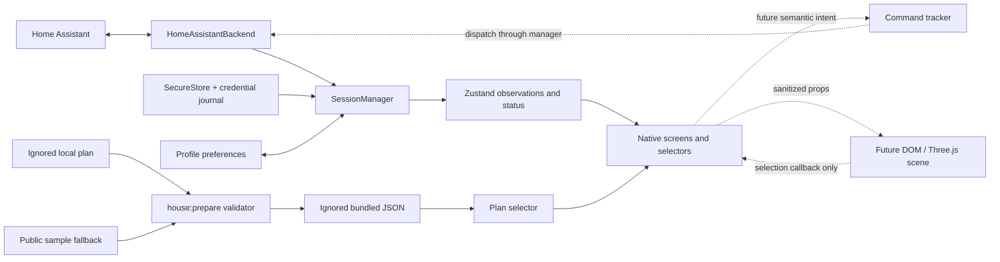

# Implementation backlog and agent handoff

Updated 2026-10-15. This is the execution guide for the next agent, including a smaller model. Work on **one ticket per change**. Do not start the whole roadmap in one turn. Read the relevant source and tests before editing; the specification contains future sketches that do not always match the current APIs.

## 1. Starting point

Implemented: Expo/RN Android development build; HA authentication and authoritative entity synchronization; recovery/lifecycle and credential-journal fixes; native persistence; read-only Home/detail/settings/entities/diagnostics; offline simulated devices; a native SVG floor-plan viewer with multiple floors, concave spaces, room selection and dimensions. Personal geometry is prepared locally; the public sample is separate.

Current checks: **57 tests / 10 suites**, TypeScript, lint, formatting, web and Android exports pass. The SVG-enabled ARM64 APK compiled and installed on the Pixel. Personal-plan browser picking, floor switching, dimensions and offline interactions passed at 320/430/768 px. Native plan interaction passed on the Pixel (F01, see the floor-plan validation report). Earlier native HA/network/storage checks passed and remain recorded separately.

Not implemented: editable/persisted plans, HA-to-plan associations, device placements, Three.js, command tracking, physical controls, authenticated camera images, production distribution, iOS validation and per-occupant OAuth. HA also has built-in demo entities. The first actual Kasa plug passed read-only integration and Cockpit backend validation; other vendor compatibility remains unproven (H01).

Read in this order:

1. [README](../README.md): setup, commands and current boundaries.
2. [Floor-plan implementation](design/floor-plans.md) and [validation](stage0/floor-plan-validation.md).
3. [Main spec](superpowers/specs/2026-10-14-home-cockpit-design.md): relevant sections are referenced by ticket below.
4. [Native validation](stage0/android-validation.md), [results](stage0/results.md), [household inventory](stage0/inventory.md).
5. The ticket's actual source files and existing tests. The old foundations plan is historical, not an unfinished checklist.

## 2. Architecture to preserve



| Area                | Current implementation                                                           | Extension rule                                                                                                                            |
| ------------------- | -------------------------------------------------------------------------------- | ----------------------------------------------------------------------------------------------------------------------------------------- |
| Session owner       | `src/session/homeAssistant/HomeAssistantBackend.ts`                              | Owns connection/heartbeat/foreground/retry policy. Do not add reconnect timers in screens, scene or manager                               |
| Session facade      | `src/session/SessionManager.ts`, singleton in `src/services/runtime.ts`          | Owns backend replacement, generation guards, active profile, persistence and lifecycle forwarding                                         |
| Observations        | `src/core/types.ts`, `store.ts`, `selectors.ts`                                  | HA remains authoritative; full snapshots replace removed entities. Reuse selectors and structural sharing                                 |
| Identity            | `mapSnapshot.ts`, `preferences/types.ts`                                         | Stable `entity.key` is distinct from mutable `entityId`; extend alias reconciliation when adding key-indexed preferences                  |
| Policy/capabilities | `core/policy.ts`, `capabilities.ts`, `presentation.ts`                           | Actual policy API is `getCondition(entity, ready)`. Theme colors are presentation, never proof of physical state                          |
| Credentials         | `services/credentials.ts`                                                        | SecureStore secrets, serialized operations, pending-write/deletion journals. Do not replace this with raw URL keys or AsyncStorage tokens |
| Preferences         | `preferences/types.ts`, `storage.ts`                                             | Currently schema 1, one `prefs` key, profiles separated by `demo` or `ha:<normalized origin>`                                             |
| Geometry            | `spatial/model.ts`, `plans.ts`, `sample-plan.json`                               | Actual `HousePlan` has rooms nested within floors; use this model, not a second copy of the older spec sketch                             |
| Plan rendering      | `FloorPlanView.tsx`, `HousePlanCard.tsx`, `HousePlanScreen.tsx`, `app/house.tsx` | SVG is decorative for screen readers; the native room list supplies named, larger touch targets                                           |
| Visual language     | `components/ui.tsx`, `EntityIcon.tsx`                                            | Reuse colors, radii, outline icons and freshness qualifiers; keep functional errors/actions visible                                       |

Invariants:

- Only the backend decides recovery. Existing transport reconnection belongs to the official HA client; initial-open/resync retries belong to the backend. Auth/version failures are terminal until explicit user action.
- A failed refresh keeps the committed subscription alive. `syncEpoch` advances only after a new authoritative initial snapshot succeeds. Registry events during a refresh trigger another refresh.
- `ready` is required before any future command dispatch. A cached value cannot become an all-clear or an enabled actuator.
- Tokens/PINs/authenticated image URLs never enter logs, persisted command records, diagnostics, the scene bridge or plan exports. Scenes never receive raw HA attributes.
- Device keys and HA area IDs are different from plan-room IDs. Do not create/assign HA rooms by guessing from names on the drawing.
- Personal `.local/home-plan.json`, `.local/home-reference.png`, `src/spatial/current-plan.json`, bundles and personal screenshots stay out of Git. The generated JSON is ignored but **is included in app/web exports**. Demo display alone does not sanitize an already prepared personal bundle.
- Controls remain read-only until the command tickets are complete. Tests may actuate fixtures/demo. A physical unlock/open is tested only with the user's specific authorization for that action.

## 3. Setup and validation for each agent

Use Node 24, `npm ci`, and the lockfile. Postinstall prepares the plan; normal start/test/typecheck/export scripts also prepare it. Do not require a personal `.local/` directory for a clean checkout: the public sample is the fallback.

```sh
npm run typecheck
npm run lint
npm test
npm run format:check
npm run export:android
```

Run the relevant checks once after a change. Add behavioral tests for new behavior; do not add snapshots of styling or repeat broad checks without a reason. Protocol changes also require `npm run proof:protocol`; it opens a local WebSocket port. The configured-HA proof is `HA_ALLOW_INSECURE_HTTP=1 npm run proof:ha`; it reads the ignored token file internally and sends no device services.

Native: `npm run android` uses Expo prebuild and the local environment when present. The current machine has SDK/JDK/Gradle under `.local/android/`, with paths in ignored `.env.local`. JDK 17 works; JDK 25 previously failed Prefab/CMake. New native dependencies require a rebuilt client; Metro refresh alone is insufficient. Generated `android/` and `ios/` are ignored: put durable native changes in app config, a local Expo module or a config plugin.

With an already installed client: `npm start -- --localhost --port 8081`, then `adb -d reverse tcp:8081 tcp:8081`. Metro delivery over USB is separate from HA's LAN connection. On a phone, `localhost:8123` is not the Mac. Do not commit the device serial, LAN address or tokens. If the phone is locked, ask the user to unlock it; do not automate authentication. Restore any temporary Wi-Fi/sleep setting after a test.

For a shareable web build:

```sh
COCKPIT_PLAN_FILE=src/spatial/sample-plan.json npm run house:prepare
npx expo export --platform web --output-dir dist-web
npm run house:prepare
```

The final preparation restores local development configuration. Browser storage does not validate native SecureStore. `expo export` produces a JS bundle, not an installable APK.

## 4. Priority and dependency map

`S` means a bounded component/data task; `M` means a module plus integration. Split an M ticket at its numbered boundaries if needed. Hardware tickets can be blocked while independent code work proceeds.

| ID  | Priority / size | Delivery                                                 | Depends on                                 |
| --- | --------------- | -------------------------------------------------------- | ------------------------------------------ |
| F01 | Done            | Finish native floor-plan acceptance                      | Unlocked Pixel                             |
| F02 | P1 / S          | Reproducible sample UI smoke script                      | None                                       |
| H01 | P0 / hardware   | Verify actual household HA capabilities                  | User's hardware/integration setup          |
| P01 | P1 / M          | Schema-2 spatial preferences and migrations              | None                                       |
| P02 | P1 / S          | Profile-aware plan provider and explicit reset           | P01                                        |
| P03 | P1 / M          | Link plan rooms to HA areas                              | P02                                        |
| P04 | P1 / M          | Place entities on the 2D plan                            | P03                                        |
| S01 | P1 / M          | Isolated, measured native Three.js feasibility           | None; use sample geometry                  |
| S02 | P2 / M          | Production scene and 2D/3D switching                     | S01 pass, P04                              |
| C01 | P1 / M          | Typed semantic intents, validation and service mapping   | None for fixtures; H01 before real control |
| C02 | P1 / M          | Observation revisions and command outcomes               | C01                                        |
| C03 | P1 / M          | Queues, debounce, lifecycle cancellation and no replay   | C02                                        |
| C04 | P1 / S          | Simulated command-capable demo                           | C01–C03                                    |
| C05 | P2 / S          | Deliberate lock controls and secure code input           | C03, C04, verified lock capabilities       |
| C06 | P2 / S          | Climate controls                                         | C03, C04, verified climate capabilities    |
| C07 | P2 / S          | Fan and switch controls                                  | C03, C04, verified fan/switch capabilities |
| I01 | P1 / M          | Native image transport with proven redirect isolation    | HA image-path proof from H01               |
| I02 | P2 / M          | Latest-image UI, polling lifecycle and event association | I01                                        |
| U01 | P2 / S          | Error explanations, diagnostics, screen-reader pass      | P03/P04/C03 as applicable                  |
| U02 | P2 / S          | Measured large-home rendering improvements               | Realistic inventory fixture                |
| U03 | P3 / S          | Related readings / fridge grouping                       | H01                                        |
| R01 | P1 / M          | Compatible dependency maintenance and audit closure      | None                                       |
| R02 | P2 / S          | CI with public fixtures and checked artifacts            | F02                                        |
| R03 | P2 / M          | Standalone release build and acceptance                  | MVP feature tickets, R01                   |
| H02 | P3 / hardware   | Dedicated HA host and explicit profile move              | Host purchase/network setup                |

Suggested next code task for a smaller model: **P01 only**, then P02. F01 is the first manual acceptance task. S01 can be tackled separately without waiting for household hardware. The command path is C01 → C02 → C03 → C04 → individual controls. Do not enable live controls after only C01.

## 5. Ticket implementation details

### F01 — Native floor-plan acceptance

Files: `docs/stage0/floor-plan-validation.md`; code changes only if a defect is reproduced.

1. The new installed SVG client is recorded in that report; the local APK is `.local/android/artifacts/home-cockpit-house-debug-arm64.apk`. Start/reuse Metro and USB reverse, then have the user unlock and open Cockpit. The previous attempt reached the Android screensaver/keyguard, not a demonstrated scene crash.
2. Open the Home plan card, visit every floor, tap an actual room polygon, verify the same room in the text list, check printed/unknown dimensions and verify that switching floors clears selection. Check the Home miniature opens the plan and Back returns correctly.
3. Verify HA credentials survived `install -r`. Do not re-enter or print the token unnecessarily. Check no fictitious device placements appear. Keep personal captures in `.local/`.
4. If checking native offline use, keep Metro over USB, temporarily disable Wi-Fi, change floors/select rooms, then restore Wi-Fi in a `finally`/cleanup path. Record exactly what ran; browser offline interactions are not this native test.

Done: update the native acceptance row with observed results or a reproducible failure; restore device settings. No physical device service calls.

**Status (2026-10-15): done.** All steps passed on the Pixel 9 Pro, including offline floor switching and HA recovery after Wi-Fi restore. Evidence in [floor-plan validation](stage0/floor-plan-validation.md).

### F02 — Reproducible public UI smoke

Add `scripts/check-ui.mjs` or an equivalently scoped runner and an explicit npm script/dev dependency for browser automation. Existing local `/tmp` helpers are not portable repository tooling. Use the public sample; never embed the personal plan's IDs/dimensions in tests or committed captures.

Cover Home → plan card, floor switching, polygon selection, dimensions absent in sample, room list selection, Back, demo entity details/favorites and selected-tab accessibility. Test widths 320/430/768 and offline **after** assets load. A fresh offline web page load is not supported by this preview; do not claim a service worker exists. Serve the SPA correctly for direct `/house` navigation. Collect page errors and save sample-only screenshots in an ignored artifact directory. Ensure servers/browsers terminate on failure.

Done: one documented command works after `npm ci` without HA, Android or personal files and fails on broken navigation/picking.

### H01 — Actual device inventory and capability proof

Update `docs/stage0/inventory.md` with dated evidence and limitations. Already known: Nest Learning Thermostat (generation unknown), Schlage Encode Plus (count/code behavior unknown), Samsung supplied identifier requiring SmartThings matching, Ring subscription, AIRTAP F1.0.26 with no Bluetooth path yet. On 2026-10-15 an actual Kasa HS103(US) was added through the official TP-Link integration and assigned to Salon. Cockpit backend/selector validation passes with fresh registries; a regression fixes HA `area_id` normalization and stale-refresh retention. Phone display and physical switching remain unverified. The Mac HA container still also has simulated devices; distinguish these from real integration evidence.

Use read-only inspection first: exact integration/model, real entity IDs and stable registry identity, areas/devices, feature flags, attributes/units, visibility/category, assumed-state behavior and update latency. Keep detailed household dumps local; commit a sanitized capability summary. Ask the user only for missing hardware/setup facts that cannot be inspected.

For authorized physical tests, record one action per controllable category, its HA result and observed physical/HA outcome; test external changes for sensors/events. Verify the camera's actual authenticated image response, content type and capture-time availability. AIRTAP needs a supported HA Bluetooth adapter/host or ESPHome proxy path; absent that, explicitly leave vents out of the controllable MVP. Do not infer support from a brand name or demo entity.

### P01 — Spatial preferences and migration

Files: `preferences/types.ts`, `storage.ts`, `__tests__/storage.test.ts`, `SessionManager` fixtures/tests where profiles are constructed. Reference spec §6.7. Keep the current geometry schema 1 separate from preference-file schema 2.

Implement this initial persisted shape:

```ts
interface SpatialPreferences {
  plan: HousePlan | null;
  seededFrom: { planId: string; revision: number } | null;
  areaLinks: Record<string, string>; // plan-room ID -> HA area ID
  placements: Record<
    string,
    {
      floorId: string;
      roomId: string | null;
      position: PlanPoint; // X/Z meters; floor provides elevation later
    }
  >; // stable entity key -> placement
}
// ProfilePreferences gains spatial; PreferencesFile.schemaVersion becomes 2.
```

1. Ordered v1→v2 migration adds empty spatial data and preserves every existing field/profile. Validate old data as v1 before migration; do not classify legitimate v1 as corrupt merely because the new field is absent.
2. Reuse `parseHousePlan` for a stored non-null plan. Validate finite placement positions and link values. Keep unresolved room/area/entity references for diagnostics instead of deleting them.
3. Extend `reconcilePreferences` to migrate placement keys through identity aliases; canonical/newer entries win collisions as they do for current preferences. Never persist observed state, session status, commands, credentials or image authorization.

Done/tests: valid v1 migration including two origins and demo; v2 round-trip; malformed backup; unknown version handling; queued writes; alias collision; missing entity retains placement. No plan editor or scene in this ticket.

### P02 — Profile-aware plan provider and reset

Files: `spatial/plans.ts` (or a new `useHousePlan` selector), `HousePlanScreen`, `HousePlanCard`, `SessionManager`, Diagnostics.

Centralize plan selection: stored profile plan when present, otherwise the installed build plan; demo always seeds from the public sample. Seed a profile once with a cloned plan plus `seededFrom`. Replacing an HA origin creates a different preference profile; do not share placements across it.

Never overwrite an existing plan when the bundled revision changes. Offer an explicit reset in Diagnostics, with confirmation describing that only spatial plan/links/placements are reset; favorites, visibility and credentials stay intact. Present a new-default notice without silently replacing user work. A missing/deleted selected floor or room falls back safely. Reset local view selection when profile/plan identity changes.

Done/tests: profile switch isolation, new bundled revision preserves saved geometry, demo uses sample, explicit reset scope, missing floor selection. Prefer one provider over several screens independently choosing different plans.

### P03 — Plan room ↔ HA area associations

Files: a small plan setup screen/route, `core/selectors.ts` or `spatial/selectors.ts`, P01 preferences, Home/House screen.

For each plan room, choose an existing HA area or Unlinked. An area can have multiple entities; require an explicit choice for duplicate room names and do not name-match automatically. Room resolution for an entity remains app override → entity area → device area → Unassigned; only then map the resolved area through explicit plan links. Plan rooms are not added to `snapshot.areas`.

Show empty/unlinked rooms honestly. No HA areas means useful setup guidance, not a blank picker or fabricated areas. Display unresolved links if HA removes an area. Shared plan/list selection must refer to stable plan-room IDs and reset on profile change. Global attention remains global.

Done/tests: room override takes precedence, same-name rooms on different floors, absent/removed areas, no metadata access, unlinked entities remain in list, persistence across restart. This ticket does not need a 3D scene or device service calls.

### P04 — 2D entity placements

Files: `spatial/selectors.ts`, `HousePlanScreen` or a focused placement screen, `FloorPlanView`, preference reconciliation/Diagnostics.

Start with explicit **Place device** mode, an eligible visible entity picker and a tap on the selected floor. Convert through the SVG's actual viewBox/letterboxing to X/Z coordinates; test round-trips. Do not store screen pixels. Require a point inside the floor and the chosen room when one is specified. Ordinary room exploration must not accidentally edit placement.

Render markers with icon + name and semantic condition; resolve aliases and current entities in native selectors. Opening a marker uses the existing stable-key `/device/[key]` route. Offer reposition/remove. A missing/hidden/unavailable entity is not silently remapped to a similarly named device; keep unresolved placement metadata and expose it in Diagnostics. No automatic placement from names.

Done/tests: concave cutout rejects placement, coordinate conversion after viewport changes, floor isolation, identity rename vs recreated UUID, hidden/removed entities, cached marker state and no service calls. Keep placement mode usable without precise dragging.

### S01 — Native Three.js feasibility, isolated

Add `src/web/CockpitScene.tsx` with `'use dom'` and a native wrapper/error boundary. Check the installed SDK's DOM support first: SDK 56+ uses `@expo/dom-webview` by default, so an extra WebView installation may be unnecessary. Resolve/pin a compatible Three.js version from official metadata. Rebuild Android if native dependencies/configuration change; otherwise prove the existing client supports the DOM wrapper. Do not replace the native app with the reference project's Swift/web architecture.

Scope: one active floor from the **existing** `HousePlan`; extruded concave floor polygons, simple low wall previews, orbit and room/device picking with fixture markers. No editor, remote textures/furniture, production controls, extra integrations or guessed household furnishing. Preview wall height is a renderer setting, not a measured house elevation.

Bridge contract: JSON-safe plan/floor geometry, sanitized markers `{key, floorId, position, icon, label, condition}`, selected IDs and `visible`; async `onRoomPress(id)` / `onMarkerPress(key)` callbacks. Native actions must be top-level props, not functions nested in another prop; type their return as `Promise<void>`. Prop updates cross an asynchronous bridge. Add async `onSceneReady()` and `onSceneError(code)` callbacks with a small sanitized error-code union. Catch DOM/WebGL errors inside the DOM component: a native React error boundary alone cannot catch an asynchronous failure in the other JS runtime. A native initialization watchdog (initially 10 s) selects the fallback if readiness never arrives. No token, raw entity attributes, authenticated camera URI or arbitrary service call. A renderer callback requests native selection/navigation only.

References: [Expo DOM components](https://docs.expo.dev/guides/dom-components/), [Three.js documentation](https://threejs.org/docs/). Verify the installed SDK's APIs before coding. Convert the existing X/Z points to scene vectors; use a rendering-only marker height while actual story elevations are unknown.

Measure on the installed Pixel: bundled/offline assets; picking vs orbit (movement threshold, ignore multi-touch taps); resize; first usable scene; sustained ≥30 fps while interacting; idle on-demand rendering; zero ongoing rendering when unfocused/backgrounded; disposal of geometry/materials/textures/listeners on unmount; context-loss fallback. Restore visibility with a fresh invalidation. Keep 2D/native list functional after failure. Record methods/versions/results, including failures, rather than claiming a screenshot proves fps.

Done: a kept proof report chooses Three.js/DOM as feasible or records a fallback. Do not proceed to S02 if the native bridge/offline/render lifecycle gate is unproven.

### S02 — Production spatial view

After S01 and P04, add a 2D/3D switch with shared floor/room selection, placements and existing device navigation. Render only one floor at a time. Use the same geometry and condition selectors in both views; do not introduce a scene-owned device store.

Diff marker conditions/materials rather than rebuild the scene for every sensor update. Preserve a useful 2D/list fallback after timeout/context loss/unsupported rendering, plus a deliberate retry. Honor reduced motion, visible/background state and native accessibility alternatives. Personal defaults remain private. Tests include unknown/stale markers, an entity removed after reconnect, rejected marker callbacks from an obsolete profile, repeated mount/unmount and no hidden rendering.

### C01 — Semantic intent facade and mapping

Create `src/commands/types.ts`, `validation.ts`, `serviceCalls.ts`; expose a narrow facade from `services/runtime.ts` via the current manager. `SessionManager.backend` is private: screens must not import a connection or call generic backend services.

Use a discriminated intent union corresponding to the methods in spec §6.5. Capture profile, stable key and resolved entity ID; revalidate ready/profile/key→same-ID/availability/capability **immediately before dispatch**, including after a confirmation dialog. Validate finite values, supported modes/presets, limits, step quantization and low≤high. Return a typed refused/no-op/started result. Already-satisfied intent sends nothing.

| Intent                    | HA service                                | Data                                                    |
| ------------------------- | ----------------------------------------- | ------------------------------------------------------- |
| Lock locked/unlocked/open | `lock.lock` / `lock.unlock` / `lock.open` | optional `code`                                         |
| Climate target            | `climate.set_temperature`                 | `temperature` or `target_temp_low` + `target_temp_high` |
| HVAC mode                 | `climate.set_hvac_mode`                   | `hvac_mode`                                             |
| Fan on/off                | `fan.turn_on` / `fan.turn_off`            | none                                                    |
| Fan percentage            | `fan.set_percentage`                      | `percentage`                                            |
| Fan preset                | `fan.set_preset_mode`                     | `preset_mode`                                           |
| Switch on/off             | `switch.turn_on` / `switch.turn_off`      | none                                                    |

The backend already accepts `{domain, service, entityId, data?}`. Keep protocol construction there. Capture the connection before awaits and guard obsolete results; add a stop-during-service regression so accessing mutable `this.connection` after teardown cannot throw. PIN/code stays transient; never put it in command records or diagnostics. Use fixtures to check exact messages; leave real UI read-only until C02–C04.

### C02 — Observation revisions and outcome tracker

Create `src/commands/CommandTracker.ts`, observation revision/predicate helpers and a bounded transient command store. Integrate manager snapshot/status events before screen rendering. Do not use HA timestamps versus phone wall clock to establish ordering.

A record needs spec §6.5 fields plus profile, dispatch entity ID, sanitized intent/desired target and enough transient evidence to retain a post-dispatch match before acknowledgement. Track a local monotonically increasing revision per stable entity, including attribute-only changes; a new epoch can be fresh evidence. Exclude token/code from records.

Implement `sending`, `accepted`, `confirmed`, `failed`, `unconfirmed`, `superseded` exactly as §6.5. Baseline state does not confirm a dispatch. Retain a qualifying post-dispatch update even if it arrives before the service result or represents a transient `opening` state. Late acknowledgements cannot downgrade terminal outcomes. HA rejection means HA reported an error, not proof of no physical effect.

Deadlines: lock 45 s, climate 30 s, fan/switch 15 s; late reconciliation until 5 minutes after the deadline, same profile/key and no newer command. Reconnect wording reports what HA **now shows**, not causality. Assumed state is labeled. Outcome clearing/dismissal must not enable an unsafe second lock action.

Done/tests with fake time/backend: ack-before-update, update-before-ack, attribute-only target, no-op, timeout, connection loss, late match inside/outside window, newer intent suppresses old outcome, profile switch, duplicate/obsolete callbacks, transient open and assumed-state wording. Include the backend's actual event order: a replacement snapshot can arrive while status is still synchronizing, immediately before ready. Retain fresh evidence and reconcile when readiness arrives. No controls in this ticket.

### C03 — Serialization, debounce and no replay

Extend C02 and manager lifecycle wiring; no new reconnection policy.

- Locks: refuse while sending/accepted. After unconfirmed, require a newer entity observation or fresh epoch before another lock action.
- Climate target/fan percentage: 600 ms debounce retaining latest unsent intent; serialize dispatch per entity until the previous service promise settles; supersede older target outcomes. Other entities remain independent.
- HVAC mode/fan on-off/preset/switch: ignore additional taps while a service call is sending.
- Leaving ready immediately drops **all unsent/debounced/queued intents**, not just on their next timer. Background drops unsent work; already-sent work is tracked to deadline. Backend replacement/profile change invalidates old dispatch callbacks. Reconnect never re-sends a command.

Extend the real compressed-WebSocket fixture in `scripts/prove-protocol.ts` or a scoped command proof. Critical acceptance: accepted unlock + socket drop + reconnect produces one unlock message total; rapid setpoints send only the final eligible intent; change profile/capability while a dialog/debounce is pending sends nothing. Include late promise settlement after stop.

### C04 — Command-capable offline demo

`DemoBackend.callService()` currently rejects everything. Add a deliberately simulated dispatcher for the supported semantic service fixture set, with delayed observed snapshots/attribute changes. It must never contact HA. Keep `Demo home` / simulated provenance visible. Support success, rejection and unconfirmed outcomes in tests without random timing; provide injected clocks/scenarios rather than production test buttons. This is UI coverage, not hardware certification.

### C05 / C06 / C07 — Controls, one small change each

Shared files: `DeviceDetailScreen`, `EntityCard`, new focused `components/controls/*`, runtime command facade. Read spec §4.4/§6.5. Keep observed value and command qualifier separate; never optimistic-toggle or roll back the physical state.

- **C05 locks:** Lock/Unlock, Open only when capability allows. Unlock/Open require deliberate confirmation separate from optional secure code input. Revalidate after confirmation. Clear code on dismissal/background/submit; no record/log persistence. Unconfirmed unlock/open asks the user to check the door and offers no auto-retry. Test changed profile/entity/capability while the dialog is open.
- **C06 climate:** Current reading, distinct single target versus low/high target range, declared HVAC modes, HA-configured unit, min/max/step and tolerance. For `both`, choose supported target fields for the actual mode/verified integration; do not collapse `auto` and `heat_cool`. Null current temperature is unknown, not zero. Test bounds, low≤high, attribute-only confirmation and rapid coalescing.
- **C07 fan/switch:** Gate on declared on/off, percentage and presets, including preset-only fans. Quantize to `percentage_step`; unsupported controls are absent. Debounce continuous percentage intent, not binary toggles. Test repeated taps and disconnect mid-change.

Done for each: fixture/demo component + command tests, installed-device interaction and the corresponding authorized real-hardware evidence or an explicit disabled limitation. Do not mark all categories verified after one switch works.

### I01 — Authenticated image path and native transport

The backend has `getCameraImageRequest(entityId)` returning a URI plus bearer header. It is not exposed to screens and its redirect behavior is not proven. Add a camera service with a narrow output such as `{localUri, fetchedAt, capturedAt: string | null}`; resolve current profile/camera eligibility inside the native layer.

First prove the actual HA/Ring proxy path read-only. Then implement origin-bound retrieval. Do not assume RN `fetch({redirect:'manual'})` or `<Image headers>` prevents credential forwarding on every native redirect. Preferred Android approach if the existing transport cannot prove it: a small local Expo native module using OkHttp with automatic redirects disabled, explicit same-origin redirect validation/hop limit, and private local image output. Durable native source/config belongs in a checked-in local module/plugin, not ignored generated `android/` files. iOS remains disabled until its equivalent transport is validated.

Reject cross-origin redirects and HTTPS downgrades before forwarding authorization. Bound size/content type/time, cancel on obsolete profile/scene, and never log request headers/authenticated URLs. Avoid permanent public/shared caches. Use two local test origins with a **fake** bearer; prove the second origin receives no credential on redirects in the installed Pixel build. Prove same-origin success and failure/cancellation cleanup. Keep image UI disabled until this gate passes.

### I02 — Latest image, visibility polling and events

Files: camera component/service, DeviceDetail and eligible Home preview, preferences for event overrides; use I01 output only.

Label **Latest available image**. Capture time unknown stays unknown; fetched-at time is separate and must not be presented as capture time. Display cached/error/loading states without exposing private URIs. Poll only when the relevant screen is visible and app active; cancel unsent/pending work on profile changes, unmount and background. Do not add live streaming to this ticket.

Associate recent motion/ding/event entities by verified shared device metadata, with explicit per-camera overrides; never suffix-guess a different camera's event. Store associations by stable keys and extend alias reconciliation. Test stale recording, no timestamp, failed image, unrelated event, background/foreground, redirect rejection and token/profile change.

### U01 — Diagnostics and accessibility

Expose unresolved links/placements and saved-plan revision; preserve them for reconciliation. `SessionBanner` currently uses generic network text: render `likelyCauses` as possibilities, detected unsupported HA version, and honest automatic-retry status without removing Retry/Settings on terminal errors. Do not expose headers/PINs/full payloads.

Run TalkBack on the Pixel, large system text, contrast and ≥48 dp important targets. Validate selected floor/room announcements, marker-list alternatives and returning focus from details. The SVG diagram itself is intentionally hidden from accessibility; the list must remain complete. Improve room-detail focus/scroll behavior if selecting a low list row leaves the detail offscreen. No new test-only product controls.

### U02 — Measured list/scene performance

Use a sanitized fixture with a few hundred entities across rooms. `HomeContent` currently subscribes to the whole store and renders a nonvirtualized ScrollView/grid; EntityCard already uses individual selectors/memoization. Measure before replacing the list.

If needed, use a virtualized native list with stable keys, keep global attention and favorites behavior, preserve room filtering/pull-refresh/large-font columns, and avoid passing changing entire snapshots into every card. Report first useful Home ≤5 s on healthy LAN and HA-update-to-UI ≤1 s after receipt. A single changed sensor should not rerender every card. Keep scene/perf artifacts aggregate and sample-only.

### U03 — Related readings and grouping

After H01, group related battery/temperature/door readings through actual `deviceId` membership. Distinguish measured fridge temperatures from setpoints; unsupported `number.*` values are not quietly controllable. Keep stable entity detail navigation and accessibility for each reading. No name-based merging of devices or camera motion. Add capability/selector tests for missing and partially available members.

### R01 — Dependency/security maintenance

The recorded graph reports 64 audit findings (49 high, 15 moderate), including SDK/tooling transitives and a router path. The last alignment check recommended Expo `~57.0.30` and Router `~57.0.28`; current tested pins are Expo 57.0.29 / Router 57.0.27. Recheck official current metadata/advisories before choosing versions.

Start with compatible SDK patches, inspect lockfile changes, then typecheck/tests/lint/export and native rebuild/smoke. Separate any major SDK migration into its own plan. Do not `npm audit fix --force`, downgrade Expo to an incompatible older release, add broad suppressions, or label the release secure because Node tests pass. Record production-reachable versus tooling-only advisories and resolve/justify them specifically before R03. The SVG addition did not increase the recorded audit count.

### R02 — CI and artifacts

Add GitHub Actions using Node 24/`npm ci`, sample-only preparation, functional checks, protocol proof and Android JS export. No HA token or personal plan is required. Add F02's headless UI workflow with bounded artifacts. Keep dependency findings as an explicit tracked gate; do not make a failing audit look passed by suppressing its output. Production binary building/signing is separate. Assert private generated/source files are ignored and never uploaded as artifacts. CI should work from a fresh clone, not a developer's generated module.

### R03 — Standalone Android release

Build a standalone binary that runs without Metro, using a documented signing/distribution path. Do not commit/upload signing keys or personal floor plans. Build public test artifacts with sample configuration unless the user explicitly chooses a private household distribution.

On Pixel: cold start offline, token persistence, background/foreground, network return, server restart/removal, terminal auth/version errors, Forget, plan assets and fresh-snapshot behavior. Add controls/camera/3D checks for whichever features are enabled. Confirm production logs exclude secrets, backup/reinstall produces a consistent profile or none, and HA's HTTP opt-in matches actual native network config. Keep JDK/SDK/artifact hash/version evidence. A development-client APK or successful JS export does not satisfy this ticket.

### H02 — Dedicated HA host and profile move

Prepare a host/network/backup plan with the user, including the proven BLE/proxy path. Do not change household integrations or DNS silently. An origin change currently produces a new Cockpit profile; implement an explicit non-secret preference migration/association if retaining customization is desired. Never reuse a token automatically across origins. Test stable identities, rollback to the old endpoint and stale/cached UI during the move.

## 6. Later candidates — do not start during MVP tickets

| ID  | Delivery                                                | Design constraints / exit evidence                                                                                                                                                                                                          |
| --- | ------------------------------------------------------- | ------------------------------------------------------------------------------------------------------------------------------------------------------------------------------------------------------------------------------------------- |
| L01 | Plan/settings import-export and a small geometry editor | Export a versioned allowlisted non-secret schema; validate bounds/topology/references; preview/confirm replacement; preserve current config on failure; unknown entities remain unresolved; private plan sharing is an explicit user action |
| L02 | iOS enablement                                          | Actual iPhone + signing path; compatible dev build; ATS/local-network permission matrix for .local/IPv4/IPv6; SecureStore/backup behavior, image redirect isolation, bridge/lifecycle and all enabled controls on device                    |
| L03 | Per-occupant HA OAuth                                   | Authorization-code/refresh-token lifecycle through official supported HA contracts; native secret storage; origin binding; token refresh/revocation/logout races; no Cockpit account backend assumed                                        |
| L04 | Activity/history                                        | Native read-only HA events plus bounded sanitized command outcomes; distinguish external observations from app commands; define retention/dismissal before persisting history; never infer command causality from state alone               |
| L05 | Tablet layout                                           | Shared plan/selection/details in adaptive panes, virtualized device list, accessibility and independent scene visibility; validate on named hardware                                                                                        |
| L06 | Lights, scenes, `number.*`, thresholds                  | First obtain the household capability inventory and extend mapper/capabilities/semantic commands/predicates together; never add arbitrary service JSON to the scene; household thresholds are preferences, not generic guessed alerts       |

## 7. Ticket completion / next-agent prompt

Use this prompt, replacing the ID:

> Implement ticket P01 from docs/BACKLOG.md only. Read its actual files and the relevant specification sections first. Preserve the architecture/privacy invariants and existing lifecycle regressions. Use the public sample in committed fixtures. Implement the smallest complete change, run the appropriate behavioral and build checks, update the ticket's status/evidence, and report any hardware-only acceptance still pending. Do not start a later ticket or actuate real devices as part of an automated test.

For every finished ticket, record the commit, checks actually run, limitations and any changed contract here or in a linked validation artifact. Keep unfinished acceptance gates explicit. Update the affected docs when behavior changes. Do not carry a worktree requiring an untracked personal plan into the handoff: `npm ci` plus the public fallback must continue to build it.
