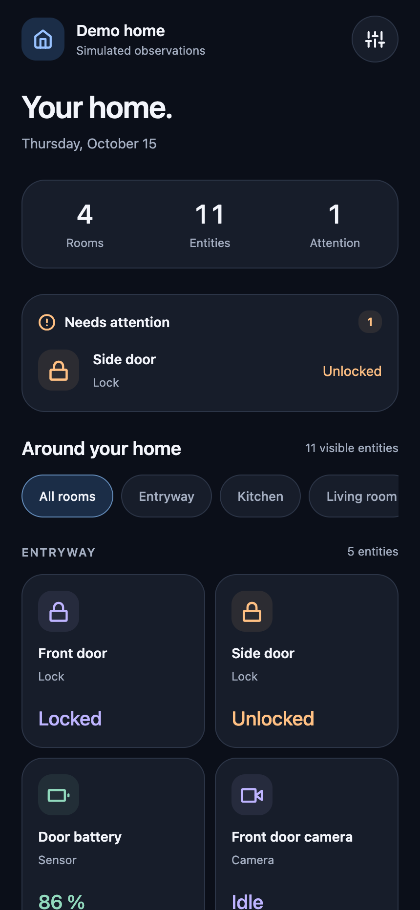
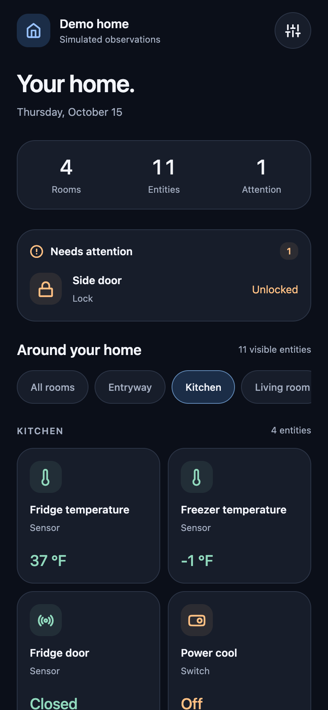
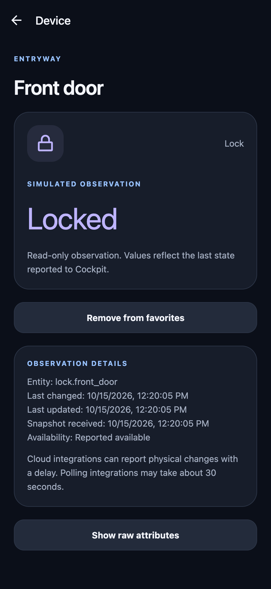

# Interface direction and delivery sequence

Date: 2026-10-15. This supplements the v4 specification; device controls and the production floor plan remain separate milestones.

## Reference and decisions

[House Control](https://github.com/0xProbabillity/house-control) is the visual reference. Its [iPhone screenshots](https://github.com/0xProbabillity/house-control/blob/main/docs/iphone.png), panel styles and room-selection behavior were inspected at commit `1b4d3fb0138b59efb4d56b0468781553ace46be9`. The useful patterns are a quiet dark background, a compact home header, consistent outline icons, colors associated with device categories, room filters and readable device surfaces. Its spatial view is a central part of the intended direction.

Cockpit now uses those principles in its native read-only interface: midnight surfaces, blue accents, lavender security devices, blue comfort devices, mint readings and amber switches. Warning/error colors and explicit state text take precedence over category colors. Color never establishes physical state. The device value has more visual emphasis than its metadata.

Home has a single header, an honest room/entity count, expandable household attention and a responsive device grid. An unassigned group is not counted as a room. Attention stays global when a room is selected, excludes hidden entities and duplicates in Favorites, and puts alerts such as jammed locks before lower-severity observations. When disconnected, attention becomes unknown and values are marked cached. Room selection resets when the profile changes; a missing selection falls back to all rooms. Large system text or a narrow screen uses one grid column. Settings and entity details share the same tokens and icon family.

No reference code or assets were copied into the app. The reference uses a Swift shell around a Three.js web interface; Cockpit keeps its Expo/native interface and HA-only backend. Feather icons come from the Expo-compatible `@expo/vector-icons` package; its font is included in exported bundles.

## Current previews and verification

These captures use Cockpit's simulated demo, not household data:

| Home                                    | Kitchen                                         | Device detail                                         |
| --------------------------------------- | ----------------------------------------------- | ----------------------------------------------------- |
|  |  |  |

The installed Pixel renders the new icons, cards, room filter and device detail through the existing development client. Chrome checks cover demo startup, room filtering with global attention, stable-key detail navigation, favorite persistence, URL validation and entity settings. Widths of 320, 430 and 768 CSS pixels are checked for page overflow and device-card bounds. Native component tests cover filtering, alert expansion/priority, hidden entities, disconnected attention, deleted room selections and profile changes. This does not establish iOS or screen-reader usability; those need their own runtime checks.

## Roadmap

| Order                                    | Concrete delivery                                                                                                                 | Acceptance gate                                                                                                                                                                                                                                          |
| ---------------------------------------- | --------------------------------------------------------------------------------------------------------------------------------- | -------------------------------------------------------------------------------------------------------------------------------------------------------------------------------------------------------------------------------------------------------- |
| Done                                     | Native connection fault checks and the visual foundation above                                                                    | Pixel cold start without Wi-Fi recovers automatically; HA restart replaces the snapshot and drops a temporary entity; list/detail navigation works                                                                                                       |
| Next: spatial feasibility                | A clearly labeled demo scene in an Expo DOM component: one floor, simple bundled geometry, orbit, room picking and device picking | Installed Pixel works without remote assets; async bridge selects the correct stable key; picking is distinct from dragging; at least 30 fps during interaction; no continuous rendering when idle or backgrounded; scene failure leaves the list usable |
| Household setup, alongside the prototype | Finish the actual room/device inventory and test the integrations in HA                                                           | Record real capabilities and limitations for Schlage, Nest, SmartThings, Ring and AIRTAP; verify camera image behavior and the BLE path. The current HA demo has no room assignments and proves no vendor compatibility                                  |
| Stage 2: controls                        | A shared command tracker, then capability-gated lock/climate/fan/switch controls and verified camera images                       | Confirm unlock/open deliberately; serialize/coalesce commands; distinguish HA acceptance from observed completion; never replay after reconnect; no action inferred from a tile's color                                                                  |
| Stage 3: household cockpit               | Versioned house geometry, room/device placements, list/plan switch, shared room selection and shared device details               | Use the household's actual plan; show unplaced devices in the list; support cached/unknown markers, reduced motion and renderer failure; retain the measured Pixel budget                                                                                |
| Later                                    | Plan import/export, a small placement editor, tablet layout, household logins and activity history                                | Schema migration and portability first; iOS only after a device and signing path exist. Add lighting/scenes only when the household inventory and command policy support them                                                                            |

The feasibility prototype comes before a large investment in 3D or an editor. Its measurements decide whether Three.js in Expo DOM is suitable; the fallback is a simpler spatial view with the same list and data model. No guessed house layout appears as the user's real home.

Follow-up: the [native 2D floor-plan foundation](floor-plans.md) now supports a private, image-traced household plan, multiple floors and room selection. Personal geometry stays in local configuration; the repository includes a separate public sample. The Three.js prototype and measured rendering budget remain the next 3D gate.

## Long-term structure

Keep geometry, placements and appearance separate from HA entities and session state. A versioned plan uses meters and stable area/placement IDs; placements reference entity keys through the existing identity/alias layer. Persist geometry and preferences, not observed device states or pending commands. A missing entity becomes an unresolved placement until reconciliation.

The renderer receives only the plan, selection, sanitized marker state and session freshness. Credentials, authenticated camera URLs and HA connections stay native. A scene callback requests a room/device selection; native navigation and the command tracker own the resulting behavior. List and plan open the same detail route and share the same room selection, so a 3D failure cannot strand controls or invent a second source of truth.

Render on demand, coalesce bridge updates, and pause work when hidden. Measure frame time, first usable scene and memory on the Pixel before adding detailed furniture, shadows or animation. Virtualize the entity list when the real inventory warrants it. Extend these boundaries instead of moving networking, permissions or device policy into the scene.
