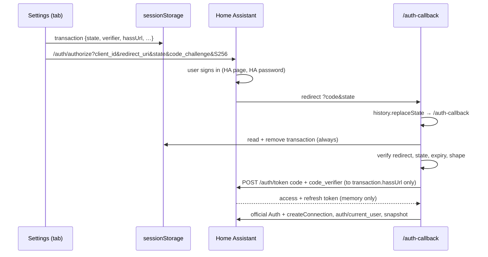

# D02 — Browser sign-in contract (C01)

Decided on 2026-10-22 by agent C for the [parallel wave](../handoff/parallel/C-web-auth.md), on top of `0733657`. C01 adds this contract, a bounded prototype under `src/services/auth/` and a public fixture. **No runtime behavior changes:** nothing imports the prototype yet, Settings, `SessionManager`, the backend, the manual token path, the native SecureStore path, the demo and the `.local` development loader are untouched. C02 wires the in-memory sign-in; C03 adds opt-in persistence after the integrator has reviewed this document and documented the M01 extension below.

## Verified facts

Every claim below was checked on 2026-10-22 against source or a disposable instance, not inferred from current documentation.

| Subject | Fact | Source |
| --- | --- | --- |
| PKCE server | `POST /auth/login_flow` accepts `code_challenge` (43 base64url chars) with `code_challenge_method` **S256 only**; `plain` and a method without challenge are 400. `/auth/token` requires and checks the verifier for a PKCE code, and **rejects a verifier for a code without challenge**. | HA core `2026.10.0` and `2026.10.1` (`components/auth/login_flow.py`, `components/auth/__init__.py`); `2026.9.0` has no PKCE |
| PKCE frontend | The authorize page (frontend `20260930.3`) forwards `code_challenge`/`code_challenge_method` to the login flow, then redirects with `document.location.assign(redirect_uri + "?code=…&state=…")`, plus `&storeToken=true` only for HA's own "keep me logged in". | Bundle `authorize.*.js`; real page driven with Playwright, see Proof |
| Codes | Bound to `(client_id, code)`, **popped before any verifier check** (a failed exchange burns the code), 10-minute lifetime. | `_create_auth_code_store`, conformance run |
| Redirect | Accepted without fetching anything when the redirect has the client id's scheme and host:port; otherwise HA fetches the client id page for `rel="redirect_uri"` links. | `indieauth.verify_redirect_uri` |
| Refresh | Same `client_id` required; the response contains **no new refresh token** (no rotation). Unused refresh tokens expire after 90 days. Access tokens are per-second JWTs (default 1800 s): two refreshes in one second may return the same value. | `TokenView`, [auth API docs](https://contributors.home-assistant.io/core/internals/auth-api/), conformance run |
| Revocation | `POST /auth/revoke` answers 200 for any token and also ends that token's access tokens and sockets. | `RevokeTokenView`, conformance run |
| CORS | `/auth/token`, `/auth/revoke` and the well-known metadata echo any `Origin`; `/auth/login_flow` refuses cross-origin preflight (403). | `cors_allowed = True`, disposable instance |
| Identity | WebSocket `auth/current_user` returns the user id of the token; the installed client exposes it as `getUser(connection)`. | `websocket_current_user`, prototype probe |
| Installed client 9.7.1 | `getAuth()` puts `base64(JSON{hassUrl, clientId})` in `state` (no nonce), sends **no PKCE**, and on callback posts the code to `state.hassUrl` unless `limitHassInstance`. `saveTokens` returns `void`. `Auth` refreshes with FormData; 400/403 become `ERR_INVALID_AUTH`, other failures a plain error (retried by `createSocket`). An HTTPS page refuses an `http:` HA except `localhost` (`ERR_INVALID_HTTPS_TO_HTTP`). `tokenRequest` is not exported. | `node_modules/home-assistant-js-websocket/dist/auth.js`, `socket.js` |

Maurice's minimum supported version is 2026.10 (`config/homeAssistant.ts`), so PKCE is always available on a supported server.

## 1. Flow

Maurice does **not** use `getAuth()`. It owns only the authorization transaction and the code exchange; everything after the exchange uses the official `Auth` class and `createConnection`, including refresh and the WebSocket protocol. No dependency change.

`client_id` is the app origin with a trailing slash (`https://maurice.example/`), `redirect_uri` is `<origin>/auth-callback`; both have the same host, so HA validates the redirect without fetching anything. The authorize page shows that client id to the user.

## 2. Origins

The HA URL is normalized with the existing `normalizeUrl` rule and keeps the explicit trusted-network confirmation for `http:`. `browserAuthCompatibility` decides before any redirect; a blocked pair shows help and leaves the manual token form available. No proxy, tunnel or relaxed check is added.

| App origin | Home Assistant | Result | Reason / evidence |
| --- | --- | --- | --- |
| `http://localhost` / `127.0.0.1` (development) | `http:` LAN or loopback, trust confirmed | **Supported** | Loopback is a secure context; tests and the disposable-HA probes use this pair |
| `http://localhost` | `https:` | Supported if the browser trusts the certificate | By construction; not run against a real certificate |
| `https:` hosted | `https:` | Supported | Chrome may ask for local-network access when HA resolves to a private address; refusal surfaces as a network error with help. Not run in C01 |
| `https:` hosted | `http:` (any host, including loopback) | **Blocked: `mixed_content`** | Token fetch and `ws://` are mixed content; one rule, no loopback exception |
| `http:` LAN address (e.g. `http://192.168.1.10:8081`) | any | **Blocked: `insecure_app`** | No Web Crypto (PKCE) outside a secure context, and a refresh token kept on a cleartext origin is exposed to injected script |
| any | HA < 2026.10 | Rejected after sign-in | Older servers ignore PKCE; the existing version check refuses the session. C02 must then revoke the refresh token it just received |

`/auth-callback` must load directly. The Expo development server does this; a static web export needs a single-page fallback for that path (hosting requirement for A, see Requests).

## 3. Transaction

`beginTransaction` (prototype) creates one pending attempt per tab in `sessionStorage` key `maurice.auth.transaction.v1`:

- `state` and `codeVerifier`: 32 bytes from `crypto.getRandomValues` each, base64url (43 chars); challenge `BASE64URL(SHA-256(verifier))` via `crypto.subtle`. The verifier never appears in a URL.
- Expected `hassUrl`, `clientId`, `redirectUri`, `allowInsecureHttp`, validated `returnTo`, `remember` (Maurice's own opt-in, C03), `createdAt`, `expiresAt` = 10 minutes, matching HA's code lifetime. **No access or refresh token is ever written here.**
- A new attempt overwrites the previous one, so an older callback no longer matches.

`consumeCallback` reads **and removes** the transaction before inspecting anything, so every callback, valid or not, consumes it. It then requires, in order: a well-formed stored record (exact field set, current app origin, compatible pair, internal `returnTo`), the exact redirect URI, exactly one `code` (bounded, unreserved characters) and one `state`, no `error`, a constant-time state match and an unexpired, not-future transaction. Rejections are `no_transaction`, `corrupt_transaction`, `wrong_redirect`, `malformed`, `state_mismatch` and `expired`; none carries the code. Only a verified result may reach `exchangeAuthorizationCode`, which posts to `transaction.hassUrl` — never to an instance named by the callback. The exchange runs once: no retry, whatever the failure, because HA has already consumed the code. A forged callback delivered into a tab burns the pending attempt (the user signs in again); it cannot log the tab into another account, which the injected-code test covers.

`exchangeAuthorizationCode` sends `application/x-www-form-urlencoded` with `credentials: "omit"`, `cache: "no-store"`, `redirect: "error"` and a 10 s deadline including the body read. It validates the response (Bearer, bounded printable tokens, finite positive lifetime) and returns the official `AuthData` shape, or `rejected` (`invalid_grant`, `invalid_request`, `access_denied`, `server_error`, `unexpected_response`) / `unreachable`. Messages never include response text. `revokeRefreshToken` reports `revoked` only on HTTP 200, otherwise `unconfirmed`.

HA's own `storeToken=true` is ignored: it is HA's frontend preference, not consent to persistence in Maurice.

## 4. Callback route and return

C02 creates `app/auth-callback.tsx`. On mount it synchronously replaces the history entry with `/auth-callback` (no query) before any await, never logs or renders the parameters, consumes the transaction, exchanges, connects, then `router.replace(returnTo)`. A failed callback shows a short reason and a **Sign in again** action, never an automatic redirect, so no loop. Cross-origin requests from that page only see the origin under the default referrer policy. Registering a header option for the route in `app/_layout.tsx` belongs to B/the integrator; Expo Router serves the file without it.

`internalDestination` (prototype) accepts only a same-origin string path ≤ 512 characters whose first segment is a known route (`""`, `settings`, `entities`, `house`, `house-links`, `house-place`, `device`, `appliance`, `diagnostics`), rejects `//`, backslashes, control characters and dot segments (raw or encoded), keeps the query opaque and drops the fragment; anything else becomes `/`. `auth-callback` is never a destination. The query is not interpreted, so the future panel syntax of B passes through unchanged. A test fails if an allowed segment has no route file.

## 5. Identity and power permissions

The profile stays `ha:<normalized origin>`, so plan, favorites, placements and preferences are shared by every sign-in to the same origin, as with the manual token. Power grants (preferences schema 3) are bound to that profile, not to an HA user. Browser sign-in makes the HA user explicit, so this contract adds a principal rule:

- After every browser sign-in, the backend calls `auth/current_user` on the new connection **before** the first synchronization; failure is a terminal authentication error. The principal is `base64url(SHA-256(hassUrl + "\n" + userId))`; the raw user id is not stored.
- **C02 (memory only): power control is unavailable in a browser-sign-in session.** `SessionManager` refuses `setSwitch` (`not_authorized`) and `allowSwitch` while the principal rule is not durable. Stored grants are neither used, modified nor removed; plan and favorites work normally; a session notice explains it. Sign-in alone never grants anything.
- **C03 (after A documents the M01 extension):** a non-secret record `maurice.grantPrincipals.v1`, separate from the preferences schema, maps each web profile to the principal under which its grants were made. Grants are usable only when the current principal matches. An unknown previous principal (migration from manual sign-in) or a different one revokes that profile's grants through the existing revocation path (targets invalidated first), keeps plan and favorites, records the new principal and shows a notice. Commands stay disabled until that write succeeds. The rule then also applies to the manual token on web (the same `auth/current_user` check), so a later manual session cannot inherit another user's grants. Native is unchanged.

## 6. Scope

The new flow is web-only. The manual token form stays available and in memory on web; native keeps its journal and SecureStore; the demo is unchanged; `.local` loading stays development-only, explicit and in memory. `session.connect({url, token, allowInsecureHttp})` keeps its meaning; browser sign-in is an additional input type carrying an in-memory authorization object, never a placeholder token. No OAuth value enters the cockpit store, `commandStore`, diagnostics, scene payloads, preferences, the credentials journal, URLs or logs. The `Auth` instance is held by `SessionManager`/backend only and is never serialized into Zustand. The camera request header (future I01) reads the current access token at request time.

## Storage contract (C03)

- **Default: memory.** Reloading requires signing in again. A Settings checkbox **Remember this browser**, unchecked by default and chosen before the redirect (`transaction.remember`), allows persisting the **OAuth refresh token only**, never the manually entered long-lived token, and only after sign-in, identity check and a first fresh snapshot succeed.
- Store: IndexedDB database `maurice-auth`, version 1, store `sessions` keyed by profile id: `{version, profileId, hassUrl, clientId, allowInsecureHttp, principal, refreshToken, rememberedAt}`, plus a per-profile `signOutSeq`. The access token stays in memory: on restore, `Auth` is created expired and `createSocket` refreshes before authenticating (verified with the real server). Because HA does not rotate refresh tokens, **refresh never writes storage**: `saveTokens` only updates memory, which removes the asynchronous `saveTokens: void` problem by design.
- Threat statement for the UI: the record is readable by any script running on this app origin and by anyone using this browser profile. It is not SecureStore and no same-origin encryption is claimed.
- Failure or quota: the session continues in memory and Settings says remembering failed; no fictitious success. A corrupt or unknown-version record is deleted and reported without its contents.
- **Sign out** (browser session): invalidate targets and tear down first, increment `signOutSeq` and delete the record in one IndexedDB transaction, broadcast, then try revocation; `unconfirmed` is reported with how to remove the token in HA (Profile → Security), and the token is not kept for retries. **Stop remembering**: deletes the record only; the current tab stays signed in until reload. **Forget this Home Assistant** keeps its meaning (connection removed, preferences kept) and additionally signs out a browser session.
- Tabs: a `BroadcastChannel("maurice-auth")` message `{type: "signed-out", profileId, seq}` carries no token. Other tabs of that profile tear down their browser session, invalidate prepared targets and revoke their own in-memory token. Each tab keeps its own `Auth` and socket. Before writing, a tab checks inside the same IndexedDB transaction that `signOutSeq` still equals the value read when its sign-in started, so a late write after a sign-out elsewhere cannot recreate the secret. Concurrent refreshes in one tab share one in-flight request; across tabs they are independent and harmless because refresh tokens do not rotate.
- Errors: invalid/revoked refresh (`ERR_INVALID_AUTH`) deletes the record, keeps preferences and grants, and asks for an explicit new sign-in; a network error keeps the record and uses the backend's existing bounded retry. No retry loop in the screen or the adapter.

## Proposed internal API and files

| Ticket | Files (C-owned unless noted) | Interface |
| --- | --- | --- |
| C01 (this commit) | `src/services/auth/{authTransaction,compatibility,returnTo,tokenEndpoint}.ts`, tests, `scripts/lib/web-auth-fixture.mjs`, `scripts/__tests__/web-auth-fixture.test.mjs` | Pure modules with injected storage, crypto, clock and fetch |
| C02 | `services/auth/browserAuth.web.ts` + neutral `browserAuth.ts`, `services/auth/authorization.ts`, `app/auth-callback.tsx`, `SessionManager`, `HomeAssistantBackend`, `SettingsScreen`, fixture WebSocket snapshot and authorize page | `browserAuth.begin(...)`, `browserAuth.complete(href)`; `session.connect({url, allowInsecureHttp, authorization})` alongside the token form; backend option for an `Auth` source and principal check |
| C03 | `services/auth/authStore.web.ts` + neutral `authStore.ts`, `services/auth/principals.ts`, `services/auth/authChannel.web.ts`, `SessionManager`, Settings | `bootstrap()` restores a remembered session; `session.signOut()`, `session.stopRemembering()` |
| C04 | `scripts/check-web-auth.mjs`, `docs/stage0/browser-auth-validation.md` | Browser recette with two contexts and a profile restart |

`core/types.ts` needs no change for C02: an invalid sign-in reuses `auth_invalid`. `useCockpit`, the command facade, `commandStore` and `useSwitchCommand` stay as they are.

## Proof (C01)

| Check | Command | Result on 2026-10-22 |
| --- | --- | --- |
| Prototype unit and integration | `npx jest src/services/auth` | 80 tests: state/PKCE, single use, expiry, malformed and foreign callbacks, corrupt storage, return destinations, origin pairs, exchange/revocation results, end-to-end over HTTP against the fixture including the official `Auth` refresh and an injected attacker code |
| Fixture conformance | `node --test scripts/__tests__/web-auth-fixture.test.mjs` | 4 tests; the 12-step conformance sequence passes against the public fixture |
| Same sequence, real server | `MAURICE_PROBE_USERNAME=… MAURICE_PROBE_PASSWORD=… node scripts/lib/web-auth-fixture.mjs --conformance http://127.0.0.1:<port>` against a **disposable** `ghcr.io/home-assistant/home-assistant:2026.10.1` container (empty config, public probe user, loopback ephemeral port) | 12/12 pass. It found one wrong fixture assumption (refreshed access tokens may be identical), now corrected; failure messages are redacted |
| Real authorize page | Playwright against the same disposable instance, app callback intercepted (one-off script, to become a C04 mode) | Callback `/auth-callback` with exactly `code` and `state`, state unchanged; PKCE code without verifier → 400 "Code verifier required", with verifier → 200; code without challenge plus verifier → 400 "Code verifier provided but no code challenge was present" |
| Prototype + official client, real server | One-off `tsx` probe of `beginTransaction` → login flow → `consumeCallback` → `exchangeAuthorizationCode` → expired `Auth` → `createConnection` → `getUser` → `revokeRefreshToken` | Repeat callback `no_transaction`; code replay `invalid_request`; one refresh before the socket; `2026.10.1`; principal obtained; revocation `revoked`; later refresh `ERR_INVALID_AUTH` |

No household instance, token, account or device was used. The container and its configuration were deleted after the run. Mutation checks confirmed that removing the single-use removal or the state comparison, or weakening redaction, makes the tests fail.

Not proven by C01: a hosted HTTPS deployment, Chrome's local-network prompt, a real certificate, the browser UI, persistence and multiple tabs. Those belong to C02–C04.

## Requests to A (integrator)

1. Review this contract's limits and interfaces before C03 (C02 does not depend on it).
2. Document the **M01 extension** of section 5 (principal binding, migration that revokes grants once, and the same check for the manual token on web) in `power-enrollment.md` before C03. Until then, C02 keeps power control unavailable in browser sessions.
3. Hosting: any static web export used for acceptance must serve the app at `/auth-callback` (single-page fallback).
4. Runners: `scripts/__tests__/web-auth-fixture.test.mjs` is already matched by `test:tooling`, and the Jest tests by the default `testMatch`; no `package.json` change is required. C04 will ask to wire `scripts/check-web-auth.mjs`.
5. Text consumed by A's browser check (`Your token stays in memory for this page only`) stays unchanged in C02 for the manual form.

## Product choices (recommendations, not blockers)

- Labels: **Sign in with Home Assistant** (primary on web when compatible), **Use an access token instead** (existing form), **Remember this browser** (unchecked), **Sign out**, **Stop remembering this browser**.
- HA's authorize page shows its own "Keep me logged in" box; Settings states that it does not control Maurice's memory.
- Recommended default for a hosted deployment: HTTPS for both app and HA; plain-HTTP HA remains a localhost development case.
