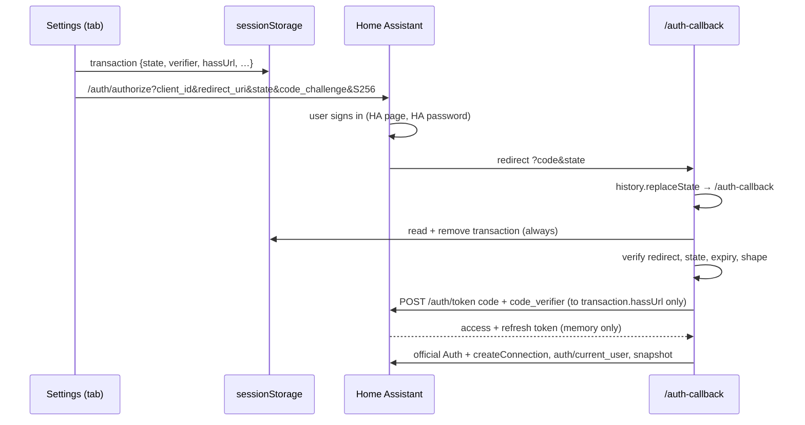

# D02 — Browser sign-in contract (C01)

Decided on 2026-10-22 by agent C for the [parallel wave](../handoff/parallel/C-web-auth.md), on top of `0733657`. C01 added this contract, a bounded prototype under `src/services/auth/` and a public fixture, without runtime change. **C02 is implemented (in memory only)**, see [C02 status](#c02-status-in-memory-sign-in). The integrator reviewed C01/C02 and accepted section 5 as the M01 extension ([power-enrollment amendment](power-enrollment.md), `5b26bed` on `work/acceptance`); **C03 is implemented**, see [C03 status](#c03-status-remembered-sign-in-and-user-bound-grants). The manual token path, the native SecureStore path, the demo and the `.local` development loader keep their behavior.

## Verified facts

Every claim below was checked on 2026-10-22 against source or a disposable instance, not inferred from current documentation.

| Subject | Fact | Source |
| --- | --- | --- |
| PKCE server | `POST /auth/login_flow` accepts `code_challenge` (43 base64url chars) with `code_challenge_method` **S256 only**; `plain` and a method without challenge are 400. `/auth/token` requires and checks the verifier for a PKCE code, and **rejects a verifier for a code without challenge**. | HA core `2026.10.0` and `2026.10.1` (`components/auth/login_flow.py`, `components/auth/__init__.py`); `2026.9.0` has no PKCE |
| PKCE frontend | The authorize page (frontend `20260930.3`) forwards `code_challenge`/`code_challenge_method` to the login flow, then redirects with `document.location.assign(redirect_uri + "?code=…&state=…")`, plus `&storeToken=true` only for HA's own "keep me logged in". | Bundle `authorize.*.js`; real page driven with Playwright, see Proof |
| Codes | Bound to `(client_id, code)`, **popped before any verifier check** (a failed exchange burns the code), 10-minute lifetime. | `_create_auth_code_store`, conformance run |
| Redirect | Accepted without fetching anything when the redirect has the client id's scheme and host:port; otherwise HA fetches the client id page for `rel="redirect_uri"` links. | `indieauth.verify_redirect_uri` |
| Refresh | Same `client_id` required; the response contains **no new refresh token** (no rotation). Unused refresh tokens expire after 90 days. Access tokens are per-second JWTs (default 1800 s): two refreshes in one second may return the same value. | `TokenView`, [auth API docs](https://contributors.home-assistant.io/core/internals/auth-api/), conformance run |
| Revocation | `POST /auth/revoke` answers 200 for any token and also ends that token's access tokens and sockets. | `RevokeTokenView`, conformance run |
| CORS | `/auth/token`, `/auth/revoke` and the well-known metadata echo any `Origin`; `/auth/login_flow` refuses cross-origin preflight (403). | `cors_allowed = True`, disposable instance |
| Identity | WebSocket `auth/current_user` returns the user id of the token; the installed client exposes it as `getUser(connection)`. | `websocket_current_user`, prototype probe |
| Installed client 9.7.1 | `getAuth()` puts `base64(JSON{hassUrl, clientId})` in `state` (no nonce), sends **no PKCE**, and on callback posts the code to `state.hassUrl` unless `limitHassInstance`. `saveTokens` returns `void`. `Auth` refreshes with FormData; 400/403 become `ERR_INVALID_AUTH`, other failures a plain error (retried by `createSocket`). An HTTPS page refuses an `http:` HA except `localhost` (`ERR_INVALID_HTTPS_TO_HTTP`). `tokenRequest` is not exported. | `node_modules/home-assistant-js-websocket/dist/auth.js`, `socket.js` |

Maurice's minimum supported version is 2026.10 (`config/homeAssistant.ts`), so PKCE is always available on a supported server.

## 1. Flow

Maurice does **not** use `getAuth()`. It owns only the authorization transaction and the code exchange; everything after the exchange uses the official `Auth` class and `createConnection`, including refresh and the WebSocket protocol. No dependency change.

`client_id` is the app origin with a trailing slash (`https://maurice.example/`), `redirect_uri` is `<origin>/auth-callback`; both have the same host, so HA validates the redirect without fetching anything. The authorize page shows that client id to the user.

## 2. Origins

The HA URL is normalized with the existing `normalizeUrl` rule and keeps the explicit trusted-network confirmation for `http:`. `browserAuthCompatibility` decides before any redirect; a blocked pair shows help and leaves the manual token form available. No proxy, tunnel or relaxed check is added.

| App origin | Home Assistant | Result | Reason / evidence |
| --- | --- | --- | --- |
| `http://localhost` / `127.0.0.1` (development) | `http:` LAN or loopback, trust confirmed | **Supported** | Loopback is a secure context; tests and the disposable-HA probes use this pair |
| `http://localhost` | `https:` | Supported if the browser trusts the certificate | By construction; not run against a real certificate |
| `https:` hosted | `https:` | Supported | Chrome may ask for local-network access when HA resolves to a private address; refusal surfaces as a network error with help. Not run in C01 |
| `https:` hosted | `http:` (any host, including loopback) | **Blocked: `mixed_content`** | Token fetch and `ws://` are mixed content; one rule, no loopback exception |
| `http:` LAN address (e.g. `http://192.168.1.10:8081`) | any | **Blocked: `insecure_app`** | No Web Crypto (PKCE) outside a secure context, and a refresh token kept on a cleartext origin is exposed to injected script |
| any | HA < 2026.10 | Rejected after sign-in | Older servers ignore PKCE; the existing version check refuses the session, and C02 then revokes the refresh token it just received |

`/auth-callback` must load directly. The Expo development server does this; a static web export needs a single-page fallback for that path (hosting requirement for A, see Requests).

## 3. Transaction

`beginTransaction` (prototype) creates one pending attempt per tab in `sessionStorage` key `maurice.auth.transaction.v1`:

- `state` and `codeVerifier`: 32 bytes from `crypto.getRandomValues` each, base64url (43 chars); challenge `BASE64URL(SHA-256(verifier))` via `crypto.subtle`. The verifier never appears in a URL.
- Expected `hassUrl`, `clientId`, `redirectUri`, `allowInsecureHttp`, validated `returnTo`, `remember` (Maurice's own opt-in, C03), `createdAt`, `expiresAt` = 10 minutes, matching HA's code lifetime. **No access or refresh token is ever written here.**
- A new attempt overwrites the previous one, so an older callback no longer matches.

`consumeCallback` reads **and removes** the transaction before inspecting anything, so every callback, valid or not, consumes it. It then requires, in order: a well-formed stored record (exact field set, current app origin, compatible pair, internal `returnTo`), the exact redirect URI, exactly one `code` (bounded, unreserved characters) and one `state`, no `error`, a constant-time state match and an unexpired, not-future transaction. Rejections are `no_transaction`, `corrupt_transaction`, `wrong_redirect`, `malformed`, `state_mismatch` and `expired`; none carries the code. Only a verified result may reach `exchangeAuthorizationCode`, which posts to `transaction.hassUrl` — never to an instance named by the callback. The exchange runs once: no retry, whatever the failure, because HA has already consumed the code. A forged callback delivered into a tab burns the pending attempt (the user signs in again); it cannot log the tab into another account, which the injected-code test covers.

`exchangeAuthorizationCode` sends `application/x-www-form-urlencoded` with `credentials: "omit"`, `cache: "no-store"`, `redirect: "error"` and a 10 s deadline including the body read. It validates the response (Bearer, bounded printable tokens, finite positive lifetime) and returns the official `AuthData` shape, or `rejected` (`invalid_grant`, `invalid_request`, `access_denied`, `server_error`, `unexpected_response`) / `unreachable`. Messages never include response text. `revokeRefreshToken` reports `revoked` only on HTTP 200, otherwise `unconfirmed`.

HA's own `storeToken=true` is ignored: it is HA's frontend preference, not consent to persistence in Maurice.

## 4. Callback route and return

`app/auth-callback.tsx` reads the address synchronously on mount and replaces the history entry with `/auth-callback` before any await. Expo Router then writes its initial address back once the root navigator mounts (it runs after the screen's effects), so the screen also clears `code`, `state` and `storeToken` through its own `navigation.setParams`; all writes are `replaceState`, so no history entry keeps them. It never logs or renders the parameters, consumes the transaction, exchanges, connects, then `router.replace(returnTo)`. `router.*` cannot be used before the root navigator is ready ("Attempted to navigate before mounting the Root Layout"), even when `useRootNavigationState()` already has a key. A failed callback shows a short reason and a **Sign in again** action, never an automatic redirect, so no loop. Cross-origin requests from that page only see the origin under the default referrer policy. Registering a header option for the route in `app/_layout.tsx` belongs to B/the integrator; Expo Router serves the file without it.

`internalDestination` (prototype) accepts only a same-origin string path ≤ 512 characters whose first segment is a known route (`""`, `settings`, `entities`, `house`, `house-links`, `house-place`, `device`, `appliance`, `diagnostics`), rejects `//`, backslashes, control characters and dot segments (raw or encoded), keeps the query opaque and drops the fragment; anything else becomes `/`. `auth-callback` is never a destination. The query is not interpreted, so the future panel syntax of B passes through unchanged. A test fails if an allowed segment has no route file.

## 5. Identity and power permissions

The profile stays `ha:<normalized origin>`, so plan, favorites, placements and preferences are shared by every sign-in to the same origin, as with the manual token. Power grants (preferences schema 3) are bound to that profile, not to an HA user. Browser sign-in makes the HA user explicit, so this contract adds a principal rule:

- After every browser sign-in, the backend calls `auth/current_user` on the new connection **before** the first synchronization; failure is a terminal authentication error. The principal is `base64url(SHA-256(hassUrl + "\n" + userId))`; the raw user id is not stored.
- **C02 (memory only, superseded by C03): power control was unavailable in a browser-sign-in session.** `SessionManager` refuses `setSwitch` (`not_authorized`) and `allowSwitch` while the principal rule is not durable. Stored grants are neither used nor created, and are not modified by signing in; **Revoke power control** keeps working because a revocation is always safe. Plan and favorites work normally. Settings says so before sign-in, and a session notice (shown in Diagnostics) repeats it. Sign-in alone never grants anything. Known transitional wording: the shared `SwitchControl` (not C-owned) answers a refused **Allow this device** with its generic "Permission could not be saved" message; C03 removes the restriction rather than this wording.
- **C03 (implemented, see C03 status):** a non-secret record `maurice.grantPrincipals.v1`, separate from the preferences schema, maps each web profile to the principal under which its grants were made. Grants are usable only when the current principal matches. An unknown previous principal (migration from manual sign-in) or a different one revokes that profile's grants through the existing revocation path (targets invalidated first), keeps plan and favorites, records the new principal and shows a notice. Commands stay disabled until that write succeeds. The rule then also applies to the manual token on web (the same `auth/current_user` check), so a later manual session cannot inherit another user's grants. Native is unchanged.

## 6. Scope

The new flow is web-only. The manual token form stays available and in memory on web; native keeps its journal and SecureStore; the demo is unchanged; `.local` loading stays development-only, explicit and in memory. `session.connect({url, token, allowInsecureHttp})` keeps its meaning; browser sign-in is an additional input type carrying an in-memory authorization object, never a placeholder token. No OAuth value enters the cockpit store, `commandStore`, diagnostics, scene payloads, preferences, the credentials journal, URLs or logs. The `Auth` instance is held by `SessionManager`/backend only and is never serialized into Zustand. The camera request header (future I01) reads the current access token at request time.

## Storage contract (C03)

- **Default: memory.** Reloading requires signing in again. A Settings checkbox **Remember this browser**, unchecked by default and chosen before the redirect (`transaction.remember`), allows persisting the **OAuth refresh token only**, never the manually entered long-lived token, and only after sign-in, identity check and a first fresh snapshot succeed.
- Store: IndexedDB database `maurice-auth`, version 1, store `sessions` keyed by profile id: `{version, profileId, hassUrl, clientId, allowInsecureHttp, principal, refreshToken, rememberedAt}`, plus a per-profile `signOutSeq` (store `signOuts`, `{profileId, seq}`). The access token stays in memory: on restore, `Auth` is created expired and `createSocket` refreshes before authenticating (verified with the real server). Because HA does not rotate refresh tokens, **refresh never writes storage**: `saveTokens` only updates memory, which removes the asynchronous `saveTokens: void` problem by design.
- Threat statement for the UI: the record is readable by any script running on this app origin and by anyone using this browser profile. It is not SecureStore and no same-origin encryption is claimed.
- Failure or quota: the session continues in memory and Settings says remembering failed; no fictitious success. A corrupt or unknown-version record is deleted and reported without its contents.
- **Sign out** (browser session): invalidate targets and tear down first, increment `signOutSeq` and delete the record in one IndexedDB transaction, broadcast, then try revocation; `unconfirmed` is reported with how to remove the token in HA (Profile → Security), and the token is not kept for retries. **Stop remembering**: deletes the record only; the current tab stays signed in until reload. **Forget this Home Assistant** keeps its meaning (connection removed, preferences kept) and additionally signs out a browser session.
- Tabs: a `BroadcastChannel("maurice-auth")` message `{type: "signed-out", profileId}` carries no token (the sequence is not needed by receivers; C03 dropped it). Other tabs of that profile tear down their browser session, invalidate prepared targets and revoke their own in-memory token. Each tab keeps its own `Auth` and socket. Before writing, a tab checks inside the same IndexedDB transaction that `signOutSeq` still equals the value read when its sign-in started, so a late write after a sign-out elsewhere cannot recreate the secret. Concurrent refreshes in one tab share one in-flight request; across tabs they are independent and harmless because refresh tokens do not rotate.
- Errors: invalid/revoked refresh (`ERR_INVALID_AUTH`) deletes the record, keeps preferences and grants, and asks for an explicit new sign-in; a network error keeps the record and uses the backend's existing bounded retry. No retry loop in the screen or the adapter.

## Proposed internal API and files

| Ticket | Files (C-owned unless noted) | Interface |
| --- | --- | --- |
| C01 (this commit) | `src/services/auth/{authTransaction,compatibility,returnTo,tokenEndpoint}.ts`, tests, `scripts/lib/web-auth-fixture.mjs`, `scripts/__tests__/web-auth-fixture.test.mjs` | Pure modules with injected storage, crypto, clock and fetch |
| C02 | `services/auth/browserAuth.web.ts` + neutral `browserAuth.ts`, `services/auth/authorization.ts`, `app/auth-callback.tsx`, `SessionManager`, `HomeAssistantBackend`, `SettingsScreen`, fixture WebSocket snapshot and authorize page | `browserAuth.begin(...)`, `browserAuth.complete(href)`; `session.connect({url, allowInsecureHttp, authorization})` alongside the token form; backend option for an `Auth` source and principal check |
| C03 (built) | `services/auth/{authStore,authChannel,principals,webAuth}.ts`, `services/auth/webAuthRuntime.web.ts` + native `webAuthRuntime.ts`, `SessionManager`, `HomeAssistantBackend`, Settings | `bootstrap()` restores a remembered session; `session.signOut()`, `session.stopRemembering()`, `session.browserSession` + `subscribeBrowser`; see C03 status |
| C04 | `scripts/check-web-auth.mjs`, `docs/stage0/browser-auth-validation.md` | Browser recette with two contexts and a profile restart |

`core/types.ts` needs no change for C02: an invalid sign-in reuses `auth_invalid`. `useCockpit`, the command facade, `commandStore` and `useSwitchCommand` stay as they are.

## Proof (C01)

| Check | Command | Result on 2026-10-22 |
| --- | --- | --- |
| Prototype unit and integration | `npx jest src/services/auth` | 80 tests: state/PKCE, single use, expiry, malformed and foreign callbacks, corrupt storage, return destinations, origin pairs, exchange/revocation results, end-to-end over HTTP against the fixture including the official `Auth` refresh and an injected attacker code |
| Fixture conformance | `node --test scripts/__tests__/web-auth-fixture.test.mjs` | 4 tests; the 12-step conformance sequence passes against the public fixture |
| Same sequence, real server | `MAURICE_PROBE_USERNAME=… MAURICE_PROBE_PASSWORD=… node scripts/lib/web-auth-fixture.mjs --conformance http://127.0.0.1:<port>` against a **disposable** `ghcr.io/home-assistant/home-assistant:2026.10.1` container (empty config, public probe user, loopback ephemeral port) | 12/12 pass. It found one wrong fixture assumption (refreshed access tokens may be identical), now corrected; failure messages are redacted |
| Real authorize page | Playwright against the same disposable instance, app callback intercepted (one-off script, to become a C04 mode) | Callback `/auth-callback` with exactly `code` and `state`, state unchanged; PKCE code without verifier → 400 "Code verifier required", with verifier → 200; code without challenge plus verifier → 400 "Code verifier provided but no code challenge was present" |
| Prototype + official client, real server | One-off `tsx` probe of `beginTransaction` → login flow → `consumeCallback` → `exchangeAuthorizationCode` → expired `Auth` → `createConnection` → `getUser` → `revokeRefreshToken` | Repeat callback `no_transaction`; code replay `invalid_request`; one refresh before the socket; `2026.10.1`; principal obtained; revocation `revoked`; later refresh `ERR_INVALID_AUTH` |

No household instance, token, account or device was used. The container and its configuration were deleted after the run. Mutation checks confirmed that removing the single-use removal or the state comparison, or weakening redaction, makes the tests fail.

Not proven by C01: a hosted HTTPS deployment, Chrome's local-network prompt, a real certificate, the browser UI, persistence and multiple tabs. Those belong to C02–C04.

## C02 status (in-memory sign-in)

Implemented on 2026-10-22 on `work/web-auth`. Built interfaces, where they refine the proposal above:

- `services/auth/signIn.ts`: `createBrowserSignIn(env)` with the `window` parts injected (`compatibility`, `begin`, `complete`); `browserAuth.web.ts` binds it lazily to `window`, `browserAuth.ts` is the native stub (`unsupported`). Consumers import `services/auth/browserAuth`.
- `services/auth/authorization.ts`: `BrowserAuthorization` wraps the official `Auth` with one refresh in flight. `close()` drops both tokens from memory first, then revokes once and returns `revoked`/`unconfirmed`; afterwards refresh rejects with `ERR_INVALID_AUTH` and a late refresh cannot restore a token. `BrowserSignIn = {url, allowInsecureHttp, authorization}`.
- `SessionManager.connect(BrowserSignIn)` beside the unchanged token and demo inputs; same `ha:<origin>` profile, nothing written to the credentials journal. `signOut()` tears down and invalidates targets before revocation; `browserSession` tells Settings which action to offer. Replacing a browser session (another connect), Forget, and terminal `auth_invalid`/`ha_version_unsupported` errors end and revoke it; Retry after Disconnect reuses it; an ended sign-in cannot reconnect.
- `HomeAssistantBackend` accepts a `BrowserSignIn`: `createConnection` with that `Auth`, `auth/current_user` before the first synchronization (`verifiedUserId`), HA error or missing id → terminal `auth_invalid`, stall → retried `sync_timeout`, disconnect → the client's reconnect. The camera header reads the current access token. Token mode is unchanged.
- **Memory hygiene:** a memory sign-in has no other owner than its page, so on `pagehide` (not for the back-forward cache) the page sends a revocation beacon for it. Without this, each reload would leave a valid refresh token in HA's user profile. C03 must not register remembered sessions for this beacon.
- Settings (web): **Sign in with Home Assistant** after the address and the trust switch, help per blocked pair, **Or use an access token** for the unchanged form, **Sign out** instead of **Forget this Home Assistant** during a browser session, with the revocation result. Labels used by A's browser check are unchanged.

C02 evidence:

| Check | Result |
| --- | --- |
| `npx jest` (full) | All suites pass, including `services/auth`, backend, `SessionManager`, `AuthCallbackScreen` and `SettingsScreen` tests |
| Real backend and official client against the fixture (`session.integration.test.ts`, no mocks) | Ready with fresh observations and verified user; one refresh before the socket when expired; revoked → terminal `auth_invalid` without WebSocket authentication; `2026.9.0` → `ha_version_unsupported` without snapshot |
| Real Chrome (Playwright) against `expo start --web` on `localhost:8094` and the fixture, other origins aborted (one-off script, becomes C04) | PKCE parameters sent; landing on `/` without code/state; fixture observations shown; no fixture token in localStorage, sessionStorage, cookies or console; no IndexedDB; Back reaches the authorize page without a code; reload asks to connect again and the beacon revoked the token; replaying the captured callback is refused without a second exchange and leaves a clean address; **Sign out** revokes; no page error; no external request |

| `npm run check:ui` (A's public smoke) on the C02 working tree | Passed: 4 widths, desktop layout, and A's manual-token browser check unchanged (memory only, reload requires the token, preferences and exact grant survive, native Forget cancel/confirm), 0 page errors, 0 external requests, sample plan unchanged |

Not proven by C02: persistence and multiple tabs (C03), hosted HTTPS, a real HA instance in the browser flow (C01 already drove HA's real authorize page), and the integrated build.

## C03 status (remembered sign-in and user-bound grants)

Implemented on 2026-10-22 on `work/web-auth`, against the [M01 amendment](power-enrollment.md) (`5b26bed`). Native, the demo and the manual token form keep their behavior, except that **on web** the manual token now goes through the same user check.

**Modules.** `authStore.ts`: `parseRememberedSession` (exact fields, normalized origin, profile, client-id origin, 43-character principal, bounded token) and `createIndexedDbAuthStore(indexedDB)` with `latest`, `signOutSeq`, `remember(session, seq)`, `signOut(profileId)` and `remove(profileId, token?)`. Each call is one transaction over `sessions` and `signOuts`, with a 5 s deadline. Error messages never contain record values. `authChannel.ts`: validated tab messages, a no-op without `BroadcastChannel`. `principals.ts`: `principalFor` and `GrantPrincipals` (key `maurice.grantPrincipals.v1`, `{version: 1, principals}`, unreadable means unknown). `webAuth.ts` is the interface `SessionManager` receives; `webAuthRuntime.web.ts` binds it to IndexedDB, BroadcastChannel and the preferences' AsyncStorage, and the native `webAuthRuntime.ts` passes nothing.

**Remembering.** **Remember this browser** is an unchecked switch next to **Sign in with Home Assistant**, chosen before the redirect (`transaction.remember`). It sits with a threat statement: anyone using this browser profile, and any script on this origin, can use the sign-in; it is not like the phone's secure storage; not for a shared computer. `connect()` reads the profile's `signOutSeq` **before anything else**. The record is written only after the first `ready` status: the user check and the principal binding have run, and a fresh snapshot has arrived. A failed first synchronization writes nothing until the backend's own retry reaches ready. `remember` rewrites only if the sequence is unchanged, so a sign-out anywhere after the session started wins, including one during the write. Failure or a missing IndexedDB keeps the page signed in with the notice "This browser could not remember the sign-in. You stay signed in on this page only." A remembered sign-in replaced in this page by another connection is **released** (tokens dropped from memory, no revocation): the record still owns it. A new remembered sign-in for the same profile replaces the record and revokes the token it held. The pagehide beacon skips a sign-in while it is remembered, and applies again after **Stop remembering**.

**Restoring.** `bootstrap()` reads the newest valid record when there is no saved native connection. It creates the official `Auth` expired, with an empty access token: the client refreshes once before the socket, then the backend verifies the user and takes a fresh snapshot. A restored session whose user no longer has the principal it was remembered with is a terminal `auth_invalid`. A newer connection, such as a sign-in callback, wins over a slower restore. An unreadable or foreign record is deleted and reported ("could not be read and was removed"); unreadable storage is reported and a sign-in still works in memory.

**Ending.** **Sign out** tears down and invalidates targets, then increments `signOutSeq` and deletes the record in one transaction, then tells other tabs, then revokes. Other tabs holding a browser sign-in for that profile end it, invalidate their targets, revoke their own token and say "Signed out of Home Assistant in another tab." **Stop remembering this browser** deletes the record only: this page stays signed in until it closes, then the beacon revokes it. If the delete fails, the session stays remembered and Settings says so. **Forget this Home Assistant** also signs out a browser session and removes the profile's record (with the tab message). A terminal error on a remembered sign-in revokes it, deletes the record only if it still holds that token (a newer one from another tab survives), and asks for an explicit sign-in, with no retry loop. A network failure at launch keeps the record and shows the backend's own retrying status.

**Principal rule (web).** Every web Home Assistant session, browser sign-in **and** manual token, reads `auth/current_user` before its first synchronization: backend options `verifyUser` and `onUser`, the hook being awaited before the first sync. `SessionManager.bindPrincipal` hashes the user. When the stored principal differs or is unknown, it revokes **all** grants through the shared revocation path (targets and unsent work invalidated first), then writes the principal, then tells other tabs `{type: "principal-changed", profileId, principal}` (a non-secret hash). Power control (`setSwitch`, `allowSwitch`) stays refused until that write succeeds. A crash or a failed write in between leaves the grants revoked and the old or unknown principal, so the next session can only repeat an empty revocation. Notices name the cause: "…reset because a different Home Assistant user signed in" or "…because the Home Assistant user who allowed them is unknown"; nothing is said when there was nothing to reset. A tab bound to another user that receives the message, or that finds another principal stored when **Allow this device** is pressed, turns power control off and drops its in-memory grants, so it cannot write them back. Signing in, refreshing and signing out never create a grant. Settings now shows session notices, and C02's "Power control is not available with browser sign-in yet" is gone, so the transitional `SwitchControl` wording no longer appears in a browser session.

**Settings navigation.** After a successful **Connect** or **Explore demo home**, Settings keeps `router.replace("/")`. C03 had switched to `router.dismissTo("/")` (integrator item 6), but in the integrated tree that pops B's workspace stack to its index and drops the detail entry, so browser Back no longer reaches the detail it came from (`check:detail-panel` 19/21; 21/21 with `replace`). Reverted at the integrator's request, with a test asserting `replace`. The hidden second Home below is a pre-existing known issue, tracked by the integrator for a later redesign that keeps Back.

**Known limits.**

- Native keeps per-profile grants without a principal: another HA user's token entered on the same phone inherits that phone's grants for the same origin (accepted in the M01 amendment).
- Two tabs of **different** users on one profile: a preference write in the first tab that races the second tab's reset (before the message arrives) can restore the first user's grants on disk under the second user's principal. Messages and the check made when allowing a device narrow this to a race of a few milliseconds; it is not closed.
- A sign-in completed after a sign-out in another tab is a new sign-in: the sequence is read when the session starts (`connect`), not when the redirect began.
- A sign-in made **without** Remember leaves another remembered record of that profile in place, and a reload restores that record (and its user's principal rule applies).
- **Stop remembering** in one tab does not change other tabs restored from the same record. Once that page closes and revokes the token, they must sign in again at their next refresh.
- The empty `maurice-auth` database is created at the first start on web, even without opt-in. It holds no value until the user opts in.

C03 evidence (2026-10-22):

| Check | Result |
| --- | --- |
| `npx jest` (full) | 61 suites, 896 tests pass. New: `SessionManager.browser.test.ts` (31 scenarios mapped to the C03 acceptance table), store parsing, channel, principals, `BrowserAuthorization` remember/release, sign-in remember/restore, backend `verifyUser`/`onUser` |
| Real backend + official client against the fixture | Restore from a refresh token alone: one refresh, then ready as `fixture-user-alice`. Through `SessionManager`: Alice allows the fixture plug; Bob signs in, the grant is reset with the named notice, `setSwitch` is refused, 0 service calls |
| Mutations | Skipping the grant reset, ignoring a sign-out seen by the write, deleting any record on a terminal error, revoking a replaced remembered sign-in and skipping the principal check on Allow each make tests fail |
| Real Chrome (Playwright, disposable on-disk profile, `expo start --web` on `localhost:8094`, fixture, other origins aborted; script `.local/c03/browser-smoke.mjs`, to become C04) | Remember unchecked by default. Memory: no record, reload asks to sign in, token revoked. Opt-in: one record with exactly the documented fields, refresh token only, no token in web storage or cookies. Browser closed: token kept. Reopened: synced without sign-in (0 new codes, 1 refresh). Two tabs: **Sign out** in one signs out the other, deletes the record, `signOutSeq` 1, token revoked. **Stop remembering**: message, page still signed in, record gone, next load asks to sign in, token revoked by the beacon. Corrupt record: reported and deleted. Alice allows the plug; Bob signs in: reset notice, Bob must allow again. 0 service calls, no token or code in the console, 0 page errors, 0 external requests |
| C02 Chrome smoke, same server | All checks still pass (memory reload, Back, replay, Sign out) |
| `npm run check:ui` with A's `scripts/trial-ha-fixture.mjs` from `e4090d6` (answers `auth/current_user`; overlaid, not committed, restored) | Passed: 4 widths, desktop layout, `browserConnection` unchanged including `preferencesAndExactGrantSurviveReload`, 0 page errors, 0 external requests. Without `e4090d6`, the manual-token check would end in `auth_invalid`, since that fixture answers unknown commands with `null` (from the code, not run) |
| Android export, rerun with an isolated `TMPDIR` and `--clear` (Metro's default transform cache is shared between worktrees) | Builds. Settings' C03 texts are present, so the bundle is this tree; no other worktree path appears. No IndexedDB store, tab channel or transaction code (`maurice-auth`, `signOuts`, `maurice.auth.transaction` absent). The principal-rule code is present in `SessionManager` but inactive without `WebAuth`; the `auth-callback` route uses the native stub |
| typecheck, lint, format | Pass |

Not proven by C03: a hosted HTTPS deployment, a real HA instance in the browser flow with persistence, quota exhaustion in a real browser (covered by the failing-store unit tests), and the integrated candidate with B's route group.

## Requests to A (integrator)

1. Done: contract and C02 reviewed; review C03 status.
2. Done (`5b26bed`): M01 extension documented in `power-enrollment.md`. C02 and C03 must land in the same integrated candidate (C02's power restriction and its transitional wording only exist without C03).
3. Hosting: any static web export used for acceptance must serve the app at `/auth-callback` (single-page fallback).
4. Runners: `scripts/__tests__/web-auth-fixture.test.mjs` is already matched by `test:tooling`, and the Jest tests by the default `testMatch`; no `package.json` change is required. C04 will ask to wire `scripts/check-web-auth.mjs`.
5. Text consumed by A's browser check (`Your token stays in memory for this page only`) stays unchanged in C02 and C03 for the manual form.
6. `scripts/trial-ha-fixture.mjs` must answer `auth/current_user` (`e4090d6`) in the candidate that includes C03.

## Product choices (recommendations, not blockers)

- Labels: **Sign in with Home Assistant** (primary on web when compatible), **Use an access token instead** (existing form), **Remember this browser** (unchecked), **Sign out**, **Stop remembering this browser**.
- HA's authorize page shows its own "Keep me logged in" box; Settings states that it does not control Maurice's memory.
- Recommended default for a hosted deployment: HTTPS for both app and HA; plain-HTTP HA remains a localhost development case.
