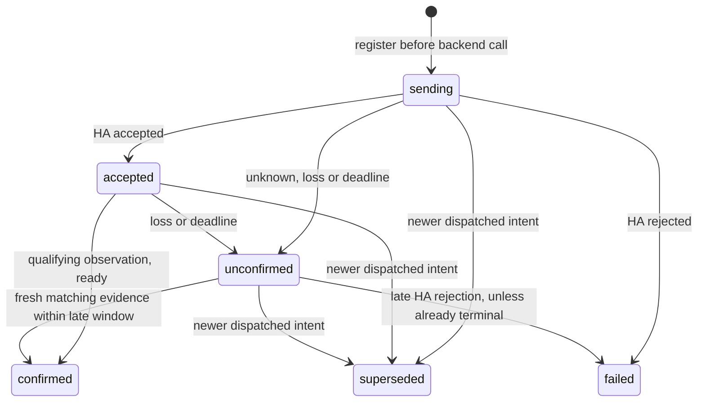

# Command outcomes — C02

Implemented in the working tree on 2026-10-16, on top of the [C01 facade](commands.md). This module tracks requests and observed outcomes; C07a now consumes it in the [scoped switch UI](switch-controls.md). C03 now implements [serialization, debounce and cancellation](command-scheduling.md); [C04 simulation](demo-commands.md) is implemented; C07a's switch UI is implemented with an explicit physical acceptance gate. No household device was actuated for this ticket.

## Dispatch and event ownership

`SessionManager` owns one `CommandTracker`. After C01 validation/no-op detection, it calls `begin` **before** invoking the backend. `started` now includes `commandId`; `started.result` remains only the HA acknowledgement. The manager forwards that acknowledgement to the tracker only if the backend/generation still matches. No code or raw service payload enters the tracker/store.

The manager forwards snapshots and status to the tracker before publishing them to the cockpit store. This order covers a backend publishing an observation synchronously inside `callService`, and the real HA backend publishing a replacement snapshot while still synchronizing, immediately before ready. Observation evidence is retained during synchronization; it cannot confirm an outcome until ready.

`services/runtime.ts` exports a read-only `commandStore` (`getState`, `getInitialState`, `subscribe`). Future React consumers can use Zustand's `useStore(commandStore, selector)`. `latestCommand` scopes lookup by profile and resolves aliases; `visibleCommand` hides a dismissed/superseded latest result without falling back to an older action. `session.dismissCommand(id)` hides an outcome without changing its status or freshness fence. Observed physical values remain exclusively in the cockpit store.

## Observation revisions and predicates

`ObservationRevisions` indexes the current full snapshot by canonical stable key. A local increasing sequence supplies per-entity revision comparisons; HA timestamps are compared for equality only, never ordered against the phone clock. State/attribute/report changes and a new session/epoch create fresh revisions. Deep-equal attribute copies, unrelated entity updates and registry-only display-name/room changes do not create fresh entity evidence. Older epochs are discarded. The map is bounded by current entities; a removed/reappearing entity gets a higher local revision.

Capture the baseline revision at dispatch. A baseline match or duplicate callback cannot confirm the command. A qualifying match after dispatch is retained even if another reading arrives before the acknowledgement; this is essential for transient `opening`. All C01 no-op and C02 confirmation checks share `predicates.ts`, using a code-free, explicitly projected desired intent, dispatch-time numeric step and temperature unit. A later larger step or a change of temperature unit cannot loosen confirmation.

Stable-key alias promotion preserves a binding if its entity ID is unchanged. An authoritative missing, renamed, recreated or ambiguous entity permanently invalidates that command's binding; a later similarly named entity or return of the old ID cannot inherit its outcome. Availability/disabled status and the desired-state predicate remain qualified.

## Lifecycle and wording

A match received before acknowledgement remains evidence while the record is sending. Acceptance rechecks it. A rejection becomes failed, even if a match was observed first; the wording says HA reported an error and a physical effect may still have occurred. Confirmed/failed/superseded outcomes are terminal: a late/duplicate acknowledgement cannot downgrade them. A late accepted result alone never changes unconfirmed back to accepted.

Unknown results require fresh reconciliation evidence. Loss/error/idle qualifies nonterminal commands as unconfirmed and discards pre-loss evidence. Healthy synchronizing alone retains sent tracking. An unconfirmed command can confirm from a fresh observation even before an outstanding service promise settles; its later result cannot overwrite that confirmed outcome.

`commandMessage` supplies safe wording for future controls. An open service accepted by HA says **“Open requested — HA accepted”** and does not claim the door opened. It confirms only an observed open/opening; absent such a reading, the lock deadline applies. No verified household integration has yet established a separate acceptance-only open policy. An unconfirmed unlock/open asks the user to check the door and offers no automatic retry. Reconciliation says **“Home Assistant now shows …”**, without assigning causality. A later contradictory reading during synchronization invalidates that reconciliation evidence; a transient opening remains an observed event, worded **“Home Assistant reported Open or opening”**. `assumed_state: true` is retained in confirmation evidence and explicitly qualified.

## Deadlines, reconnect and bounded retention

`src/constants/config.ts` owns lock **45 s**, climate **30 s**, fan/switch **15 s**, a late window of **5 minutes after the deadline**, and **100 records**. One timer watches the next pending deadline. Every event also reconciles elapsed deadlines; foreground does so before backend recovery starts, because background timers may never have fired. The late window ends at `deadline + 5 minutes` (exclusive), regardless of acknowledgement timing.

Transport reconnect and same-origin explicit Retry preserve code-free sent outcomes. Old backend acknowledgements/callbacks remain invalid, while the new backend's authoritative snapshot can reconcile the old outcome for the same profile, key and dispatch entity ID. The new observation gets a higher revision even if the old/new session epoch counters restart. A different profile or Forget clears tracking; nothing is persisted or restored after process restart. Intentional disconnect retains qualified cached outcomes and cancels timers until a new scope starts.

A newer **dispatched** intent supersedes older nonterminal tracking for that entity; old callbacks can no longer confirm it. C03 decides whether a second action is allowed before it reaches this point and supersedes older continuous outcomes as soon as a valid latest intent enters its quiet period. The tracker alone does not enforce in-flight exclusion or queuing.

Terminal/superseded history can be evicted at capacity. Unconfirmed outcomes remain tracked through the late window; an expired unconfirmed lock also remains protected until a fresh observation exists. If no entry can be safely evicted, validation returns `refused(tracking_capacity)` before calling the backend. A result dismissed manually or hidden by a newer observation revision is retained internally, so dismissal never satisfies lock freshness. C03 uses `latest` and `hasFreshObservation`, not the visible-card selector, for lock recovery. Same-entity supersession remains an internal tracker primitive behind that policy.

Records and nested desired/confirmation objects are immutable. Explicit desired-intent projection strips optional lock code and extra input fields; raw attributes, HA error payloads, tokens and headers never enter the command store, preferences, diagnostics or scene props.

## Verification — 2026-10-16

- **399 tests / 27 suites** pass. C02 adds 51 tracker/revision/predicate cases and 6 manager integration cases, retaining the C01 and UI/spatial regressions. Cases cover both event orders, transient open, attribute-only targets, baseline/duplicate/obsolete events, step/unit capture, deadlines with suspended timers, late-window boundaries, terminal precedence, assumed wording, same/different profile replacement, alias promotion, identity invalidation, dismissal freshness and bounded capacity.
- TypeScript, ESLint and configured Prettier checks pass.
- `npm run proof:protocol` passes over actual loopback WebSockets using the pinned HA client. The existing 12 exact mappings remain checked; two additional fake calls prove update-before-ack and reconnect with a replacement snapshot received before ready. **14 fake services total; no configured household HA endpoint/token is used.**
- Public-sample web and Android Hermes/DOM exports pass and the original ignored local plan is restored afterward. These are bundles, not an installed binary or a new phone/hardware acceptance result. No UI control, native dependency or actual-device action was added. S02's remaining Pixel gate stays in its own ledger.

This checkpoint is uncommitted and retains earlier working-tree changes.

## Extension after C03

C03 now applies the actuator policy before validation/no-op, manages pending/in-flight work and invalidates prepared targets on every readiness/background interruption. See [scheduling, verification and C04 handoff](command-scheduling.md). Keep this tracker's event ordering, code-free projection, local revisions, deadline reconciliation and same-profile late evidence intact when extending the implemented [demo services](demo-commands.md) and future UI. A superseded outcome cannot reappear from an old acknowledgement; physical observations remain authoritative.
