# Command scheduling — C03

Implemented in the working tree on 2026-10-16, after the [semantic facade](commands.md) and [outcome tracker](command-outcomes.md). Command policy now covers per-entity serialization, continuous-target debounce, lock freshness, immediate cancellation and no replay. [C04 simulation](demo-commands.md) and [C07a switch UI](switch-controls.md) now use this path; real HS103 activation remains acceptance-gated. No household device was actuated.

## Ownership and dispatch order

`SessionManager` remains the only caller of the private backend. It owns a `CommandScheduler` for unsent intents/in-flight slots and the existing `CommandTracker` for sent outcomes. The backend still owns connection recovery; the scheduler never reconnects or retries a service.

```mermaid
flowchart LR
  UI[Future native control] --> Target[Capture target and check current scope]
  Target --> Policy[Busy / lock freshness guard]
  Policy --> Validate[Validate latest capability and value]
  Validate --> Immediate[Lock, binary, mode or preset]
  Validate --> Pending[Latest continuous target, 600 ms]
  Pending --> Available[Wait for prior entity service promise]
  Available --> Recheck[Revalidate target, readiness, unit and capability]
  Immediate --> Recheck
  Recheck --> Track[Register sending and baseline]
  Track --> Final[Check synchronous invalidation]
  Final --> Backend[One backend call]
  Backend --> Ack[Scoped acknowledgement and slot release]
  Ack --> Tracker[Observed outcome tracker]
```



The manager keeps current command readiness and snapshot references, updated **before** tracker/cockpit publication. A synchronous subscriber cannot use an old public ready/availability value during a transition. Deadline reconciliation is followed by another eligibility check before enqueue. The scheduler reserves an in-flight slot before sending-record subscribers run; the manager rechecks again after registration. If a synchronous subscriber invalidates an unsent dispatch, `cancelUnsent` removes that registration and no service is called.

Stable keys identify scheduling lanes. Alias promotion resolves both existing and incoming keys against the latest snapshot, preserving one lane for the same entity. Renames/recreation still fail C01 target validation. Backend replacement clears old lanes; a late promise release has to match the exact retained lane/flight object and cannot release a newer request's slot.

## Result contract for callers

Immediate actions keep `refused`, `no-op`, or `started` from C01/C02. Busy taps return a typed refusal (`in_flight`) without calling HA, creating a record or scheduling another tap. `fresh_observation_required` qualifies an uncertain lock; `capability_changed` qualifies an obsolete temperature unit/control context.

Continuous intents (`setClimateTarget`, `setFanPercentage`) additionally return:

```ts
{ kind: "queued", completion: Promise<DeferredResult> }
// DeferredResult = DispatchResult | { kind: "cancelled", reason }
// DispatchResult = refused | no-op | started
// started.result remains Promise<ServiceCallResult>, the HA acknowledgement.
```

`completion` resolves exactly once when the request is actually dispatched, becomes a no-op/refusal, or is cancelled. Cancellation reasons are `superseded`, `not_ready`, `background`, `session_changed`. A queued value has no command ID or sending record yet. Consumers should not display it as sent or treat cancellation as an HA error. Physical confirmation still comes from the outcome store.

## Per-entity policy

| Intent                                   | Implemented policy                                                                                                                                                                                                                                                     |
| ---------------------------------------- | ---------------------------------------------------------------------------------------------------------------------------------------------------------------------------------------------------------------------------------------------------------------------- |
| Lock locked/unlocked/open                | Refuse while an entity call is in flight or its latest lock result is sending/accepted. After unconfirmed, require `tracker.hasFreshObservation`, including when the result was dismissed.                                                                             |
| Climate target / fan percentage          | Keep one latest unsent intent; restart a 600 ms quiet period. Dispatch only when both the period and prior service promise have completed. Other entities remain independent.                                                                                          |
| HVAC mode / fan on-off / preset / switch | One in-flight entity call. Additional taps are refused, including taps that would otherwise be no-ops. A valid immediate action cancels an older unsent continuous target for that entity, so an already-off action cannot be undone by an old pending fan percentage. |

These guards run before no-op detection. `sending`/`accepted`/`confirmed` record status alone cannot release a service slot: a qualifying observation can arrive before a late promise result. Locks additionally wait for their observed outcome/freshness condition. Dismissal changes visibility only.

A valid latest continuous intent immediately supersedes/hides the older target outcome while its own dispatch is pending. Already-terminal confirmed/failed records keep terminal status and are hidden. Older callbacks cannot bring their outcome back. Cancelled unsent work stays cancelled; independently sent, unsuperseded commands retain C02 tracking/deadlines.

No-op applies when the latest observation satisfies a request and no preceding unsettled call can overwrite it. If the user returns a slider to its observed baseline while an earlier different target is in flight/accepted/unconfirmed, the latest value is retained as an explicit compensating intent. It is dispatched once after serialization even if the baseline still matches at that moment. Dropping that value as a no-op could let the older call apply afterward and win. A superseding unsent value with no earlier sent call can cancel to a genuine no-op with no service sent.

Raw requested numbers are copied into the code-free pending intent and normalized again at dispatch. A changed step is applied to the original requested value, rather than rounding a value already quantized under old metadata. A changed temperature unit refuses the request. Limits, modes, supported fields, availability and stable-key→same-ID binding are revalidated by C01.

## Cancellation, lifetime and secrets

Every manager-issued target is bound to a private eligibility generation in addition to backend/profile/session/identity. Any non-ready status, background transition or teardown invalidates prepared targets. Returning to ready does not revive a pending dialog; the user must review/capture a new action. C05 still owns clearing optional code from its future UI on dismissal/background/submit.

Non-ready/background events cancel all unsent work **at the event**, including values waiting behind a service, rather than waiting for timer expiry. Foreground recovery keeps controls gated while C02 reconciles absolute deadlines and the backend synchronizes. Resuming/reconnecting creates no command. There is no command persistence, replay log or automatic actuator retry.

Background/loss retains actual in-flight slots until their promises settle. Backend/profile replacement cancels pending work and detaches old slots so they cannot block or release a new backend's requests. Unsent queues never survive these boundaries. Same-profile C02 late outcome reconciliation remains available for already-sent commands.

The scheduler accepts only the two continuous forms and explicitly copies permitted fields. Lock/code intents are never queued. No raw HA attributes, service JSON, token, header, code or credential enters queue metadata, observable stores, diagnostics, preferences or scene props. Up to **100 lanes** may be active/pending; excess work is refused without evicting live requests. One timer belongs to each pending quiet period; waiting after that period uses promise release, with no polling/retry timer.

## Verification — 2026-10-16

- **442 tests / 28 suites** pass. C03 adds 38 manager cases and 5 scheduler cases. Coverage includes rapid coalescing, both debounce/promise orderings, entity independence, baseline compensation, immediate-action cancellation, lock guards/freshness after dismissal, all non-ready statuses, background, same/different-profile replacement, obsolete promise settlement, changed identity/capability/unit/limits/step, alias promotion, immutable input projection, bounded capacity and synchronous publication invalidation.
- TypeScript, ESLint and configured Prettier checks pass; existing C01/C02 and UI/spatial regressions remain passing.
- `npm run proof:protocol` passes with the official client over disposable loopback servers. The C01/C02 phase retains 14 fake calls. `scripts/prove-command-policy.ts` exercises the actual manager/facade against two fixture origins: accepted unlock + socket loss + reconnect sends one unlock total; a pending value is cancelled; rapid fan values coalesce, later fan values serialize behind a held acknowledgement while climate progresses; changed capabilities and profile cancel/refuse pending work. **18 fake calls total**, without configured HA or household credentials. Proof profiles use the public sample plan and in-memory storage.
- Public-sample web and Android Hermes/DOM exports pass; the ignored local plan is restored afterward. These are bundles, not a new APK or phone/physical-device acceptance. No control UI, native dependency or real-device action was added. S02's remaining Pixel gate remains separate.

This checkpoint is uncommitted and preserves the earlier working tree.

## C04 handoff — delivered

C04 now implements the closed simulated service whitelist, authoritative demo state, independent deterministic acknowledgement/effect timing, and acceptance through the actual manager/facade/scheduler. Existing C01–C03 policy is unchanged. See [C04 architecture, verification and C07a handoff](demo-commands.md) for the current contract; the 442-test checkpoint above remains C03's historical evidence.

C07a's [switch UI](switch-controls.md) is implemented, with real HS103 activation gated. C07a owns the first Kasa lamp UI and its authorized physical acceptance; C05/C06/C07b retain separate verified-hardware/confirmation requirements. S02 Pixel acceptance remains pending in its own ledger.
