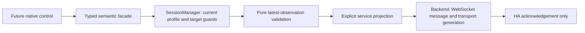

# Semantic commands — C01 facade

Implemented in the working tree on 2026-10-16. C01 provides validation and one dispatch, with a separate HA acknowledgement. C02 now adds [observation revisions and outcome tracking](command-outcomes.md). C07a now adds [scoped switch UI](switch-controls.md); other actuators remain read-only. C03 adds [scheduling, cancellation and no replay](command-scheduling.md). C04 now implements [offline simulated commands](demo-commands.md); real HS103 activation remains acceptance-gated. No household service was called to validate C01.

## Ownership and public API

`services/runtime.ts` exports `commands = session.commands`. Its `CommandFacade` exposes `capture`, `setLockState`, `setClimateTarget`, `setHvacMode`, `setFanOn`, `setFanPercentage`, `setFanPreset`, and `setSwitch`. There is no generic service/connection API on that object. `SessionManager.backend` stays private.



`commands.setSwitch(key, true)` captures the current target and dispatches synchronously. Methods accept either a stable key or a previously captured `CommandTarget`. Future confirmation dialogs must capture **before opening**, keep that exact object, and pass it to the semantic method after confirmation. Recapturing the key after confirmation would authorize the new target and defeat the identity check.

```ts
const captured = commands.capture(key);
if (captured.kind === "refused") return showReason(captured.message);
// Future C05 UI: collect deliberate confirmation and optional transient code.
// On confirmation, use captured.target, never just the original key:
const result = commands.setLockState(captured.target, "unlocked", code);
// Clear code in the UI immediately; never store it with a result or observation.
```

This is an integration example, not a control enabled in C01. `CommandTarget` is frozen and contains profile ID, stable entity key, resolved entity ID and snapshot session ID. A manager-owned `WeakMap` binds the exact object to its backend, generation, eligibility lifetime and temperature unit. C03 invalidates prepared targets on every readiness interruption/background transition. Copied, serialized, foreign or obsolete targets are refused, including replacement with another backend for the same HA origin. Identity aliases can promote a key while its resolved entity ID remains unchanged; renames or recreation require a new review.

Immediately before service dispatch, the manager checks foreground, `ready`, profile/backend/generation/session, unique stable-key resolution to the captured entity ID, observation availability, disabled status, and current capability/value validation. There is no asynchronous gap between these checks and the backend call. No display value is changed by a command.

## Results and validation

The facade returns synchronously:

| Result    | Meaning                                                                                                               |
| --------- | --------------------------------------------------------------------------------------------------------------------- |
| `refused` | Typed reason and fixed safe message; no backend call                                                                  |
| `no-op`   | Latest observation already satisfies the normalized request; no backend call                                          |
| `queued`  | C03 continuous target; `completion` resolves to a dispatch decision or typed cancellation; no sending record yet      |
| `started` | Captured target, C02 `commandId` and `result: Promise<ServiceCallResult>`; no secret or intent in the returned object |

The promise is an acknowledgement: `accepted`, a sanitized `rejected`, or `unknown` (`timeout`/`connection_lost`). It does not confirm physical success. An obsolete backend/transport response becomes `unknown(connection_lost)`, including a reconnect on the same official-client `Connection` object. The backend captures the connection and transport generation before awaiting; teardown cannot cause an unsafe dereference. Unexpected thrown errors are sanitized and never retried by the facade.

`validation.ts` accepts runtime data as `unknown` and projects only supported semantic values. `serviceCalls.ts` maps the validated union to the existing `ServiceCall` descriptor; the backend alone constructs the WebSocket envelope and target. Extra `service`, `entityId` or `data` fields on an incoming request cannot change that projection.

- No coercion of strings/null to numbers or booleans. Reject non-finite values, out-of-range values, inverted ranges, mixed target shapes, undeclared modes/presets and unsupported domains/actions. Unknown, unavailable, blank and disabled observations cannot become a no-op or dispatch.
- Climate values use HA's configured temperature unit, declared min/max/step, and the existing unit-specific defaults only for absent/null metadata. Malformed explicit limits/steps fail closed. Round to the nearest step anchored at `min`; cap at the last grid value below `max`. Check low≤high before rounding. For a capability declaring both target forms, `heat`/`cool` permits a single target and `heat_cool` permits a range; other modes are refused until a suitable mode is selected. No implicit HVAC-mode change and no `auto`→`heat_cool` substitution.
- Fan on and off require their respective flags; `onOff` means both directions exist. Percentages require the speed flag, remain in 0–100, snap to `percentage_step` and round to an integer for HA. Fractional steps such as 100/3 yield 33, 67 and 100. Presets require the preset flag and a declared matching preset; preset-only fans work.
- Lock/open requires `canOpen`; ordinary lock/unlock are base lock actions. An optional code must be a nonblank string, preserving leading zeroes. `code_format` is a Python regular expression and HA can supply a default code: this layer leaves format validation to HA rather than guessing JavaScript equivalence. C05 owns secure input, deliberate confirmation and clearing on dismissal/background/submit. Code exists only in the transient dispatch path, never the returned target/result, preferences, diagnostics or scene.
- No-op tests use the spec's observed-state predicates: exact binary/mode/preset state, open/opening for an open request, and numeric target attributes within half a step. Null/non-finite target attributes do not satisfy a request. No device truth is inferred from a service acknowledgement.

The HA service names, fields and fan flags were checked against the pinned official [fan constants](https://github.com/home-assistant/core/blob/2026.10.1/homeassistant/components/fan/const.py), [fan implementation](https://github.com/home-assistant/core/blob/2026.10.1/homeassistant/components/fan/__init__.py), and [lock code handling](https://github.com/home-assistant/core/blob/2026.10.1/homeassistant/components/lock/__init__.py). The [main specification](../superpowers/specs/2026-10-14-home-cockpit-design.md#command-contract) owns future command behavior; [C01's service table](../BACKLOG.md#c01--semantic-intent-facade-and-mapping) owns the supported mappings.

## C01 verification — 2026-10-16

- **342 tests / 26 suites** pass, including validation/service projection, current-session dispatch, delayed-dialog changes, alias promotion, missing/recreated/renamed entities, no-op, malformed values, code non-persistence, and obsolete results after stop/reconnect.
- TypeScript, ESLint and configured Prettier checks pass.
- `npm run proof:protocol` passes against a disposable loopback WebSocket server using the pinned official JS client. Its existing recovery cases still send zero services. An additional phase sends **12 fake service messages** and checks their exact envelope, entity target and service data. It cannot use the configured household HA endpoint or token.
- Public-sample web and Android Hermes/DOM exports pass. These are bundles, not a newly accepted APK. The original ignored local plan is restored after the export. No command UI or new native dependency was added; no phone command or physical-device test is claimed.

This checkpoint is uncommitted; earlier tickets' working-tree edits are retained. S02's remaining Pixel acceptance stays in its separate ledger.

## Extension after C02

C02 registers the sending record and baseline before `backend.callService`, shares the predicates and projects code-free desired targets; see [outcome architecture, verification and C03 handoff](command-outcomes.md). It retains evidence through the backend's snapshot-before-ready ordering and qualifies deadlines, loss and assumed state. `started.result` still exposes only the HA acknowledgement; future UI reads the separate transient command store.

C03 implements in-flight actuator guards, 600 ms continuous-target debounce, cancellation on loss of ready/background and no replay; see [scheduling and C04 handoff](command-scheduling.md). Validate a stored target at actual dispatch. Do not treat a captured target as a confirmation grant or infer eligibility from a dismissed result. C04 now exercises the same path with deterministic [simulated services](demo-commands.md); C07a's [switch UI](switch-controls.md) preserves this contract, with its own hardware gate.
