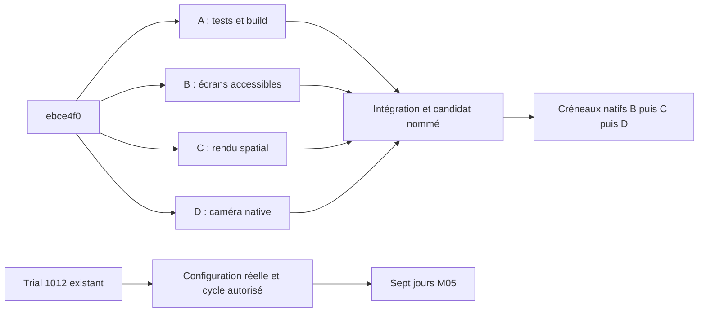

# Maurice — prochaine vague pour quatre agents Opus 5.5

Préparé le 16 novembre 2026 après reprise Flex et revue ciblée du dépôt. Ce document est un découpage, pas une autorisation de nouvelles fonctionnalités ni un rapport de livraison. Les quatre missions sont prêtes à transmettre à des sessions Opus 5.5 ; aucun agent Opus n'a été lancé par cette revue, ce modèle n'étant pas disponible dans son outil de délégation.

## Checkpoint et direction

- Base : `main` à `ebce4f06f730b6311a24634d40e7afc314fedf92`. Arbre propre avant cette documentation ; `HEAD...origin/main` = `0/0` sur la référence locale, sans fetch ni vérification de la CI distante.
- Lire `AGENTS.md`, `.opencode/skills/maurice-product/SKILL.md`, puis les sections pertinentes des ADR et questions ouvertes. La revue reste documentaire : aucun code, test, dépendance ou configuration modifié ; aucun commit.
- **Ne pas relancer B01–B04 ou C01–C04 de l'ancien handoff** : le panneau web et la connexion persistante existent déjà. Les cinq chantiers du 16 novembre sont intégrés aussi.
- Priorité produit : accepter la vraie maison et la lampe sur Trial 1012, puis observer sept jours. Le travail visuel autorisé continue en parallèle sur une autre source ; il ne doit pas remplacer ce binaire d'essai.
- La prochaine vague doit transformer les changements intégrés en preuves reproductibles et corriger les défauts reproduits. Pas de nouvelle famille de commandes, de nouvelle persistance ou de redesign supplémentaire.

## Reprise de l'historique, confrontée au code

| Source retrouvée | Ce qu'elle établit | Vérification actuelle / limite |
| --- | --- | --- |
| Flex `claude_code`, session `46188142-abf8-4345-a8f4-7c19a8c54130`, message 444 | Le propriétaire relance HA et autorise le travail parallèle pour améliorer le graphisme | Les commits de cette vague sont dans l'historique local ; ADR-17/18 et revue CEO §12–13 consignent l'intégration |
| Même session, messages 938 puis 1005 | Un premier durcissement caméra était insuffisant ; lecture native et purge à l'oubli ont ensuite été corrigées | `cameraImage.ts` lit `arrayBuffer()`, borne le délai et le cache ; `SessionManager.forget()` appelle `clearCameraCache`. Ne pas rouvrir les bugs comme s'ils étaient encore présents |
| Même session, messages 1071, 1132, 1276, 1353 | Rapports des agents audit, 2D, 3D et écrans | Rapports secondaires. Versions forcées dans `package.json`, `MODEL_FILL = 0.8`, FOV orbit 30°, composants et tests présents. Acceptation native encore distincte |
| Même session, message utilisateur 2001 | Choix « icone A / scene d'etat 3 » | Commit `ebce4f0`, références d'icône dans `app.json` et les écrans ; `assets/illustrations/all-quiet.png` présent mais sans consommateur trouvé |
| Même session, messages 2052 et 2094 | Icône intégrée ; Trial 1012 connecté à HA mais affichant encore Sample home ; reset non effectué | `profilePlan.ts` confirme le seed unique et le reset explicite. L'état du téléphone provient de l'historique, pas d'une nouvelle inspection. Ne pas reproduire les noms, comptes ou captures privés dans les preuves publiques |
| Flex `codex`, session `01a17918-295c-74f2-9e0b-495574547d39`, message 50, 26 octobre | Ancienne recommandation A/B/C | Recommandation obsolète : `DetailWorkspace.web.tsx` et `services/auth/authStore.ts` existent ; ne pas la suivre comme statut actuel |

Contradictions à conserver visibles :

1. Les tableaux récents de statut ont été corrigés, mais `docs/BACKLOG.md` §4 marque encore D02 « Not started » et le panneau différé ; `docs/README.md` conserve aussi une phrase « browser credentials stay in memory ». Le code contient la mémorisation opt-in. Une réconciliation documentaire est nécessaire.
2. L'ancien README parallèle reste présenté comme « prochains agents » alors que ses lots B/C sont intégrés. Il est désormais un historique, pas le plan d'exécution courant.
3. Flex msg 2052 affirme que `npm test` évite les worktrees. Actuellement `package.json` lance simplement `jest --runInBand` et `jest.config.js` n'exclut pas `.claude/`. La revue a reproduit la découverte de tests dans plusieurs anciens worktrees et leurs erreurs React. Ce résultat contaminé ne prouve pas une régression de `main`.
4. ADR-18 garde trois choix en attente : grille desktop sans titres de pièces, retrait des titres de cartes uniquement numériques, quadrillage métrique du plan. Les montrer avec captures publiques et demander une décision avant de les modifier ; ne pas présenter leur présence comme une approbation.
5. Les overrides majeurs `glob`, `minimatch`, `zod` sont intégrés et l'audit était rapporté vert. Cela ne prouve pas la compatibilité de tous les chemins de build Expo.

## Répartition parallèle

Les quatre agents partent du **même SHA explicite**, chacun dans un worktree indépendant, créé hors de l'arbre parcouru par Jest. Ne pas partir automatiquement d'une ancienne branche distante. Ne pas partager `node_modules`, caches de build, ports ni profil navigateur. Les tâches d'analyse et de correction peuvent avancer ensemble ; les recettes lourdes, builds et accès au téléphone sont réservés par le coordinateur.

| Agent | Lot | Priorité / taille | Résultat attendu | Écrivain exclusif |
| --- | --- | --- | --- | --- |
| A | Socle de validation et compatibilité des builds | P0 / M | Tests isolés, preuve CI au SHA exact, chaîne Expo exercée avec les versions intégrées | `jest.config.js`, `package*.json`, `.github/workflows/`, politique d'audit, scripts communs de build/preuve ; rapport A |
| B | Accessibilité et cohérence des écrans | P1 / M | Concept C utilisable aux grandes tailles de texte, au clavier et sur Android | `app/*_layout.tsx`, écrans hors plan/placement, `theme.ts`, `ui.tsx`, `AppShell*`, `MainTabBar`, cartes/contrôles de présentation, `desktop.css`, tests correspondants ; rapport B |
| C | Plan 2D et scène 3D sur appareil | P1 / M | Sélection, lisibilité, fallback et coût GPU mesurés sur un candidat identifié | `src/web/`, `CockpitSceneView`, `FloorPlanView`, `HomePlanOverview`, `home/HomeArchitecture`, `HousePlanScreen`, `PlacementScreen`, `spatial/planStyle.ts`, `scripts/check-spatial-ui.mjs`, tests correspondants ; rapport C |
| D | Transport et affichage caméra sur Android | P1 / M | Preuve native de lecture, isolation des redirections, délai et nettoyage | `services/cameraImage.ts`, `components/camera/`, `scripts/prove-camera.ts`, fixtures et tests caméra ; rapport D |

Les rapports sont quatre nouveaux fichiers séparés sous `docs/stage0/`, préfixés `2026-11-16-next-wave-A` à `D`. Le coordinateur seul réconcilie `docs/README.md`, `docs/BACKLOG.md`, les index et les registres ADR/OQ, après réception des preuves. Aucun agent ne modifie `SessionManager`, l'auth, le modèle du plan, les préférences, la façade ou les règles de commande sans attribution d'un correctif transversal précis. D peut proposer un correctif de session ; le coordinateur en attribue alors l'écriture.

### A — tests et chaîne de livraison

1. Reproduire la découverte parasite avec `jest --listTests`, définir une exclusion ciblée des worktrees sans masquer de tests du dépôt ; vérifier la liste obtenue. Le problème est déjà reproduit dans cette revue.
2. Lire les résultats de CI pour `ebce4f0` et relever SHA, jobs, liens et conclusion réelle. Ne pas déduire CI verte de tests locaux.
3. Dans un checkout propre et public : installation verrouillée, typage, lint, format, tests Jest/outillage, preuves protocole/caméra/dépendances, exports et garde runtime. Exercer les chemins Expo concernés par les overrides ; un audit sans advisory ne suffit pas.
4. Préparer un candidat de validation de la source intégrée avec sample, provenance et hash. Conserver les gates existants ; un build internal-trial ne permettra pas de valider la 3D. Fournir aussi à C le chemin de build de développement/validation déjà existant, sans activer la 3D du trial.

Sortie : découverte des tests bornée au checkout, résultats reproductibles, compatibilité constatée ou échec minimal documenté, candidat nommé. Pas de downgrade, nouvelle exception ou changement de channel pour « faire passer » sans traiter le contrat et son approbation.

### B — écrans, navigation et accessibilité

1. Rejouer les boucles Home → lampe, consultation distributeur, Settings et détails avec fixtures : 320/430/768/1440 px, texte 100/150/200 %, clavier et focus de retour, mouvement réduit.
2. Reproduire les limites signalées dans le design §12 : bouton Back de Stack mesuré à 30 × 30 sur web, titres Stack divergents des titres d'écran, safe areas et contrôles Android non acceptés. Corriger uniquement les défauts démontrés dans les contrats existants, cibles 48 dp incluses.
3. Préparer les captures publiques des trois choix ADR-18 à arbitrer. Ne pas les modifier au titre d'un simple polish.
4. Vérifier icône A dans un build identifié ; ne pas brancher la scène « all quiet » : son prédicat produit reste à décider, et absence d'alertes ne signifie pas couverture complète.

Sortie : matrice avec pass/fail/non exécuté, preuves navigateur et recette TalkBack supervisée quand disponible. Ne pas revendiquer Observed sur la base de Jest. Les styles partagés sont un contrat pour C ; transmettre toute modification avant sa recette finale.

### C — rendu spatial

1. Rejouer le runner spatial existant ; ne pas refaire le cadrage déjà implémenté. Tester les petites fenêtres, changement d'étage, sélection/retour, masquage/reprise, un seul renderer et fallback 2D.
2. Sur un build qui autorise déjà la 3D, vérifier les 23 assets embarqués hors Metro, labels, marqueurs et interaction. Distinguer APK `export:embed` de l'export JS/OTA (OQ-09).
3. Mesurer les interactions sur GPU réel et appareil nommé, cible M04 ≥30 fps ; consigner protocole, distribution des mesures et conditions. Le WebGL logiciel CI ne remplace pas cette preuve.
4. Corriger les défauts reproduits sans retoucher géométrie persistée, permissions ni valeurs visuelles approuvées. Comparer 2D et 3D sur sample ; le plan personnel ne quitte pas l'environnement privé autorisé.

Sortie : rapport local/web puis preuve native bornée à chaque téléphone/binaire. Seeker ne clôt pas automatiquement la gate Pixel. Téléphone absent : livrer les preuves disponibles et le protocole prêt, garder la gate ouverte.

### D — caméra native

1. Vérifier les corrections actuelles et leurs tests avant tout changement. Ne pas refaire le délai global de 15 s, la limite de 5 Mo ou le cache de 24 Mo.
2. Préparer une fixture publique de transport : réponse image, corps bloqué/rompu, image invalide, redirection même origin et autre origin, annulation/arrière-plan. Vérifier la non-transmission du credential au second origin.
3. Exécuter la fixture dans le runtime Android effectif du candidat ; consigner fetch utilisé, résultat de décodage, timeout total, changements de profil et oubli. Une preuve Node seule n'est pas la sortie attendue.
4. Corriger un défaut seulement après reproduction ; transmettre au coordinateur tout besoin touchant la session.

Sortie : matrice native reproductible et bornée, tests de non-régression significatifs pour chaque correction. Pas d'aperçu Home, d'événements caméra, de notification ou de capture privée publiée.

## Intégration et dépendances



- A publie tôt son diagnostic des dépendances. Un changement du lockfile impose un nouveau socle communiqué aux autres ; ils ne réinstallent pas en silence au milieu d'une mesure.
- Le coordinateur intègre A puis les correctifs B/C/D indépendants, contrôle chaque diff, puis lance une seule campagne complète sur le SHA résultant. B précède la recette finale de C quand les primitives communes changent.
- Un seul agent manipule le Seeker à un instant donné. Ne pas remplacer Trial 1012 pour un test visuel : utiliser une installation distincte si le projet la permet, sinon faire décider explicitement le remplacement/restauration. Ne pas inventer un package ou une migration.
- Pas de commit, push, installation ni commande physique dans le cadre de la présente revue. Les sessions d'exécution suivent leur mandat explicite ; aucun commit automatique n'est prescrit par ce document.
- Pas de suppression d'anciens worktrees comme solution à Jest. Pas de copie de `.local`, jetons, clés ou profils entre agents.

## Chemin terrain, réservé au propriétaire et au coordinateur

Trial 1012 reste sur `4230f52`, privé, 3D désactivée. Le dernier historique indique un profil conservant Sample home. Vérifier cet état sur le téléphone avant de conclure. Si un reset est nécessaire, présenter les conséquences puis obtenir l'accord explicite ; ne jamais remplacer automatiquement le plan enregistré. Lier les pièces, placer les deux appareils et vérifier la persistance. Le cycle de lampe nécessite son autorisation au moment du geste, avec état initial restauré. Ensuite seulement : journal daté de sept jours, disponibilité HA et recours aux apps fabricant. Aucun agent ne peut simuler cette maturité.

## Prompts prêts à transmettre

Préambule commun, à copier avec la mission spécifique :

> Tu travailles sur Maurice avec Opus 5.5. Lis AGENTS.md, le skill produit local et docs/handoff/parallel/2026-11-16-next-wave.md. Base explicite ebce4f06f730b6311a24634d40e7afc314fedf92, worktree isolé. Commence par vérifier ton SHA et les fichiers actuels. Respecte ton ownership et les contrats ; distingue proposition, correction prouvée et changement produit à approuver. Rapporte la preuve exacte, ses limites et le prochain geste. Ne copie aucune donnée privée. Ne committe/pousse pas sans mandat explicite.

- **Agent A :** « Prends le lot A. Priorité à la contamination Jest par les worktrees, puis CI au SHA exact et compatibilité réelle des overrides Expo. Fournis tôt aux autres le socle et le protocole de candidat. »
- **Agent B :** « Prends le lot B. Prouve les boucles quotidiennes et l'accessibilité du Concept C existant. Vérifie Back, titres, 200 % et icône ; conserve les choix ADR-18 ouverts et n'ajoute pas all-quiet. »
- **Agent C :** « Prends le lot C. Prouve le rendu spatial intégré sur sample, puis sur GPU natif identifié. Préserve MODEL_FILL et les gates ; ne confonds pas trial sans 3D, APK autonome et export OTA. »
- **Agent D :** « Prends le lot D. Prouve sur Android le transport caméra déjà durci à l'aide de fixtures publiques, notamment redirections, corps et annulation. Aucun accès au vrai foyer nécessaire pour les tests automatiques. »

## Portée de cette revue

Vérification fraîche sur `ebce4f0` : **105 tests / 4 suites passent** (caméra, authStore, modelCamera, HomeScreen), après exclusion explicite des worktrees. Commande :

```sh
./node_modules/.bin/jest --runInBand --watch=false --runTestsByPath src/services/__tests__/cameraImage.test.ts src/services/auth/__tests__/authStore.test.ts src/web/__tests__/modelCamera.test.ts src/screens/__tests__/HomeScreen.test.tsx --testPathIgnorePatterns='/\.claude/'
```

Le premier lancement par motifs, contaminé par les worktrees, a été interrompu ; ses échecs ne sont pas comptés comme des résultats du checkpoint. `git diff --check` passe pour la documentation.

Flex consulté : cellules Claude Code et Codex, sessions ciblées ci-dessus ; Pi non interrogé, conformément à OQ-08. Code relu par sondages : auth, navigation, build flags, caméra, plan de profil, cadrage, configuration Jest, scripts npm et workflow public. Pas d'audit exhaustif. Les 1146 tests / 81 suites et quatre recettes de la vague précédente sont des preuves documentées, pas une campagne complète relancée ici. Aucun appareil, service HA, build ou CI distante inspecté par cette revue.
