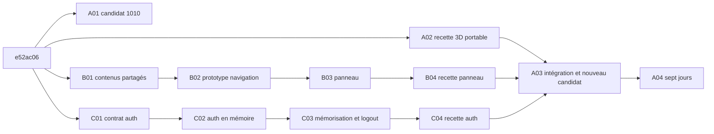

# Backlog parallèle — 2 ou 3 agents Opus 5.5

État inspecté le **22 octobre 2026**, code de référence **`e52ac06`**. Ce dossier est le **point d’entrée des prochains agents**. Il remplace l’ordre séquentiel UX00→UX09 pour le travail restant, sans renommer les jalons du [backlog produit](../../BACKLOG.md). Les tickets ci-dessous sont des tâches futures, sauf les preuves explicitement citées.

## Ce qui existe réellement

| Sujet | État vérifié | Conséquence |
| --- | --- | --- |
| UX00–UX03 | Accueil/cartes partagés, aperçu téléphone, loader local et action de carte implémentés | Ne pas reconstruire un dashboard ou un contrôleur desktop séparé |
| UX04 / M02 | Plan privé, 8 liens, 2 placements, 2 favoris configurés dans un **profil Chrome dédié** | Pas de synchronisation implicite vers Chrome habituel ou Android |
| UX05 | Sélection Home commune plan/pièce/appareils ; conservation lors du retour navigateur | Réutiliser `HomeViewProvider` et les validations de cible |
| UX06–UX08 | Caméra maquette, transitions, fallback durable, un renderer web actif ; défaut 3D web ≥1024 px | Ne pas refaire la caméra ; éviter une régression lors du panneau |
| Commandes | Façade C01–C04, résultats qualifiés, non-rejeu ; M01 autorise un switch précis après enrollment | Favori/position/login ne créent jamais une permission |
| Connexion Chrome | Token uniquement en mémoire ; loader `.local` réservé au développement | Le login produit durable reste à faire (D02) |
| Détails | Deux routes complètes, aucun panneau latéral implémenté | Le reste utile de D03 est le panneau à contenu partagé |
| Validation source | **692 Jest / 47 suites**, **23 tests Node**, type/lint/format ; smoke public 320/430/768/1440 et fixture navigateur passent | Dernière preuve locale, pas nouvelle CI distante |
| 3D Chrome | Mac M4 : médianes 57,8 / 55,1 FPS, sample/privé, deux marqueurs ; zoom Chrome 200 % vérifié | Les mesures de masquage utilisent une visibilité injectée ; le rendu GPU est réellement mesuré. **A02 :** rejouable via `npm run check:spatial-ui` (CI headless) et `-- --headed --performance` (Mac) |
| Android | Trial **1010 construit**, source propre `e52ac06`, sample, 3D désactivée | **Pas installé/accepté dans cette passe** ; A01 doit terminer cette recette |
| Terrain | Ancien cycle de lampe accepté sur Pixel 1009 ; sept jours non observés | Ne pas réutiliser l’ancien consentement ni déclarer M05 terminé |

Artefact local : `.local/trial/sample/build-1010/build.json` et APK associé.
SHA-256 APK : `007c552b9f854ae5defc8df9ced9c6ff20d65cdeb66cd7f29cbdc7e7a8832fb4`.
Le Seeker était détecté, déverrouillé, Android 16, Trial 1007, HA ready avant mise à jour ; revérifier sa disponibilité. `.local/ux09/baseline.json` et le journal d’usage existent seulement sur le Mac principal. Aucun cycle physique ni installation 1010 n’a été réalisé. Les tokens et la géométrie privée ne sont pas nécessaires aux autres agents.

## Objectif de cette vague

Rendre la version actuelle utilisable et vérifiable au quotidien, puis apporter deux améliorations indépendantes : consulter les détails sans perdre la maison sur desktop, et se reconnecter sur Chrome sans ressaisir un token. **Une seule application, mêmes contenus, mêmes règles de commande.**

Je recommande **3 agents**. Le troisième apporte surtout la recette et l’intégration ; ouvrir trois grands refactors UI en même temps augmenterait les conflits.

| Agent | Premier ticket | Puis | Propriétaire |
| --- | --- | --- | --- |
| **A — validation et intégration** | [A01 : accepter le candidat existant](A-validation.md#a01--recette-du-candidat-1010) ; si téléphone absent, A02 | A02 tests 3D portables → A03 intégration → A04 terrain | Outillage public, CI, builds, preuves finales |
| **B — détails partagés et panneau** | [B01 : extraire les contenus](B-detail-panel.md#b01--extraire-les-contenus-sans-changer-la-navigation) | B02 prototype historique → B03 panneau → B04 recette | Navigation et présentation des détails |
| **C — connexion web durable** | [C01 : contrat et prototype auth](C-web-auth.md#c01--contrat-et-prototype-dauthentification) | C02 connexion mémoire → C03 mémorisation/logout → C04 recette | Authentification, stockage des credentials, backend |

**Avec 2 agents :** agent 1 prend B, agent 2 prend C. Tous deux peuvent commencer immédiatement. Après leurs premiers commits indépendants, l’agent 1 prend A02 puis A03 ; l’agent 2 prend A01 sur le Mac/phone disponible. A04 reste une observation humaine, pas une tâche à remplir automatiquement. Un seul des deux devient intégrateur et propriétaire des fichiers communs. Aucun build natif final avant l’intégration de B et C.

### Dépendances réelles



A01 accepte uniquement l’ancien SHA. Son succès ne certifie pas le candidat intégré d’A03. C01 et B02 sont des livrables techniques avec preuve, pas des discussions ouvertes : l’agent écrit sa décision et son prototype, l’intégrateur vérifie les contraintes, puis le même agent continue. Les questions produit réellement non résolues sont listées, avec une recommandation ; ne pas arrêter tout le chantier pour un choix de nom ou de style.

Les tailles sont des indications de périmètre : **S** = changement localisé et sa preuve ; **M** = module et intégration bornée. Ce ne sont pas des estimations de durée. Chaque lot a une sortie vérifiable avant le suivant.

## Propriété des fichiers et contrats gelés

| Zone | Écrivain unique pendant cette vague |
| --- | --- |
| `app/_layout.tsx`, routes `app/appliance/`, `app/device/`, `HomeScreen`, écrans de détail, `AppShell*`, `desktop.css`, `EntityCard`, `services/deviceNavigation.ts`, `spatial/navigation.ts`, nouveaux `components/details/` et `navigation/` | B |
| `SettingsScreen`, nouveau `app/auth-callback.tsx`, nouveaux `services/auth/`, `credentialStorage*`, `credentials.ts`, `runtime.ts`, `SessionManager`, `HomeAssistantBackend`, tests associés | C |
| `core/types.ts` | C **seulement pour le contrat de connexion** ; aucun changement de snapshot/status/commande sans coordination |
| `scripts/check-ui.mjs`, `scripts/lib/browser-connection-check.mjs`, `scripts/trial-ha-fixture.mjs`, scripts de build, workflows, `package*.json`, politique d’audit, index documentaires | A / intégrateur |
| `scripts/check-detail-panel.mjs` et fixtures propres au panneau (nouveaux) | B |
| `scripts/check-web-auth.mjs` et `scripts/lib/web-auth-fixture.mjs` (nouveaux) | C |
| Moteur 3D, `modelCamera`, `ModelCameraController`, hosts, sélection Home, modèle/préférences du plan, façade de commandes et thème global | Gelés ; correctif reproduit livré séparément et attribué avant édition |
| Tests et document de preuve propres à chaque lot | Auteur du lot ; aucun autre agent ne réécrit son état |

Les nouveaux noms de fichier sont **proposés**, ils n’existent pas encore. Les listes d’ownership ne donnent pas le droit de modifier toute la zone sans nécessité.

Contrats maintenus durant B/C :

- `useCockpit` demeure la source des observations ; `status.kind === "ready"`, identité du profil et session ont la même signification.
- `commands.capture`, `commands.setSwitch`, `commandStore` et `useSwitchCommand` restent les interfaces des contrôles. B ne contourne pas la façade ; C ne la réécrit pas.
- C garde `session.connect({url, token, allowInsecureHttp})` et la démo compatibles. Un nouveau mode d’auth est additif ; pas de faux token de remplissage.
- B garde les routes `/appliance/[id]` et `/device/[key]` utilisables directement. C revient après auth à une **destination interne validée**, indépendante de la future syntaxe du panneau. Pas de changement conjoint du root layout : C crée la route callback, B/intégrateur fait l’éventuel enregistrement explicite.
- Le scope spatial reste profil + plan + révision. Auth refresh ne doit pas produire un profil différent pour le même origin normalisé ; changer de foyer invalide les anciennes cibles.
- Les grants restent en préférences schéma 3, locaux au client ; login/logout n’accordent rien et aucun import de grants entre clients n’est ajouté.

## Exécution sans collision

Utiliser un worktree par agent, à partir du commit qui contient **ce dossier**. Exemple après son commit, depuis le dépôt principal :

```sh
git worktree add -b work/acceptance ../maurice-acceptance HEAD
git worktree add -b work/detail-panel ../maurice-detail-panel HEAD
git worktree add -b work/web-auth ../maurice-web-auth HEAD
```

A conserve l’accès au téléphone dans un seul worktree, selon les outils locaux disponibles. Les autres utilisent exclusivement le sample et les fixtures. Ne pas copier `.local`, `.env.local`, profils Chrome ou clés de signature dans les autres branches. Chaque worktree installe ses dépendances ; pas de symlink partagé de `node_modules`. Ports proposés : A 8090/8091, B 8092/8093, C 8094/8095 ; les fixtures HTTP privilégient un port éphémère.

1. Lire ce README, son ticket et les sources citées ; contrôler le diff local avant toute modification.
2. Un ticket = un commit cohérent. Conserver les premiers lots sans modification de comportement facilement intégrables.
3. Si un fichier appartient à un autre agent, envoyer le besoin et une proposition d’API ; ne pas l’éditer en parallèle. Un bug transversal devient un correctif séparé avec propriétaire.
4. B/C ajoutent leurs runners sans éditer `package.json` ni les workflows. A les raccorde après revue. A ne change pas les dépendances sous leurs pieds ; un correctif urgent R01 entraîne un nouveau socle commun explicite.
5. A intègre B01, puis C02, puis B03/B04, puis C03/C04, et termine par A03. Cet ordre de fusion ne bloque pas le développement parallèle. Rejouer les tests de contrat après chaque intégration, pas trois fois la même suite sans changement.
6. Aucun push/publication implicite. Fournir SHA, tests exacts, captures publiques et limites ; l’intégrateur est seul propriétaire des index d’état.

Commandes communes : Node 24, `npm ci`, puis `npm run typecheck`, `npm run lint`, tests ciblés et `npm run format:check`. L’intégration lance les suites complètes, la preuve protocole, les exports/runtime guards et le smoke public selon A03. Ne pas confondre bundle Android JS, APK construit, APK installé et effet physique confirmé.

## Prompts à donner aux agents

### Agent A

```text
Tu es l’agent A (Opus 5.5), responsable de validation et d’intégration de Maurice.
Lis docs/handoff/parallel/README.md puis A-validation.md dans ce dossier.
Compare le code/HEAD à e52ac06 et les preuves locales aux statuts documentés.
Commence par A01 si le Seeker et l’APK 1010 sont disponibles ; sinon A02.
B travaille sur les détails, C sur l’auth : respecte l’ownership et les contrats.
Ne certifie jamais leurs futures modifications avec l’ancien APK 1010.
Livre un commit par ticket, avec preuve, limitations et consigne de reprise.
Ne modifie aucun appareil réel sans autorisation spécifique au moment du cycle.
```

### Agent B

```text
Tu es l’agent B (Opus 5.5), responsable du panneau de détail de Maurice.
Lis docs/handoff/parallel/README.md et B-detail-panel.md.
Commence B01 : extraire les contenus existants en gardant les routes et commandes.
Puis réalise B02 et prouve historique/URL/focus/renderer avant de brancher B03.
Ne crée pas de seconde logique métier pour le desktop. Mesure la largeur du panneau.
A possède les scripts/CI communs ; C modifie auth/session mais préserve leurs API.
Reste dans tes fichiers, un ticket par commit ; aucune commande physique.
```

### Agent C

```text
Tu es l’agent C (Opus 5.5), responsable du login web durable de Maurice.
Lis docs/handoff/parallel/README.md et C-web-auth.md, puis les sources installées.
Commence C01 : documenter et tester callback/state/PKCE/refresh/stockage/forget.
La bibliothèque installée ne suffit pas à prouver la sécurité du callback.
Préserve le chemin token natif, le loader dev et les contrats consommés par B.
Livre C02 en mémoire avant C03 persistant opt-in ; aucun secret dans les fixtures.
A possède package/workflows/audit ; un ticket par commit et preuves bornées.
```

## Après cette vague

| Ordre / ticket existant | Résultat souhaité | Déclencheur / condition |
| --- | --- | --- |
| **M05 / A04** | Une semaine d’usage utile et journal local | Candidat intégré réellement accepté ; pas sept redémarrages simulés |
| **H02** | HA disponible même lorsque le Mac dort | Prioritaire si le journal montre ce blocage ; migration d’origin séparée, sans transfert automatique de grants |
| **U02** | Inventaire volumineux utilisable | Fixture publique représentative, mesure avant/après ; commencer `EntitiesScreen` (actuellement ScrollView + toutes les lignes et pièces) ; optimisation Home après B |
| **D03 finition** | Mobilier simple et matériaux plus lisibles | Après stabilité du panneau/caméra ; même budget GPU ; pas de halos d’état sans contrat d’observation |
| **H01 puis C07b ou C06** | Une seule nouvelle catégorie utile, fan ou climat | Appareil réellement identifié, capacités observées et autorisation précise ; réutiliser C01–C04 |
| **I01 puis I02** | Une image caméra vérifiée | Contrat de transport/redirections/auth avant affichage ; pas de token dans l’URL du composant |
| **C05** | Commande de serrure | Besoin réel + preuve H01, confirmation explicite et codes éphémères |
| **R03b / iOS / PWA** | Distribution et autres plateformes | Recette dédiée et audit strict ; ne découlent pas de cette vague |

Les tickets différés restent détaillés dans `docs/BACKLOG.md`. Ne pas lancer des nouvelles commandes, une refonte de store, une migration de plan ou une bibliothèque UI pour occuper un agent bloqué sur du matériel. A02 est précisément le travail indépendant prévu dans ce cas.
