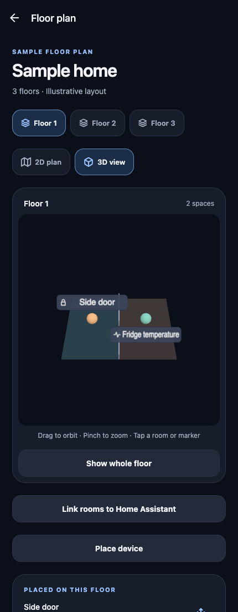

# Production spatial-view validation — S02

Date: 2026-10-16. Working tree after `45df8a4`; no S02 commit recorded. See [implementation ownership](../design/spatial-view.md). This validates the production plan/placement path using public demo data, not actual hardware control or household placement accuracy.

## Repository

**232 tests across 25 suites pass**, with TypeScript, ESLint and configured formatting passing. Existing U03/U04/P03/P04/S01 regressions remain passing. New tests verify shared 2D/3D selection, floor changes, current-profile/plan/floor callback guards, alias navigation, removed/hidden/unavailable/unknown/cached placements, viewport pause and fallback markers/navigation.

Real Three.js resource tests verify that equal marshalled values do nothing, changed conditions retain geometry/material/label resources, renamed/reclassified labels dispose their old texture/material, movement preserves identity, and removal disposes owned resources without disposing other sprites' shared quad. These tests need no WebGL and do not establish GPU performance.

## Artifact

An optimized ARM64 embedded proof APK was built with the public sample plan and a separate application ID `com.larrabee.homecockpit.s02proof`. It uses debug signing, release optimization, no minification/shrinking, and a proof-enabled WebView inspector. It contains no HA credentials or personal geometry and runs independently of Metro. This is a spatial proof artifact, not an accepted household release or R03 completion.

- Size: 45,251,655 bytes.
- SHA-256: `594bd5eb75e8a69bf84bca058d55e9cb6160b0edebcd2b84b6fb0d2ab495e51f`.
- Expo 57.0.29, React Native 0.86.3, Three.js 0.186.1; JDK 17, ARM64, Hermes.
- Public web export and the Android embedded Hermes/DOM build pass. The ignored generated plan was restored after export/build.

## Runtime checks

Chrome, public sample and simulated observations:

- Actual schema-2 saved placements load through PreferencesStorage; two markers on Floor 1 and one on Floor 2 remain separate from S01 fixtures.
- Native room-list selection, DOM room picking, 2D/3D switching and whole-floor reset share selection. Individual marker navigation opens the existing observation route.
- An actual simulated observation change updates the existing material while preserving marker geometry, material identity, label texture, floor rebuild count and the user's camera.
- Unfocused and entirely offscreen canvas frame deltas are **zero**. Reduced-motion mode has no animated camera; desktop widths 320/430/768 CSS pixels keep the floor in frame without horizontal overflow.
- A real WebGL context loss yields a usable 2D plan with saved markers, native room/device navigation and deliberate Retry.
- Three view switches dispose the old context/listeners/content; remounts return to **7 geometries / 3 textures**. Disposal leaves at most one historical shared/internal geometry/texture counter; the context is actually lost and scene-owned content is empty. These counters are not a claim of measured GPU bytes.
- Loaded public-demo navigation works offline. No page errors or device service calls were recorded.

## Native Seeker — passed

Seeker, Android 16, the installed APK whose hash matches the artifact above. Public positions were saved through the native placement editor and retained across the final APK update. The suite exercises production `HousePlanScreen`, not SceneLab:

| Measurement                              | Observed result                                                                                   |
| ---------------------------------------- | ------------------------------------------------------------------------------------------------- |
| DOM renderer ready                       | 291 ms, measured from renderer mount; excludes process/native navigation                          |
| Five-second native ADB orbit             | 590 frames / 4993.2 ms = **118.2 rendered fps**                                                   |
| P95 animation-frame spacing during orbit | 8.4 ms                                                                                            |
| Idle / unfocused / offscreen frame delta | **0 / 0 / 0**                                                                                     |
| Short background/resume                  | Zero hidden frames; one expected resume invalidation                                              |
| Three 2D/3D remounts                     | **7 geometries / 4 textures** each, selected-room view; no surviving WebView target after unmount |
| Native resize                            | 334 → 294 → 334 CSS px wide; height stays 380; original display override restored                 |

Room touches use known clear interior points of the public plan, avoiding interactive marker/name rectangles. DOM picking returns selection through the actual native bridge; switching to 2D and back retains it. Marker picking opens the existing observation detail, then native Back returns to the scene. A real simulated condition transition preserves geometry/material/label identities, floor rebuild count and the user's orbit. Native lists remain available throughout.

A real WebGL context loss retains room/device navigation and deliberate Retry. Switching floors isolates saved markers. The DOM loads from `file:///android_asset/www.bundle/`; an uncached reload with HTTP/HTTPS/WS/WSS blocked succeeds. After force-stop/relaunch, reopening demo reloads the saved positions and the 3D view. No Metro connection is required by this proof. The normal installed app is restored afterward; no credentials, real household placements or physical devices were changed.

[Aggregate proof](spatial-view-proof-2026-10-16.json) retains the exact artifact, checks and safe measurements. Raw reports and native captures stay ignored. This is a short single-floor, two-marker observation, not a distribution, thermal trial or large-home budget. It does not replace the separate earlier S01 Pixel results.

The normal development client was then cold-started through the existing local Metro server: the saved HA session synchronized, the private household plan opened in 3D, and that view was left foreground. Only a readiness boolean was recorded; no private geometry, labels or images were exported. This read-only smoke is separate from the public embedded-APK measurements above and does not verify actual device positions.

**Remaining S02 target gate:** repeat this suite on Pixel 9 Pro. Only the Seeker was connected for this run; S02 stays Implemented rather than fully accepted across its named reference phones.

## Reproduction and scope

Local lab helpers are ignored: `.local/android/build-s02-proof.py`, `.local/android/s02-native.mjs` and `.local/house-validation/check-s02-browser.py`. Build with the public sample, a temporary `s02Proof` Gradle build type copied from release, application ID suffix `.s02proof`, debug signing and `EXPO_PUBLIC_S01_PROOF=1` for the existing inspector gate. Export web, then assemble `:app:assembleS02Proof` with `-PreactNativeArchitectures=arm64-v8a`; restore the original generated plan in `finally`.

Tests must use actual schema-2 saved public placements, not S01's `fixtureMarkers`. Browser fixtures load through PreferencesStorage. The native workflow creates positions through the existing placement editor, reopens the demo after process restart, and leaves the normal app/profile separate. No device service call is required. Raw local tooling is not CI; reproducible F02/R02 checks remain open.

Rendered fps means frames submitted during a pointer gesture, not GPU time or Android compositor fps. Idle/hidden/unfocused counters need stable sampling windows; legitimate observation, layout or resume invalidations are separate from a render loop. Native UI transitions and context-loss recovery must be exercised in the installed artifact. Do not substitute browser checks for Pixel acceptance.

Future hardware gates include Pixel S02 acceptance, larger placement counts/longer memory and thermal trials, TalkBack/large system fonts, iOS and standalone household HA behavior. S01's dated measurements remain evidence for that earlier artifact only. Actual lamp/feeder positions are still user configuration, not inferred from this proof.

## P1 furniture assets — standalone APK proof, 2026-10-28

The OQ-09 warning was reproduced on `expo export --platform android` but does not affect the Gradle
APK path. This section records the standalone asset proof for P0/P1; it is not a new S02 acceptance
or a release candidate.

**Artifact.** Release APK built from the dirty working tree with
`cd android && ./gradlew :app:assembleRelease -PreactNativeArchitectures=arm64-v8a`:

- `android/app/build/outputs/apk/release/app-release.apk`, 43 MB
- package `com.larrabee.homecockpit`, versionName `0.1.0`, **debug-signed** (same certificate as the
  installed dev client)
- SHA-256 `731dd0cf2dbf082ce618b70ff226eb03f42618b304c3facfcca0af990c83c92c`

**Embedding.** `unzip -l` lists all **23** furniture GLBs under
`assets/www.bundle/assets/assets/furniture/<name>.<md5>.glb`, matching the relative paths in the
DOM component bundle. The Gradle `export:embed` path persists DOM assets with the bundle; the
`expo export --platform android` JS/OTA artifact does not (OQ-09 residual).

**Offline observation.** The APK was installed over the dev client (`adb install -r`; data
preserved). Metro was stopped and `adb reverse --remove-all` was executed before launch. The app
opened on the saved HA profile; switching to the demo profile and Floor 1 → 3D view rendered the
furnished sample (sofa, rug, tables, chairs, kitchen units) from the APK. No private capture is
committed. The Play Protect confirmation was dismissed locally.

**Boundary.** This proves the DOM asset path and offline furniture rendering. It is not a named
trial, a Pixel/GPU measurement, or M04 acceptance. Because `.local/home-plan.json` was present, the
APK bundles the locally prepared personal plan (`my-home`): it is a **private local artifact and
must not be shared**. The demo profile uses the public sample, and no capture or APK is committed.
The trial channel still disables 3D (`buildFeatures.spatial3d`).

## P2 premium details — 2026-11-16

Source: branch `work/scene-3d-polish` on `c6872f5` (this commit) · Binary: none · SHA-256: n/a
Device: none — headless Playwright Chromium 156.0.8078.4 (software WebGL, SwiftShader), macOS, Node 24.11.1
Plan: public sample, offline demo home, no Home Assistant
Scope: presentation of the shared 3D scene — framing, labels, keyboard focus, atmosphere and device
markers. [Design and values](../design/3d-asset-system.md#12-p2--premium-details-2026-11-16).

Captures were taken from a web export of the worktree (`expo export --platform web` with
`COCKPIT_PLAN_FILE=src/spatial/sample-plan.json`, `EXPO_NO_DOTENV=1`, `EXPO_OFFLINE=1`) and of the
untouched `c6872f5`, at 1440 × 900 (DPR 1) and 390 × 844 (DPR 2), with the recette's two public
fixture placements and, separately, six public demo entities on floor 1. They are not committed.

| Check | Result | Notes |
| --- | --- | --- |
| Camera fit across aspect ratios | pass | Probe `fit`: limiting share `0.800` at 332 × 200 and 324 × 380 (orbit), 353 × 260, 742 × 260 and 1130 × 380 (model); the floor outline stays inside the canvas |
| Fit after resize, rotation, zoom, selection | pass | `check:spatial-ui` keyboard/bounds, selection and resize sections |
| Device names, 2 and 6 markers | pass | 2/2 and 6/6 shown in the whole-floor views at all four canvas sizes; none overlaps a head or another name; none clipped |
| Device names, selected room on the phone | pass | Names whose head is outside the canvas are hidden (1/2, 4/6); the list keeps them |
| Keyboard focus ring | pass | Tab reaches the scene host and draws the accent ring; a pointer press focuses the host and draws none (two captures) |
| Marker opens its device | pass | A tap at the projected head opens the detail panel (1440) or route (390) |
| Touch target around a head | pass, lab only | A tap 15 px off a head still reports that marker, on the throwaway route below |
| Seven marker conditions | pass, lab only | Viewed on a throwaway route that is not committed; the demo home only produces healthy readings |
| Window daylight | pass, lab only | Viewed on a throwaway floor with five `window` lines; **the public sample has none** |
| Room selection accent | pass | Home and Plan, 1440 and 390 |
| Frames while idle | pass | `0` rendered frames over 1.5 s after every capture run; peak one live renderer |
| Page and console errors | pass | None during the capture runs apart from Chromium's software-GL `ReadPixels` notices |
| `npm run check:spatial-ui` | pass | `result: "passed"`: every section, 0 external requests, 0 unexpected console events, peak one live renderer (10 created, 9 disposed), plan and checkout unchanged |

The recette ran on the working tree immediately before this commit (`revision` `c6872f5`,
`dirtySource: true`). It stages only `app`, `assets`, `src`, `scripts`, `plugins`, `patches` and the
root configuration, and those are byte-identical in the commit; this ledger and the design document
are not inputs. An earlier run the same day passed every functional section but was reported
`failed` by the script (`checkoutUnchanged: false`) because a documentation file was edited while it
ran. That run was discarded and repeated with the tree left untouched. The recette's own
`home-3d-1440.png` is taken while the scene has keyboard focus, so it shows the new focus ring.

Interaction, checked with a throwaway script on the same export: in the model view a pointer drag
rotates to the yaw limit with the fit still `0.800` and the floor inside the canvas, the wheel
zooms, and widths 1024/1280/1440 keep the zoom and re-fit; a floor 1 → floor 2 → floor 1 round trip
returns to the same resource counts (64 geometries, 12 textures). In the orbit view, emulated touch
drags orbit, a two-finger spread zooms, and a 844 × 390 viewport re-fits to `0.800`.

Steady-frame cost, furnished floor 1 with two markers: `75` draw calls and `7,872` triangles before,
`72` and `7,914` after (`74` and `7,918` when both room tags show). With six markers: `79–83` and
about `9,285` before, `89–90` and about `9,405` after. Unfurnished floor 2: `17` and `3,928` before,
`10` and `3,934` after. Counted at the WebGL draw calls of one frame and equal to
`renderer.info.render` where the build exposes it.

Automated: `npm test` → 1045 tests / 78 suites pass (scene suites: 80 tests / 11 suites, 49 / 8
before); `npm run typecheck`, `npm run lint` and `npm run format:check` pass; `npm run
check:spatial-ui` as in the table.

Limits: nothing was built, installed or run on a phone. Native rendering in the Android WebView,
GPU cost, frame rate, thermal behaviour and memory on the Seeker or Pixel are **not measured**; the
browser renderer here is software. Touch, pinch and TalkBack were not exercised on a device. The
marker conditions and window daylight have no committed automated visual check. Colour and contrast
were judged by eye from captures, not measured. The scene shows no "selected marker" state.

Next: build a named 3D-enabled candidate from this revision and measure open time, interaction
frame rate and idle frames on the target phone (M04).
