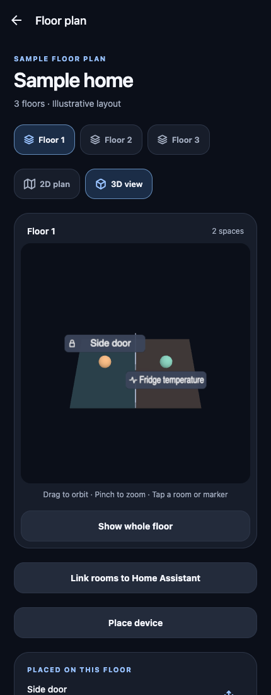

# Production spatial-view validation — S02

Date: 2026-10-16. Working tree after `45df8a4`; no S02 commit recorded. See [implementation ownership](../design/spatial-view.md). This validates the production plan/placement path using public demo data, not actual hardware control or household placement accuracy.

## Repository

**232 tests across 25 suites pass**, with TypeScript, ESLint and configured formatting passing. Existing U03/U04/P03/P04/S01 regressions remain passing. New tests verify shared 2D/3D selection, floor changes, current-profile/plan/floor callback guards, alias navigation, removed/hidden/unavailable/unknown/cached placements, viewport pause and fallback markers/navigation.

Real Three.js resource tests verify that equal marshalled values do nothing, changed conditions retain geometry/material/label resources, renamed/reclassified labels dispose their old texture/material, movement preserves identity, and removal disposes owned resources without disposing other sprites' shared quad. These tests need no WebGL and do not establish GPU performance.

## Artifact

An optimized ARM64 embedded proof APK was built with the public sample plan and a separate application ID `com.larrabee.homecockpit.s02proof`. It uses debug signing, release optimization, no minification/shrinking, and a proof-enabled WebView inspector. It contains no HA credentials or personal geometry and runs independently of Metro. This is a spatial proof artifact, not an accepted household release or R03 completion.

- Size: 45,251,655 bytes.
- SHA-256: `594bd5eb75e8a69bf84bca058d55e9cb6160b0edebcd2b84b6fb0d2ab495e51f`.
- Expo 57.0.29, React Native 0.86.3, Three.js 0.186.1; JDK 17, ARM64, Hermes.
- Public web export and the Android embedded Hermes/DOM build pass. The ignored generated plan was restored after export/build.

## Runtime checks

Chrome, public sample and simulated observations:

- Actual schema-2 saved placements load through PreferencesStorage; two markers on Floor 1 and one on Floor 2 remain separate from S01 fixtures.
- Native room-list selection, DOM room picking, 2D/3D switching and whole-floor reset share selection. Individual marker navigation opens the existing observation route.
- An actual simulated observation change updates the existing material while preserving marker geometry, material identity, label texture, floor rebuild count and the user's camera.
- Unfocused and entirely offscreen canvas frame deltas are **zero**. Reduced-motion mode has no animated camera; desktop widths 320/430/768 CSS pixels keep the floor in frame without horizontal overflow.
- A real WebGL context loss yields a usable 2D plan with saved markers, native room/device navigation and deliberate Retry.
- Three view switches dispose the old context/listeners/content; remounts return to **7 geometries / 3 textures**. Disposal leaves at most one historical shared/internal geometry/texture counter; the context is actually lost and scene-owned content is empty. These counters are not a claim of measured GPU bytes.
- Loaded public-demo navigation works offline. No page errors or device service calls were recorded.

## Native Seeker — passed

Seeker, Android 16, the installed APK whose hash matches the artifact above. Public positions were saved through the native placement editor and retained across the final APK update. The suite exercises production `HousePlanScreen`, not SceneLab:

| Measurement                              | Observed result                                                                                   |
| ---------------------------------------- | ------------------------------------------------------------------------------------------------- |
| DOM renderer ready                       | 291 ms, measured from renderer mount; excludes process/native navigation                          |
| Five-second native ADB orbit             | 590 frames / 4993.2 ms = **118.2 rendered fps**                                                   |
| P95 animation-frame spacing during orbit | 8.4 ms                                                                                            |
| Idle / unfocused / offscreen frame delta | **0 / 0 / 0**                                                                                     |
| Short background/resume                  | Zero hidden frames; one expected resume invalidation                                              |
| Three 2D/3D remounts                     | **7 geometries / 4 textures** each, selected-room view; no surviving WebView target after unmount |
| Native resize                            | 334 → 294 → 334 CSS px wide; height stays 380; original display override restored                 |

Room touches use known clear interior points of the public plan, avoiding interactive marker/name rectangles. DOM picking returns selection through the actual native bridge; switching to 2D and back retains it. Marker picking opens the existing observation detail, then native Back returns to the scene. A real simulated condition transition preserves geometry/material/label identities, floor rebuild count and the user's orbit. Native lists remain available throughout.

A real WebGL context loss retains room/device navigation and deliberate Retry. Switching floors isolates saved markers. The DOM loads from `file:///android_asset/www.bundle/`; an uncached reload with HTTP/HTTPS/WS/WSS blocked succeeds. After force-stop/relaunch, reopening demo reloads the saved positions and the 3D view. No Metro connection is required by this proof. The normal installed app is restored afterward; no credentials, real household placements or physical devices were changed.

[Aggregate proof](spatial-view-proof-2026-10-16.json) retains the exact artifact, checks and safe measurements. Raw reports and native captures stay ignored. This is a short single-floor, two-marker observation, not a distribution, thermal trial or large-home budget. It does not replace the separate earlier S01 Pixel results.

The normal development client was then cold-started through the existing local Metro server: the saved HA session synchronized, the private household plan opened in 3D, and that view was left foreground. Only a readiness boolean was recorded; no private geometry, labels or images were exported. This read-only smoke is separate from the public embedded-APK measurements above and does not verify actual device positions.

**Remaining S02 target gate:** repeat this suite on Pixel 9 Pro. Only the Seeker was connected for this run; S02 stays Implemented rather than fully accepted across its named reference phones.

## Reproduction and scope

Local lab helpers are ignored: `.local/android/build-s02-proof.py`, `.local/android/s02-native.mjs` and `.local/house-validation/check-s02-browser.py`. Build with the public sample, a temporary `s02Proof` Gradle build type copied from release, application ID suffix `.s02proof`, debug signing and `EXPO_PUBLIC_S01_PROOF=1` for the existing inspector gate. Export web, then assemble `:app:assembleS02Proof` with `-PreactNativeArchitectures=arm64-v8a`; restore the original generated plan in `finally`.

Tests must use actual schema-2 saved public placements, not S01's `fixtureMarkers`. Browser fixtures load through PreferencesStorage. The native workflow creates positions through the existing placement editor, reopens the demo after process restart, and leaves the normal app/profile separate. No device service call is required. Raw local tooling is not CI; reproducible F02/R02 checks remain open.

Rendered fps means frames submitted during a pointer gesture, not GPU time or Android compositor fps. Idle/hidden/unfocused counters need stable sampling windows; legitimate observation, layout or resume invalidations are separate from a render loop. Native UI transitions and context-loss recovery must be exercised in the installed artifact. Do not substitute browser checks for Pixel acceptance.

Future hardware gates include Pixel S02 acceptance, larger placement counts/longer memory and thermal trials, TalkBack/large system fonts, iOS and standalone household HA behavior. S01's dated measurements remain evidence for that earlier artifact only. Actual lamp/feeder positions are still user configuration, not inferred from this proof.
