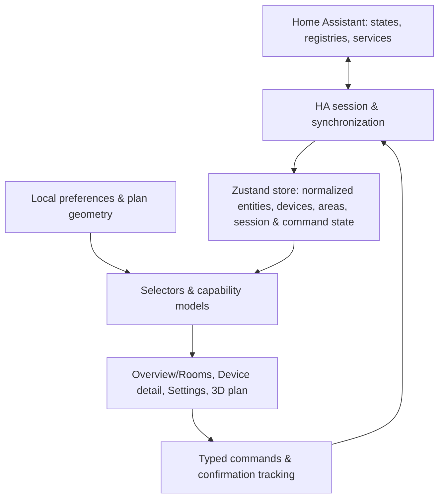

# Home Cockpit — Functional & Technical Specification

- **Date:** 2026-10-14
- **Version:** 4 — revised after [review 1](./2026-10-14-home-cockpit-review.md), [review 2](./2026-10-14-home-cockpit-review-v2.md) (disposition in §11), and implementation lifecycle review on 2026-10-15
- **Status:** Draft — for review
- **Scope:** product definition for the MVP, the long-term shape, and detailed contracts for Stages 0–1. Later stages get their own spec revisions and implementation plans.

---

## 1. Context and goals

### 1.1 Problem

The household's smart devices are spread across several vendor apps (Google Home for Nest, Schlage Home, SmartThings, Ring, AC Infinity). There is no single place to see the state of the house and act on it.

### 1.2 Goal

**Home Cockpit** is an iOS + Android app that answers three questions quickly:

1. *Does anything need attention?*
2. *What is happening in this room?*
3. *Did my action take effect?*

It does this through a room-oriented overview with the household's useful controls, and, as a distinct milestone, an interactive 3D floor plan (inspired by *House Control*) where devices are clickable markers.

### 1.3 Target user

A single household (the author's home) and its occupants. Personal tool, not a multi-tenant product: no Cockpit accounts, no backend. Authentication is owned by Home Assistant.

### 1.4 Responsibility boundary

- **Home Assistant** owns integrations, device truth, history, automations, unattended alerts and notifications.
- **Cockpit** owns presentation, entity selection, room/plan geometry, and interaction (including tracking the outcome of commands it sends).

### 1.5 MVP success criteria

1. The user enters a Home Assistant URL and token, connects, and gets a usable home screen within 5 s on a healthy LAN.
2. Changes **known to HA** are reflected in the app within 1 s of HA emitting them. Device-to-HA latency is an upstream property, measured separately and shown honestly (§4.6) — e.g. the Schlage integration polls the vendor cloud every 30 s.
3. Lock/unlock the Schlage locks, change the Nest setpoint and mode, control the AC Infinity vents, read the Samsung fridge values, and see Ring's latest available image and recent motion/ding activity — each limited to what Stage 0 proves the installed integrations actually provide.
4. Every command ends in an explicit, truthful outcome: confirmed, failed, or unconfirmed. The app never invents a state, and never automatically re-sends an unlock.
5. Connection problems are explained with likely causes and a way to fix them; displayed values are always qualified (live, synchronizing, cached) so stale data never looks live.
6. The 3D view (Stage 3) shows the house with live markers, works offline from the app bundle, and tapping a marker opens the device. If the scene fails, the rest of the app keeps working.

### 1.6 Non-goals (MVP)

- No direct integration with vendor clouds; no in-app Matter/Thread controller or commissioning (see §3.2).
- No Cockpit backend, no Cockpit-native push notifications (use HA's own notification paths, e.g. the official Companion app).
- No automations or thresholds that must run unattended (they belong in HA).
- No floor plan editor, no live camera video, no multi-home UI.
- No plugin system, event bus, or support for hypothetical non-HA hubs.

---

## 2. Devices in scope

| Device | Expected HA path | Main entities | Notes / Stage 0 checks |
|---|---|---|---|
| Nest Learning Thermostat | Google Nest (official, Google Device Access: Google project setup + US$5 registration fee) **or** Matter, depending on the model generation | `climate.*`, `sensor.*` | Confirm model; choose cloud vs Matter; record exposed features (single target vs range, modes, units) |
| Schlage Encode Plus (several) | Schlage (official; vendor cloud, 30 s polling) | `lock.*`, `sensor.*` (battery) | Measure command-to-confirmed latency; check whether the lock exposes a code requirement |
| Samsung connected fridge | SmartThings (official) | `sensor.*`, `binary_sensor.*`, `switch.*` (setpoints may be `number.*`, not supported in the MVP) | Determine whether values are measured temperatures, setpoints, or both, and name them accurately; if setpoints matter, add `number` support in Stage 2 |
| Ring cameras | Ring (official) | `camera.*` (`live_view` / `last_recording`), `event.*` (motion, ding) | Prove the still-image path: subscription status, image availability and age via `camera_proxy` (§4.5) |
| AC Infinity AIRTAP T4 vents | Community BLE integration [`ljmerza/ac-infinity-airtap-ble`](https://github.com/ljmerza/ac-infinity-airtap-ble) (HACS) | `fan.*` (on/off, 10 speed steps), `sensor.*` (temperature) | Needs a connectable Bluetooth adapter or ESPHome BLE proxy within range; validate the exact hardware revision |

LG appliances from the original brief are out of scope (not in the household). Any other HA entity in a supported domain still appears **with its supported capabilities** (§5.4); full compatibility is not promised merely because a domain matches.

---

## 3. Architecture

### 3.1 Big picture



- **Session** (`src/session/`): owns networking, authentication, synchronization, heartbeat, app-lifecycle handling and cancellation. Implemented behind the `HomeBackend` interface (§5.2) by `HomeAssistantBackend` and `DemoBackend`.
- **Store** (`src/core/store.ts`): the single reactive store. Holds what the session reports; never talks to the network itself.
- **Preferences** (`src/preferences/`): versioned, persisted local configuration (visibility, favorites, room overrides, plan geometry).
- **Views**: pure selectors and capability/presentation models; screens consume these, never raw HA payloads.
- **Commands** (`src/commands/`): semantic commands (`setLockState`, `setClimateTarget`, …) translated to HA service calls, with lifecycle tracking (§6.5). Screens never use HA domain/service strings.

### 3.2 Openness and protocols (Matter, etc.)

**Decision: Home Assistant is the single integration point; the app speaks the HA entity model only.**

- HA bridges Matter (Matter Server integration), Thread, Zigbee, Z-Wave and cloud integrations. Everything becomes an entity in a domain (`lock`, `climate`, `fan`, …) regardless of protocol.
- Cockpit maps **domains + capabilities**, never brands. A Matter lock and a Schlage cloud lock are both `lock.*` and get the same controls, gated by their declared features.
- An in-app Matter controller is rejected: commissioning, Thread and fabric management need native modules on both platforms and duplicate HA.

### 3.3 Tech stack (pinned at kickoff)

| Concern | Choice | Version policy |
|---|---|---|
| Framework | Expo **SDK 57**, React Native, TypeScript strict | SDK pinned; native packages installed with `npx expo install` for SDK-compatible versions; lockfile committed |
| Builds | **Development builds** (`expo-dev-client`) on iOS and Android from Stage 0 | Expo Go is not a supported target: networking and the 3D bridge must be validated in installed builds |
| Navigation | `expo-router` | SDK-matched |
| State | `zustand` | latest at kickoff, pinned by lockfile |
| Secrets | `expo-secure-store` | SDK-matched |
| Preferences | `@react-native-async-storage/async-storage` | SDK-matched |
| HA client | `home-assistant-js-websocket` **9.7.x** (official) | Pinned; its own reconnect schedule is accepted (no second reconnect loop) |
| 3D | Three.js in an **Expo DOM component** (`'use dom'`); SDK 57 renders DOM components with `@expo/dom-webview` by default | Bridge semantics validated in Stage 0 (async callbacks, JSON-serialized props) |
| Tests | `jest-expo`, `@testing-library/react-native` | SDK-matched |
| Lint / format | ESLint (`eslint-config-expo`), Prettier | — |

**Minimum Home Assistant version:** recorded in Stage 0 from the household instance (target: the installed release, expected 2026.10.x). Below the minimum, the app **refuses** the connection with `ha_version_unsupported` (blocking error with the detected version), because the sync and registry contracts are only proven against the recorded release.

---

## 4. Functional specification

### 4.1 Connection setup (Settings → Connection)

- Fields: **Home Assistant URL**, **Long-lived access token** (masked, show/hide), and — only for `http://` URLs — a required checkbox **"I trust this local network; the token will be sent unencrypted."** HTTPS is the default and recommended path.
- Help text: where to create a token (HA → Profile → Security), and the recommendation to use a dedicated HA user with the minimum privileges Stage 0 proves sufficient, not a shared administrator account.
- **URL validation:** scheme `http` or `https`; host required; optional port; path must be empty or `/` (HA sub-path hosting is not supported); reject embedded credentials, query strings and fragments. The URL is normalized to its origin.
- **Connect**: attempts a connection (§6.2). Credentials are saved only after authentication succeeds.
- **Demo mode**: connects to `DemoBackend` (fake entities of every supported kind). Demo uses its own preference profile (§6.7).
- **Disconnect** (temporary): closes the session; credentials are kept; no auto-reconnect until the user reconnects or relaunches.
- **Forget this Home Assistant**: closes the session, deletes the token and cached images, clears in-memory state. Preferences for that profile are kept (they contain no secrets). The screen states that this does **not** revoke the token in HA, with a pointer to revoke it there.
- On launch with saved credentials, the app connects automatically.

### 4.2 Home screen (Overview + Rooms)

Stage 1 combines the long-term *Overview* and *Rooms* into one screen:

1. **Session banner** (§4.6) — hidden when ready.
2. **Needs attention** — items derived from domain policy (§5.5) for **visible** entities only (hiding an entity also removes it from this section): e.g. a jammed or unknown-state lock, an unlocked lock (default policy "normal = locked"), an unavailable favorite. "Unavailable" and "unknown" never count as all-clear. Each entity appears at most once here, and an entity listed here is not repeated in Favorites. Session-level staleness is **not** listed per entity: while the session is not ready, the banner carries a single home-level notice and this section shows "Status unknown while disconnected" instead of its items.
3. **Favorites** — user-pinned entities.
4. **Rooms** — one section per area, then **Unassigned**. Room resolution: app override → entity area → device area → Unassigned.
5. Pull-to-refresh renews the HA subscription (§6.3).

Stage 3 adds a list/plan toggle on this screen. A separate *Activity* tab (recent HA events and command outcomes) is a Stage 4 candidate.

### 4.3 Entity cards

One card per visible entity (Stage 2 adds targeted grouping, e.g. one fridge card with several readings). Each card shows name, primary state, freshness qualifier when relevant, and — from Stage 2 — a primary control gated by capabilities:

| Kind | Primary state | Primary control (Stage 2) |
|---|---|---|
| lock | Locked / Unlocked / Locking… / Unlocking… / Jammed / Open / Unknown | Lock / Unlock (unlock requires confirmation; code entry if required) |
| climate | Current temperature, target (single or range), mode | − / + on target (coalesced) |
| camera | Latest available image thumbnail + image-time label | open detail |
| fan | Off / On + speed | On/Off |
| switch | On / Off | On/Off |
| sensor / binary sensor | Value + unit / device-class label (Open/Closed, Detected/Clear…) | — |
| event | "Motion 2 min ago", "Ding 1 h ago" | — |

During a command, the card shows the command's lifecycle state (§6.5) next to the last observed value, e.g. *"Unlock requested — current state not confirmed"*.

### 4.4 Device detail

- Header: name, room, physical device (manufacturer/model when known), availability, and freshness: last changed, last updated, received by the app.
- Capability-gated controls (Stage 2):
  - **lock**: Lock / Unlock (+ Open if supported); related battery reading via shared physical device. **Unlock and Open** both require a deliberate confirmation step (authorization), which is separate from entering a device-required code. Both follow the same no-replay rules (§6.5).
  - **climate**: single target or low/high range according to declared features; modes from `hvac_modes` (including `auto` and `heat_cool` as distinct modes); min/max/step and unit respected; low ≤ high validated; null readings shown as "—".
  - **fan**: on/off; percentage slider honoring `percentage_step` when supported; preset selector when the fan is preset-only.
  - **switch**: on/off.
  - **camera**: see §4.5.
- Related entities of the same physical device (e.g. battery, motion events, fridge readings).
- Collapsible raw attributes for diagnostics.

### 4.5 Cameras and events (Ring)

- Still images are loaded from `GET /api/camera_proxy/<entity_id>` with the bearer token, but only for cameras whose image path Stage 0 has proven. The label is **"Latest available image"**, with its capture time when HA exposes it, otherwise "capture time unknown" — distinct from "fetched at".
- Unsupported, empty or error responses show a placeholder with the reason (e.g. "No recording available — a Ring subscription may be required").
- Detail screen refreshes the image every 10 s **while visible and foregrounded**, never with overlapping requests. Refresh means "re-fetch whatever HA has", not "take a new picture".
- Image cache keys are scoped to the HA profile and entity; forgetting a profile clears its images.
- `event.*` entities are shown as relative time since the last event. A "recent motion" badge appears for events younger than 2 minutes (configurable) and then expires. An old event is never displayed as ongoing motion.
- Camera ↔ event/motion association uses the **shared physical device** plus device class / event types; an explicit preference override resolves ambiguity. No name-prefix matching.

### 4.6 Session state and freshness (user-facing)

| Session status | Banner | Values | Controls |
|---|---|---|---|
| connecting / authenticating | "Connecting to Home Assistant…" | cached labels only if any, marked "cached" | disabled |
| synchronizing | "Synchronizing…" | marked "cached" until the new snapshot lands | disabled |
| ready | hidden | live (as known to HA) | enabled |
| reconnecting | "Reconnecting… (last synchronized 14:02)" | dimmed, marked "cached" | disabled |
| error — retrying | cause + likely fixes + **Retry now** | dimmed, "cached" | disabled |
| error — auth rejected | "Home Assistant rejected the token" + **Open settings** (no automatic retry) | dimmed, "cached" | disabled |

Freshness rules:
- An unchanged value is not "stale" because it is old: a lock locked for a week is simply locked since a week ago. "Stale" applies only to app-side knowledge (no synchronized session).
- Entity `unavailable` → greyed "Unavailable"; `unknown` → "Unknown" (never collapsed into on/off or locked/unlocked).
- Integrations known to poll (Schlage) show a small info hint in device detail: "Updates from this device can take up to ~30 s".

Error causes are presented as **likely causes**, not definitive diagnoses — a JS-level socket failure cannot distinguish DNS, TLS, local-network permission denial, cleartext blocking, proxies or a stopped server. Example: *"Can't reach Home Assistant at home.local:8123. Possible causes: phone not on the home network, local network access denied for Cockpit (iOS Settings), server stopped, certificate problem."*

### 4.7 Entity selection and visibility (Settings → Entities)

- **Default visible:** entities in supported domains that are not disabled or hidden in HA, and whose `entity_category` is neither `diagnostic` nor `config`. This keeps the fridge readings and Ring events while dropping firmware/signal entities.
- **HA registry entries vs running entities:** a disabled HA entity has no state; choosing "show" in Cockpit cannot enable it. Settings lists such entries separately ("Disabled in Home Assistant") with an explanation that enabling happens in HA; Cockpit performs no HA configuration changes.
- Users can **favorite**, **hide**, or **show** any entity, and override its room.
- A **Diagnostics** filter shows hidden/diagnostic entities, unresolved plan placements, and storage/migration notices with counts.
- Visibility, favorites and placement are independent: an unplaced entity is still visible and actionable.

### 4.8 3D cockpit (Stage 3)

- Single visible floor in v1 (the schema carries a floor id; multi-floor rendering is out of scope).
- Rooms as floor rectangles with low walls and labels; placed entities as markers with an **icon + text label**, colored by semantic condition (§5.5) through a theme mapping.
- Touch: orbit, pan, zoom; tap on a marker opens detail. Gestures must not conflict with the screen's scroll.
- Lazy-loaded; rendering paused when hidden or backgrounded; GPU resources disposed on unmount; WebGL context loss recovered. Scene failure is caught by an error boundary and the list remains usable.
- Performance budget agreed on named target phones in Stage 0 (initial target: 30 fps sustained while interacting, no rendering when idle/hidden).

---

## 5. Data model

### 5.1 Identity

- `entityId` (e.g. `lock.front_door`) is the **current HA address**, used for service calls. It can be renamed in HA.
- `key` is the **app identity**: the entity registry entry id when available, else `entity:<entityId>` for unregistered entities. Preferences and placements reference `key`.
- Reconciliation cases are distinct: *renamed* (same key, new entityId → preferences follow), *missing* (key absent from the snapshot → shown in Diagnostics, preferences kept), *re-created* (new key with an old entityId → treated as a new entity; Diagnostics offers to transfer preferences).
- **Identity survives metadata outages.** The last known `entityId → registry id` mapping is persisted per profile as versioned **metadata** (not device state). When the entity registry cannot be loaded, keys come from that mapping; a failed registry request is never treated as proof that an entry was removed. Fallback keys `entity:<entityId>` are used only when no identity was ever known.
- **Alias rule:** when an entity first seen with a fallback key later receives a registry id, preferences and placements referencing `entity:<entityId>` are migrated to the registry key in one step, and the fallback key is recorded as an alias so open routes still resolve.

### 5.2 Backend interface (`src/session/types.ts`)

```ts
export interface HomeBackend {
  /**
   * Opens, authenticates and completes the first synchronization.
   * Resolves only when the first complete snapshot has been emitted (session usable).
   * Rejects with SessionError (incl. synchronization timeout). Idempotent while open.
   * A transient rejection does not stop background recovery; observe onStatus.
   */
  start(): Promise<void>;
  /** Intentional close: cancels timers/retries; never reconnects afterwards. */
  stop(): void;
  /** Complete replacement snapshots; every emission is the full current set. */
  onSnapshot(listener: (snapshot: HomeSnapshot) => void): Unsubscribe;
  onStatus(listener: (status: SessionStatus) => void): Unsubscribe;
  /**
   * Starts a new subscription epoch and resolves only after the server's initial
   * snapshot for that epoch has been received and emitted. Cached replays never satisfy it.
   * Concurrent calls (refresh, foreground, reconnect) are coalesced into one epoch.
   */
  resync(): Promise<void>;
  /** Liveness check with a deadline; resolves false on timeout. */
  ping(timeoutMs: number): Promise<boolean>;
  /** Force transport recovery unless stopped or terminal; backend owns retries. */
  recover(): void;
  /** Pause/resume liveness and resynchronize on foreground; preserve terminal errors. */
  setForeground(active: boolean): Promise<void>;
  callService(call: ServiceCall): Promise<ServiceCallResult>;
  getCameraImageRequest(entityId: string): { uri: string; headers: Record<string, string> };
}

export type Unsubscribe = () => void;

export interface HomeSnapshot {
  sessionId: string;          // generation of the session that produced it
  receivedAt: string;         // ISO, local clock
  entities: Record<string, EntityRecord>;   // keyed by entityId
  devices: Record<string, PhysicalDevice>;  // keyed by HA device id
  areas: Record<string, Area>;              // keyed by HA area id
  syncEpoch: number;          // committed subscription epoch; failed candidates never replace its stream
  config: HomeConfig;
  metadata: {                 // per-registry freshness; failure never changes known identities (§5.1)
    entities: MetadataStatus;
    devices: MetadataStatus;
    areas: MetadataStatus;
  };
}

export interface HomeConfig {
  /** From HA's configuration (`unit_system.temperature`), never from the phone locale. */
  temperatureUnit: '°C' | '°F';
  haVersion: string;
}

export type MetadataStatus =
  | { kind: 'fresh'; loadedAt: string }
  | { kind: 'stale'; lastLoadedAt: string | null; reason: 'timeout' | 'error' | 'forbidden' };

export interface ServiceCall {
  domain: string;
  service: string;
  entityId: string;
  data?: Record<string, unknown>;
}

export type ServiceCallResult =
  | { kind: 'accepted' }                    // HA acknowledged the call
  | { kind: 'rejected'; message: string }   // HA returned an error: definite failure
  | { kind: 'unknown'; reason: 'timeout' | 'connection_lost' }; // may or may not have executed
```

Snapshots are always **complete**. The store replaces its entity set from each snapshot, so entities removed in HA disappear (or move to "missing" for preference purposes). The backend **deliberately preserves** object identity: when mapping a new snapshot, an `EntityRecord` whose raw state, attributes and metadata are unchanged reuses the previous record object (shallow comparison in the mapper). This does not rely on the client's internal identity, so per-entity selectors avoid needless re-renders.

### 5.3 Core records (`src/core/types.ts`)

```ts
/** Adapter-owned. No presentation fields. */
export interface EntityRecord {
  key: string;                 // §5.1
  entityId: string;
  domain: string;
  state: string;               // raw HA state
  attributes: Record<string, unknown>;
  lastChanged: string;         // ISO, from HA
  lastUpdated: string;         // ISO, from HA
  lastReported?: string;       // ISO, if exposed by the subscription
  deviceId: string | null;
  areaId: string | null;       // entity-level area from the registry
  entityCategory: 'config' | 'diagnostic' | null;
  hiddenInHA: boolean;
  disabledInHA: boolean;
  name: string;                // registry name → friendly_name → entityId
}

export interface PhysicalDevice {
  id: string;
  name: string;
  manufacturer: string | null;
  model: string | null;
  areaId: string | null;
  entityIds: string[];
}

export interface Area { id: string; name: string; }

export type SessionStatus =
  | { kind: 'idle' }                                  // no credentials / stopped
  | { kind: 'connecting' }
  | { kind: 'authenticating' }
  | { kind: 'synchronizing' }
  | { kind: 'ready'; haVersion: string; readySince: string }
  | { kind: 'reconnecting'; lastReadyAt: string | null }
  | { kind: 'error'; error: SessionError; retrying: boolean };

export type SessionError =
  | { code: 'invalid_url'; detail: string }
  | { code: 'unreachable'; likelyCauses: UnreachableCause[] }
  | { code: 'auth_invalid' }                          // retries stop until credentials change
  | { code: 'ha_version_unsupported'; haVersion: string }   // blocking (§3.3)
  | { code: 'sync_timeout'; phase: 'initial' | 'resync' }   // retryable
  | { code: 'storage'; detail: string }
  | { code: 'unknown'; detail: string };

export type UnreachableCause =
  | 'not_on_network' | 'local_network_permission' | 'server_stopped'
  | 'tls_certificate' | 'cleartext_blocked' | 'dns';

export interface ConnectionSettings {
  url: string;                 // normalized origin
  token: string;
  allowInsecureHttp: boolean;  // must be true when url is http://
}
```

### 5.4 Capability models (`src/core/capabilities.ts`)

Derived purely from `EntityRecord` (`supported_features` flags mirrored from HA core constants, plus attributes) and `HomeConfig` (configured temperature unit). Controls render only what a capability declares.

```ts
export type LockCapability = { kind: 'lock'; canOpen: boolean; codeFormat: string | null };

export type ClimateCapability = {
  kind: 'climate';
  target: 'single' | 'range' | 'both' | 'none';
  hvacModes: string[];         // as declared, incl. 'auto' and 'heat_cool'
  min: number; max: number; step: number;
  unit: '°C' | '°F';           // from HomeConfig.temperatureUnit; values displayed and sent in this unit
};

export type FanCapability = {
  kind: 'fan';
  onOff: boolean;
  percentage: { step: number } | null;
  presets: string[];           // non-empty for preset-only fans
};

export type SwitchCapability = { kind: 'switch' };
export type ReadOnlyCapability = { kind: 'sensor' | 'binary_sensor' | 'event' | 'camera' };

export type Capability =
  | LockCapability | ClimateCapability | FanCapability | SwitchCapability | ReadOnlyCapability;

/** Returns null for unsupported domains (they are ignored). */
export function getCapability(entity: EntityRecord, config: HomeConfig): Capability | null;
```

Supported domains: `lock`, `climate`, `fan`, `switch`, `camera`, `sensor`, `binary_sensor`, `event`. Others are ignored.

### 5.5 Domain policy and semantic conditions (`src/core/policy.ts`)

```ts
export type Condition = 'normal' | 'active' | 'attention' | 'alert' | 'unavailable' | 'unknown' | 'stale';
export function getCondition(entity: EntityRecord, cap: Capability, ctx: { sessionReady: boolean; now: number }): Condition;
```

Defaults: lock `locked` → normal, `unlocked`/`open` → attention, `jammed` → alert, transitions → active; fan/switch on → active (not "good" or "bad"); `unavailable`/`unknown` map to their own conditions; any value while the session is not ready → stale. Colors and icons are a theme mapping of `Condition`, never encoded in the policy. Household-specific thresholds (e.g. freezer temperature) are a Stage 4 preference.

### 5.6 Preferences and plan (`src/preferences/types.ts`)

```ts
export interface PreferencesFile {
  schemaVersion: 1;
  profiles: Record<ProfileId, ProfilePreferences>;   // 'demo' | `ha:${origin}`
}
export type ProfileId = string;

export interface ProfilePreferences {
  favorites: string[];                          // entity keys, ordered
  visibility: Record<string, 'shown' | 'hidden'>; // overrides of the default rule
  roomOverrides: Record<string, string>;        // entity key → area id
  cameraEventOverrides: Record<string, string[]>; // camera key → event/motion keys
  floorPlan: FloorPlan | null;                   // null until a plan is set (Stage 3)
  defaultPlanRevision: number | null;           // which bundled default seeded the plan
}

export interface Vector3 { x: number; y: number; z: number; }

/** Canonical geometry for both future 2D and 3D views: meters, Y up, origin at the plan's south-west corner. */
export interface FloorPlan {
  floors: { id: string; name: string; elevation: number }[];   // v1 renders floors[0] only
  rooms: { id: string; areaId: string | null; name: string; floorId: string;
           polygon: { x: number; z: number }[] }[];            // rectangles in v1, polygon-ready
  placements: { entityKey: string; floorId: string; position: Vector3 }[];
  camera: { position: Vector3; target: Vector3 };
}
```

Not persisted: entity states, session state, pending commands.

---

## 6. Technical design

### 6.1 Folder structure

```
app/                              # expo-router routes; each renders a screen from src/screens
  _layout.tsx                     # providers, session bootstrap, lifecycle hook
  index.tsx · settings/… · device/[key].tsx
src/
  screens/                        # HomeScreen, SettingsScreen (+ sub-screens), DeviceDetailScreen
  components/                     # EntityCard, RoomSection, SessionBanner, controls/…, CockpitView (Stage 3)
  core/                           # types.ts, store.ts, selectors.ts, capabilities.ts, policy.ts, rooms.ts
  session/
    types.ts                      # HomeBackend, HomeSnapshot, ServiceCall…
    SessionManager.ts             # session generations, lifecycle forwarding, credentials binding
    homeAssistant/                # HomeAssistantBackend.ts, registries.ts, errors.ts, url.ts
    demo/                         # DemoBackend.ts, demoHome.ts
  commands/                       # semantic commands, CommandTracker.ts, predicates.ts
  preferences/                    # types.ts, storage.ts, migrations.ts, defaults.ts
  services/                       # credentials.ts (SecureStore + AsyncStorage), imageCache.ts
  web/                            # CockpitScene.tsx ('use dom'), scene/… (Stage 3)
  constants/config.ts             # timeouts, deadlines, intervals, storage keys
```

### 6.2 Session lifecycle

`SessionManager` creates one session per `start`, with an incrementing **generation id**. Every callback, promise continuation and timer checks its generation and is dropped if it is no longer current. Switching profile (HA ↔ demo, credentials change), disconnect and forget all bump the generation and call `backend.stop()` on the old backend, which suppresses reconnection.

`HomeAssistantBackend` is the single owner of recovery policy, foreground liveness and status transitions. `SessionManager` forwards lifecycle events and binds persistence; it never sets `synchronizing` itself. The requested connection is recorded before preferences are read, independently of the saved active profile: Retry repeats the requested connection, while Forget removes the profile actually committed to storage. A connection that first fails transiently and later reaches `ready` is saved at that point.

Connection sequence (`HomeAssistantBackend`):
1. Validate & normalize URL (§4.1). Status `connecting`.
2. `createConnection` with `createLongLivedTokenAuth` → `authenticating`. `auth_invalid` → `error(auth_invalid, retrying: false)`.
3. `synchronizing`: load HA configuration (`get_config` → `HomeConfig`), open an entity subscription epoch (authoritative feed: initial full state + updates in one subscription — no separate `get_states`, so no fetch/subscribe race), and load the area/device/entity registries. Entity-registry access for the chosen HA user is verified in Stage 0.
   - **Deadlines:** configuration + initial entity snapshot must arrive within **15 s**, otherwise `error(sync_timeout, retrying: true)` with a Retry action; late responses of the timed-out attempt are discarded by epoch. Registries are **optional** with a **10 s** deadline: a timeout or error yields a degraded snapshot (`metadata.*.kind = 'stale'`) that keeps known identities (§5.1) and shows a Diagnostics notice.
4. When both the first entity set and the registries have arrived → first `HomeSnapshot`, status `ready`. Controls enable only in `ready`.
5. Registry changes (`*_registry_updated` events) trigger a registry reload and a new snapshot. Watchers are installed before initial synchronization. Changes received during a refresh mark it dirty and force a follow-up refresh before returning to `ready`.

Reconnect: once a `Connection` exists, its transport retries belong to the official client; Cockpit adds no competing socket reconnect loop. Before a `Connection` exists, an initial network failure is retried by the backend. Synchronization failures on a healthy transport are also retried by the backend, keeping the connection open. These backend retries use exponential delays of 1, 2, 4, 8, 16 and then 30 s, reset after a complete successful synchronization. Backend retry timers pause in background and stop on intentional close or terminal error. On socket loss → `reconnecting`; cancellation of an in-progress first synchronization is not fatal and does not close the connection. On reconnection → `synchronizing` → a fresh complete snapshot → `ready`. Authentication rejection and unsupported HA versions are terminal, with no automatic retries.

Heartbeat (foreground only, owned by the backend): `ping` every 30 s on an open connection with a 10 s deadline. A missed deadline triggers **forced recovery** through the client's `connection.reconnect(true)`. Missing/disconnected connections use the recovery paths above. `connection.close()` is reserved for intentional disconnect/forget and terminal failures, because it disables reconnection.

**Fresh-snapshot mechanism.** The official client's high-level `subscribeEntities` caches the collection on the connection with an unsubscribe grace period, so an immediate unsubscribe/resubscribe can replay cached state without contacting the server. Cockpit therefore does **not** use it for epochs. Each epoch issues an explicit server subscription through the client's lower-level API (`connection.subscribeMessage` with `{ type: 'subscribe_entities' }`) and decodes the compressed entity stream in `src/session/homeAssistant/entityStream.ts` (pure, unit-tested). The previous epoch's subscription is unsubscribed after the new epoch's initial snapshot arrives. Stage 0 proves this against the pinned client release; private client fields and timed waits are not used.

### 6.3 Refresh

Pull-to-refresh calls `resync()`: a new subscription epoch (§6.2) plus a registry reload; it resolves after the server's initial snapshot for that epoch and any refresh made necessary by registry events during the operation. The deadline per epoch is 15 s. A candidate epoch never invalidates the last committed subscription. On timeout that committed stream keeps updating the displayed snapshot and retains its `syncEpoch`; the session goes to `error(retrying: true)`, late candidate results are discarded, and a backend retry is scheduled. The old stream is retired only on successful replacement, transport loss or intentional close. Controls remain disabled until `ready`. The client's `entitiesColl.refresh()` is not used.

### 6.4 App lifecycle (`AppState`)

- **→ background:** stop heartbeat, camera polling and 3D rendering; cancel unsent (debounced) commands; keep tracking already-sent commands until their deadline; the OS may suspend the socket.
- **→ foreground (every time):** first reconcile command deadlines from their recorded timestamps (background timers may not have fired: any sent command past its deadline becomes `unconfirmed` immediately). Preserve terminal errors and their Retry/Settings actions. Otherwise status → `synchronizing`; `ping(5 s)`; on failure recover the transport (or create the missing initial connection), then resynchronize before returning to `ready`. Restart heartbeat in `finally`, including after ping or synchronization failure. Controls stay disabled until `ready`.

### 6.5 Commands (`src/commands/`)

Screens call semantic commands only:

```ts
setLockState(key, 'locked' | 'unlocked' | 'open', code?)
setClimateTarget(key, { temperature } | { low, high })
setHvacMode(key, mode)
setFanOn(key, on) · setFanPercentage(key, pct) · setFanPreset(key, preset)
setSwitch(key, on)
```

Each command produces a tracked record:

```ts
export interface CommandRecord {
  id: string;
  sessionId: string;
  entityKey: string;
  label: string;                   // "Unlock Front door"
  issuedAt: string;
  deadline: string;
  status: 'sending' | 'accepted' | 'confirmed' | 'failed' | 'unconfirmed' | 'superseded';
  baselineRevision: number;        // entity observation revision at dispatch (§6.5 Ordering)
  error?: string;
}
```

Rules:
- **Only in `ready`.** Commands are refused otherwise (UI disabled, and refused again in the command layer).
- **Lifecycle:** `sending` → (`ServiceCallResult.accepted`) `accepted` → (a snapshot satisfies the desired-state predicate) `confirmed`. `rejected` → `failed`. `unknown` result, connection loss or deadline passed → `unconfirmed`. A late matching update after `unconfirmed` upgrades it to `confirmed`.
- **Predicates (every semantic command):**

  | Command | Confirmed when |
  |---|---|
  | `setLockState(locked)` / `(unlocked)` | state equals `locked` / `unlocked` |
  | `setLockState(open)` | state becomes `open` or `opening` at least once after dispatch; if the integration exposes no persistent open state (Stage 0), only `accepted` is reported, worded "Open requested — HA accepted" |
  | `setClimateTarget` | target attribute(s) within half a `step` |
  | `setHvacMode` | state equals the requested mode |
  | `setFanOn` | state equals `on` / `off` |
  | `setFanPercentage` | `percentage` within half a `percentage_step` |
  | `setFanPreset` | `preset_mode` equals the requested preset |
  | `setSwitch` | state equals `on` / `off` |

  Attribute-only updates count.
- **Ordering:** the tracker records, at dispatch, the entity's **baseline observation revision** (a local monotonically increasing counter per entity, not HA timestamps vs the phone clock) and observes every update from dispatch onward — a matching update that arrives **before** the service-call acknowledgement is kept, and the predicate is re-evaluated when the acknowledgement arrives. A terminal status (`confirmed`, `failed`) is never downgraded by a late acknowledgement.
- **Already satisfied:** if the latest observation already satisfies the target, no service call is sent; the UI reports "Already locked" (explicit no-op).
- **Late reconciliation window:** an `unconfirmed` command can still become `confirmed` within **5 minutes** of its deadline, only for the same profile and entity key, and only until a newer command for that entity supersedes it. After a reconnect, the wording is "Home Assistant now shows Locked" — it reports state, not which actor caused it. After the window, a matching change is ordinary state, not a command outcome.
- **Meaning of `failed`:** HA returned an error. The UI says "Home Assistant reported an error", without claiming that no physical effect occurred.
- **Assumed-state integrations** (`assumed_state: true`): confirmation is labeled "Confirmed (state assumed by the integration)".
- **No invented state:** the card keeps the last observed value, qualified by the command status. Nothing is rolled back.
- **Actuator policy per kind:**
  - **Locks:** a new command is **refused** while the previous one is `sending` or `accepted` (awaiting confirmation). After an `unconfirmed` outcome, the next lock action is enabled only after a fresh observation of the entity (a new snapshot epoch or a state update newer than the outcome).
  - **Climate target, fan percentage:** only the latest unsent intent is kept (600 ms debounce). Dispatch is serialized per entity: the next value is sent only after the previous call returns a `ServiceCallResult`; a newer value **supersedes** the previous command (status `superseded`, not shown to the user). Only the final target's confirmation is reported.
  - **HVAC mode, fan on/off, fan preset, switch:** one in-flight call per entity; further taps while `sending` are ignored.
- **Eligibility is revalidated immediately before dispatch** (including after a confirmation dialog): session `ready`, same profile, the key still maps to the same `entityId`, the entity is available, and the capability still declares the action. Otherwise nothing is sent and the dialog explains why.
- **No replay:** every unsent intent (debounced or queued) is **dropped** as soon as the session leaves `ready`, not only on timers. Commands are never re-sent after reconnect. An `unconfirmed` unlock or open tells the user to check the door; it is not retried.
- **Deadlines (initial, tuned from Stage 0 measurements):** lock 45 s (30 s vendor polling), climate 30 s, fan/switch 15 s. Stored in `constants/config.ts`.
- `unconfirmed` and `failed` outcomes stay visible on the card until the next observed change or dismissal.

### 6.6 Credentials and network

- **Storage:** each profile has a random **storage id** (UUID without dashes → alphanumeric). Token in SecureStore under `profile.<storageId>.token` — SecureStore keys only allow alphanumerics, `.`, `-`, `_`, so the human-readable profile id (`ha:<origin>`) is never used as a key. Profile metadata (`storageId`, normalized origin, `allowInsecureHttp`) lives in AsyncStorage under `profiles.v1`, keyed by profile id. Because SecureStore cannot enumerate keys, first journal a pending storage id in metadata, then write the token, then commit the profile metadata and remove the journal. The commit also journals superseded storage ids until their tokens are deleted, so a crash after metadata commit cannot orphan the old token. Forget removes the active metadata and journals token cleanup before deletion, so an interrupted Forget cannot reactivate the profile. Recover both journals on the next storage operation; metadata without a token is cleaned up. Credential reads, writes and forget operations share one serialized queue. Acceptance: HTTPS origin with a non-default port and an IPv6 origin both save, load and forget correctly without collisions.
- **Profile binding:** profile id = `ha:<normalized origin>`. Editing the URL creates a different profile; a token is never reused for another origin. Caches and preferences are per profile.
- **No cross-origin authorization:** the bearer header is only attached to requests whose origin equals the profile origin (camera images included; redirects to another origin are not followed with credentials).
- **Logging:** never log tokens, headers or full HA payloads in production builds.
- **Reinstall/backup:** SecureStore and AsyncStorage survive reinstall differently on iOS and Android; the validation checklist includes "reinstall → app either has a consistent profile or none".
- **HTTP on the LAN** (opt-in) is **build-time configuration**; nothing in Settings changes native configuration.
  - **Android (validated target):** cleartext allowed via `expo-build-properties` (`usesCleartextTraffic`). Stage 0 proves WebSocket and authenticated image loading over `http://<LAN IP>:8123` on the Pixel 9.
  - **iOS (deferred, §8):** `NSAllowsLocalNetworking` + `NSLocalNetworkUsageDescription`. Before iOS is supported, a support matrix of address forms (`.local`, IPv4, IPv6) × iOS versions is tested against Apple's current ATS documentation (including IP-address exceptions on iOS 17+); unsupported forms require HTTPS. A change of exception requires a rebuild.
- **HA authorization model:** per-occupant HA login (authorization-code + refresh token, no Cockpit backend) is a Stage 4 item; Stage 1 uses a long-lived token of a dedicated HA user.

### 6.7 Preferences persistence

- Single AsyncStorage key `prefs` containing `PreferencesFile`. Loaded and validated in Stage 1 (room overrides, visibility and favorites depend on it).
- **Migrations:** ordered functions `vN → vN+1`. Schema version is separate from bundled-default revision: a new bundled default plan does not overwrite a user-modified plan; Diagnostics offers "Reset plan to default".
- **Malformed JSON:** the raw value is copied to `prefs.corrupt.<timestamp>`, defaults are loaded, and Diagnostics shows a notice.
- **Unresolved placements/overrides** (key not in the snapshot) are kept and counted in Diagnostics, never silently dropped.
- Demo and HA profiles never share preferences.
- Export/import of non-secret JSON: Stage 4.

### 6.8 3D bridge (Stage 3; prototyped in Stage 0)

- `CockpitScene` (`'use dom'`) receives JSON-serializable props: `plan: FloorPlan`, `markers: { key, floorId, position, icon, label, condition }[]`, `visible: boolean`, and an **async** callback `onMarkerPress(key)`.
- No credentials, raw attributes or remote content cross into the web view.
- Scene updates are diffed: condition changes update marker materials only.
- The RN wrapper passes `visible=false` when the screen is unfocused or the app is backgrounded → render loop stops.

### 6.9 Testing strategy

- **Unit:** URL validation; capabilities per domain (single vs range climate, preset-only fan, lock with code); policy conditions incl. unknown/unavailable; room resolution order; preference migrations and corrupt-JSON recovery; command predicates with step tolerance.
- **Behavioral (fake HA WebSocket server speaking the real `subscribe_entities` protocol, compressed messages included):**
  - entity mutated during initial synchronization;
  - entity deleted while disconnected → absent after reconnect;
  - delayed `resync` completing after a switch to demo → no cross-session state;
  - attribute-only climate update confirms a setpoint command;
  - command accepted, then socket drops → `unconfirmed`, reconnect, reconcile, **no second unlock sent**;
  - late update after deadline upgrades `unconfirmed` → `confirmed`;
  - rapid setpoint changes → one service call with the last value;
  - entity renamed in registry → favorites follow; re-created entity → treated as new;
  - token revoked mid-session → `auth_invalid`, retries stop;
  - silent dead socket → heartbeat deadline triggers reconnect.
- **Component (RNTL):** cards per kind and condition, session banner per status, connection form validation.
- **Installed-app smoke test, iOS and Android:** setup, one control, background/foreground, server restart/reconnect, denied local-network permission, reinstall.
- Demo mode proves app workflow, not vendor compatibility; real-hardware validation remains required.

### 6.10 Performance targets (to confirm on named phones and the real entity count)

- Usable home ≤ 5 s on a healthy LAN.
- HA update → UI ≤ 1 s after receipt; a single sensor update re-renders only its card.
- No camera polling or 3D rendering while hidden/backgrounded.

---

## 7. Delivery roadmap

Gates are acceptance criteria, not calendar estimates.

| Stage | Deliverable | Exit criterion |
|---|---|---|
| **0 — Prove the dependencies** | Hardware/firmware inventory and HA entity/capability matrix (`docs/stage0/inventory.md`); project scaffold (Expo SDK 57, dev builds, lockfile); `home-assistant-js-websocket` connect/subscribe/reconnect proof under Hermes on an installed Android build (Pixel 9; iOS deferred, §8); one real action per **controllable** category (lock, climate, fan, switch), an observed external change for sensor/event categories, and a proven image response for cameras; immediate-resync proof (explicit subscription epoch) against the pinned client release; registry access with the chosen HA user; Ring still-image proof; HTTP-on-LAN proof; HA installation; throwaway 3D prototype (offline bundle, picking vs orbit, callbacks, on the Pixel 9) | Each device works through HA or a limitation/scope change is recorded; Ring images proven, not inferred; minimum HA version recorded; 3D feasible or fallback chosen |
| **1 — Trustworthy read-only home** | Session lifecycle & synchronization, registries, session banner, connection settings, entity visibility/favorites/rooms, versioned preferences, demo mode, Home (Needs attention + Favorites + Rooms), Device detail (read-only), Diagnostics | Cold start, foreground recovery, server restart, entity removal and demo/HA switching all produce correct, qualified state |
| **2 — Safe household controls** | Capability-aware lock/climate/fan/switch controls, command tracking, camera images & event display, targeted grouping (fridge, camera + events, lock + battery), readable errors | All retained MVP controls work on real hardware, including delayed or uncertain outcomes, with no stale command replay |
| **3 — Spatial cockpit** | House geometry & placements, 3D scene & markers, list/plan toggle | Works offline from the bundle, updates live, meets the agreed performance/accessibility budget; scene failure leaves the app usable |
| **4 — Everyday household use** *(candidates)* | Per-occupant HA login, Activity view from HA history, config export/import, HA scenes/scripts, household thresholds, tablet layout, optional 2D plan | Occupants complete common tasks independently and can restore configuration after reinstall |
| **5 — Demonstrated needs only** | Plan editor, live camera viewing, richer alerts, local/remote endpoint switching, widgets | Each addition has a real household use case and an owner |

Each stage gets its own implementation plan. Stage 0 prototype UI code is throwaway, but its **proof results and selected package versions are kept** as artifacts in `docs/stage0/`.

---

## 8. Household inputs (answered 2026-10-14)

| # | Question | Answer | Consequence |
|---|---|---|---|
| 1 | Home Assistant installed? | **No** → **decided: HA Container (Docker) on the development Mac now, dedicated always-on box later** | Stage 0 starts by running HA in Docker on the Mac (no add-ons, no Bluetooth; Matter Server would run as a separate container if needed). Real device integrations and AIRTAP move to the dedicated box once bought; app code is unaffected because only the URL changes. Until real integrations are set up, software proofs run against HA's built-in `demo` integration, which exposes fake lock, climate, fan, camera and sensor entities through the real WebSocket API. |
| 2 | Device models | Several Ring cameras; Samsung fridge `AFH-US-M64-24-T7XXMU`; AIRTAP rev **F1.0.26**; **no Bluetooth adapter**. Nest generation and Schlage count still to record. | AIRTAP needs a Bluetooth path: HA host with a usable built-in adapter in range, or ESPHome BLE proxies (ESP32 boards) near the vents. Without one, vents are dropped from the MVP. Fridge model string to be matched to the SmartThings capabilities exposed in Stage 0. |
| 3 | Ring subscription | **Yes** | The `last_recording` image path is expected to work; still proven in Stage 0. |
| 4 | Target phones / distribution | **Pixel 9** only; **no Apple Developer account** | **Android-first.** Stage 0–3 validation runs on the Pixel 9 with local Android development builds (`npx expo run:android` or EAS development build, sideloaded). Code stays cross-platform, but iOS is **not validated** until an iPhone and a signing path exist; iOS-specific items (ATS, local-network permission) move to a later iOS enablement step. |
| 5 | HA identities | **One** dedicated HA user | Matches Stage 1 design; per-occupant login stays a Stage 4 candidate. |

---

## 9. Product validation note

Before investing heavily in custom UI (Stage 2+), compare the intended daily workflows against a small HA dashboard on the same phone to confirm what Cockpit adds (spatial view, attention summary, command outcomes). This is a check, not a blocker.

---

## 10. Out of scope reminders

Cockpit-native push requires an HA-side integration and APNs/FCM delivery path — a separate project. Unattended alerts stay in HA. No owned backend until a concrete need (cross-phone preference sync, custom push) justifies it.

---

## 11. Review disposition

### Review 1

| Review item | Disposition |
|---|---|
| 1 — Command outcome instead of rollback | **Accepted.** §6.5: lifecycle with `unconfirmed`, predicates, serialization, coalescing, no replay. Deadlines are per-domain initial values tuned in Stage 0. |
| 2 — "Live" = HA knowledge; transport health separate | **Accepted.** §1.5 (2), §4.6, `synchronizing` status, HA timestamps + `receivedAt`. |
| 3 — Ring still images | **Accepted.** §4.5 and Stage 0 proof; "latest available image" wording; event recency badge. |
| 4 — One sync contract | **Accepted.** `subscribeEntities` as sole feed; complete snapshots; session generations; `resync` via resubscription; `refresh()` not relied upon. |
| 5 — Lifecycle & liveness | **Accepted.** §6.2 heartbeat, §6.4 resync on every foreground, auth rejection stops retries. |
| 6 — Entities / devices / areas, identity | **Accepted** with a minimal model (§5.1, §5.3); registry access verified in Stage 0 with graceful ungrouped fallback. |
| 7 — Selection separate from geometry | **Accepted, reduced:** no onboarding wizard; default rule based on `entity_category` + HA hidden/disabled flags, then favorites/hide in Settings. Export/import deferred to Stage 4. |
| 8 — Capability & unit checks | **Accepted.** §5.4, limited to the supported domains. |
| 9 — Network & credentials | **Accepted.** Opt-in HTTP, strict URL rules, origin-bound profiles, disconnect vs forget, "likely causes" errors. Per-occupant OAuth in Stage 4. |
| 10 — Pin versions, DOM webview, client reconnect, type fixes | **Accepted.** Expo SDK 57, client 9.7.x, library reconnect only, `EntityRecord` without presentation fields, `ConnectionSettings` and `CommandRecord` defined. The hand-written client is no longer planned; if Hermes issues appear, isolate and patch first. |
| 11 — Persistence first, migrations | **Accepted.** Preferences in Stage 1 with migrations, corrupt-JSON recovery, per-profile separation. |
| 12 — 3D feasibility gate | **Accepted.** Throwaway prototype in Stage 0; single floor in v1; conditions separate from colors; error boundary. |
| Product direction / navigation | **Accepted, staged:** Overview + Rooms on one screen in Stage 1; Activity is a Stage 4 candidate. |

### Review 2

| Review item | Disposition |
|---|---|
| 1 — Invalid SecureStore key | **Accepted.** §6.6: random alphanumeric storage id per profile; profile id never used as a key. |
| 2 — Resubscribe may replay cache | **Accepted.** §6.2: explicit `subscribe_entities` epochs through the client's lower-level API, own stream decoder; `resync()` resolves on the server's initial snapshot; `syncEpoch` in snapshots; concurrent requests coalesced. Proven in Stage 0. |
| 3 — Serialization ended too early | **Accepted.** §6.5 actuator policy per kind; locks refuse a new command until confirmation; all unsent intents dropped when leaving `ready`. |
| 4 — Confirmation ordering & window | **Accepted.** Baseline revision, state-before-ack, explicit no-op, 5-minute late window, predicates for every command, wording of `failed` and assumed state. |
| 5 — Identity during registry outage | **Accepted.** §5.1 persisted identity mapping, alias rule; per-registry `MetadataStatus` replaces `registryAvailable`. |
| 6 — Climate unit source | **Accepted.** `HomeConfig.temperatureUnit` from HA config; `getCapability(entity, config)`. |
| 7 — Sync deadlines & recovery | **Accepted.** 15 s required sync, 10 s optional registries (degraded mode), `start()` semantics, `reconnect(true)` for heartbeat recovery, deadline reconciliation on foreground. |
| 8 — Open = unlock policy; eligibility | **Accepted.** §4.4 and §6.5 revalidation before dispatch. |
| 9 — iOS exceptions are build-time | **Accepted.** §6.6; iOS matrix deferred with iOS enablement (§8). |
| Smaller clarifications | **Accepted:** version check is blocking; disabled HA entries explained; identity preserved by the mapper; Needs-attention dedup/hide/outage rules; Stage 0 proofs per category kind; Stage 0 artifacts kept. |

---

## 12. Development environment (observed 2026-10-14)

- macOS with Docker CLI installed; the Docker daemon is not running (Docker Desktop or Colima must be started).
- Java (Homebrew OpenJDK) present; **Android SDK / `adb` not installed** — Android Studio (or command-line tools) is required for local Android development builds on the Pixel 9 (USB debugging enabled). EAS cloud builds are the alternative.
- Node 24.11, npm 11.11.

Foundation implementation results and the updated environment are recorded in [Stage 0 results](../../stage0/results.md). Docker has since been started; Android SDK and Pixel runtime validation remain pending.
