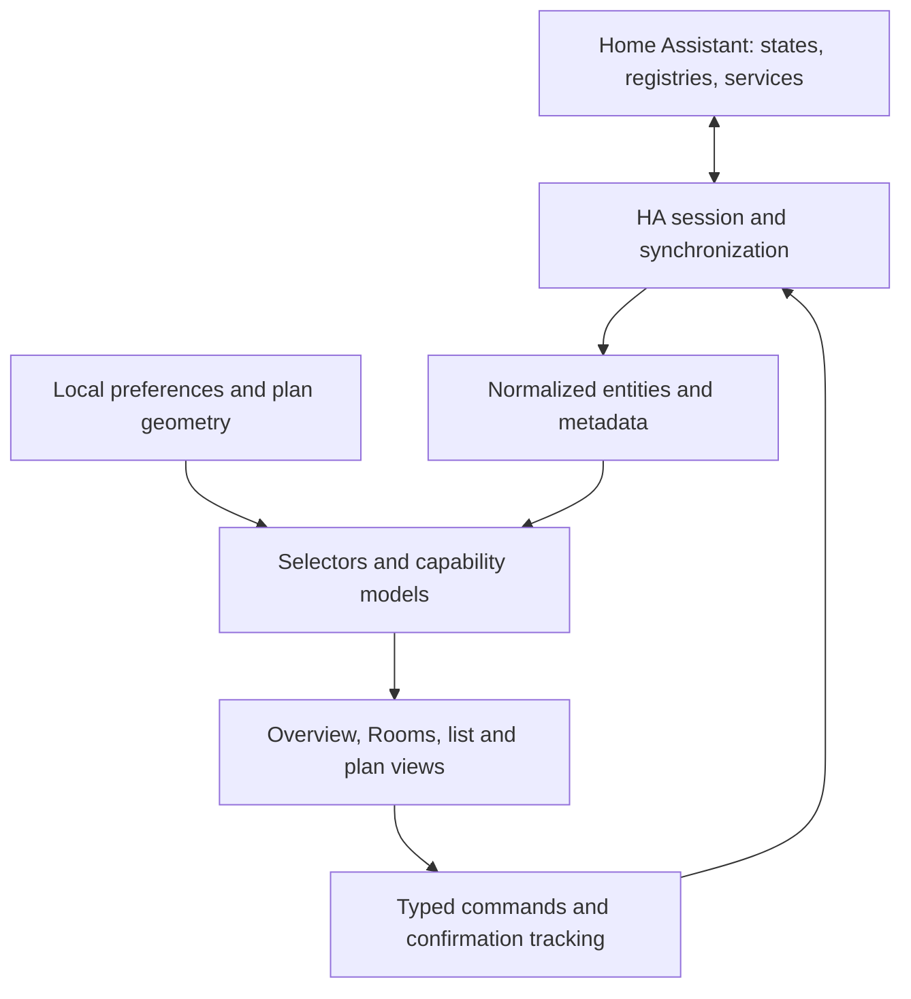

# Home Cockpit specification review and proposed roadmap

Review date: 2026-10-14. Reviewed [the draft specification](./2026-10-14-home-cockpit-design.md). The workspace contains the specification only; there is no application implementation or dependency manifest to audit. External behavior below was checked against primary documentation and, where necessary, source code. The actual household devices and Home Assistant instance were not available for validation.

The architecture is a good starting point: keep Home Assistant as the integration hub, Expo/React Native for the app, Zustand for client state, SecureStore for credentials, and a mock implementation for development. I would revise the synchronization, command, and identity contracts before building controls. The largest risks are promising fresher information than HA provides and presenting an uncertain physical action as a known outcome.

The priorities below mean: **P1** should be resolved before shipping the affected behavior; **P2** should be addressed while designing the foundation to avoid unnecessary rework. They do not imply that every enhancement must enter the first release.

1. **P1 — Replace action rollback with an explicit unconfirmed outcome.** Spec §4.3, [line 140](/Users/jeremy/dev/cockpit-larrabee/docs/superpowers/specs/2026-10-14-home-cockpit-design.md:140), and §5.4.

   A request can reach HA and unlock a door even if the connection drops before the response. After ten seconds, reverting the card to “Locked” would then make an unsupported claim. HA acknowledging a service call also does not establish that the physical device completed it.

   Keep observed HA state separate from command intent. Use a command lifecycle such as `sending → accepted → confirmed`, with `failed` for a definite rejection and `unconfirmed` for timeout or connection loss. Show “Unlock requested; current state not confirmed” when appropriate. Keep the last observed value, visibly qualified, rather than overwriting it with an invented rollback value. “Confirmed” means HA subsequently reports the desired state; some integrations themselves report assumed state, which should remain visible as a limitation.

   Define an action ID, session ID, issue time, desired-state predicate, and deadline. Match climate commands against attributes, with step-aware numerical tolerance. Serialize commands per entity; coalesce unsent temperature/speed changes; cancel unsent debounces on disconnect or backgrounding. Reject actions while the session is unsynchronized. Never queue or automatically replay an unlock after reconnect. Put this policy in the command layer as well as the UI.

   **Acceptance:** HA accepts an unlock, the socket drops, and the physical door unlocks. The app shows an unconfirmed outcome, reconnects, reconciles to HA, and sends no second unlock.

2. **P1 — Define “live” as current HA knowledge, with separate transport health.** Spec §1.4, [line 28](/Users/jeremy/dev/cockpit-larrabee/docs/superpowers/specs/2026-10-14-home-cockpit-design.md:28), §4.6, and §5.1.

   Schlage Encode Plus is supported by the official integration, but that integration uses the vendor cloud and fetches lock state every 30 seconds. A manually operated lock can therefore be delayed even while Cockpit's WebSocket is healthy. This does not prove every command takes 30 seconds; it does invalidate an unconditional immediate-state promise. [Schlage integration documentation](https://www.home-assistant.io/integrations/schlage/)

   Distinguish connection health, completion of initial synchronization, entity availability, and age/provenance of the reported value. Keep `lastChanged`, `lastUpdated`, and a local snapshot-received timestamp; retain `lastReported` if the chosen API exposes it. Neither an old unchanged value nor a freshly downloaded HA snapshot proves the device was recently contacted. Do not label a week-old unchanged lock state as offline merely because its state has not changed. [HA state object semantics](https://www.home-assistant.io/docs/configuration/state_object/)

   Add a `synchronizing` state and enable controls only after synchronization. Mark cached values clearly during reconnect. Revise acceptance criteria to measure HA-to-app update latency separately from device-to-HA latency, and tune command deadlines from observed integration behavior rather than one universal ten-second value.

3. **P1 — Validate Ring's still-image path before promising usable snapshots.** Spec §1.4, §4.4, and §6.3, [line 396](/Users/jeremy/dev/cockpit-larrabee/docs/superpowers/specs/2026-10-14-home-cockpit-design.md:396).

   Current Ring documentation distinguishes `live_view` and `last_recording` camera entities and subscription requirements for recordings. Ring motion and ding events are not equivalent to a continuously asserted motion sensor. [Ring integration documentation](https://www.home-assistant.io/integrations/ring/)

   More specifically, the HA 2026.10.1 camera implementation obtains its still image from a recording URL and caches the result; its image method raises an error when there is no subscription and no recording URL. The existence of a live-view camera therefore does not establish that `/api/camera_proxy/...` provides a fresh photograph without a subscription. [Ring camera implementation, release 2026.10.1](https://github.com/home-assistant/core/blob/2026.10.1/homeassistant/components/ring/camera.py)

   Test the installed HA version, actual camera entities, subscription, image availability, and image age. Specify “last available recording image” where appropriate. Show an image timestamp if known, otherwise “capture time unknown”; distinguish it from the time the app fetched the bytes. Provide a placeholder for unsupported/empty/error responses. Ten-second polling must not imply a new capture every ten seconds. Stop requests off-screen/backgrounded, avoid overlapping fetches, and scope image cache keys to the HA installation and entity.

   An `event.*` state is a last-event timestamp. Display “Motion 2 minutes ago,” or a clearly defined recent-event badge that expires. A historical event is not evidence of motion still occurring. [HA event entity semantics](https://developers.home-assistant.io/docs/core/entity/event/)

4. **P1 — Make snapshots, subscriptions, reconnect, and refresh one consistent contract.** Spec §5.2 and §6.3, [line 391](/Users/jeremy/dev/cockpit-larrabee/docs/superpowers/specs/2026-10-14-home-cockpit-design.md:391).

   The fallback flow fetches states before subscribing. A state change between those operations can be missed indefinitely. The official client already supplies an entity collection with initial state and subsequent updates; use that as the authoritative feed rather than independently bootstrapping a second state cache. [Official WebSocket client](https://github.com/home-assistant/home-assistant-js-websocket)

   For a custom client, subscribe and buffer changes before requesting the snapshot, then reconcile them before declaring the session ready. The adapter contract should explicitly distinguish a complete replacement snapshot from incremental updates. A reconnect snapshot must remove entities absent from the new snapshot, not just upsert those present. Protect against an older refresh overwriting newer events.

   Define pull-to-refresh explicitly. In the client source checked here, the modern entity collection is created without a fetch function, and the generic collection's `refresh()` throws in that case. Do not assume the README's `entitiesColl.refresh()` example works for the chosen release. Verify it after pinning; use a renewed subscription snapshot or a deliberately reconciled state fetch if needed. [Entity collection source](https://github.com/home-assistant/home-assistant-js-websocket/blob/master/lib/entities.ts), [collection refresh implementation](https://github.com/home-assistant/home-assistant-js-websocket/blob/master/lib/collection.ts)

   Also specify a session generation counter. Disconnect, credentials changes, and switching between demo and HA invalidate callbacks, pending promises, and timers from the old session. An intentionally closed session must not reconnect. Subscription setup must be idempotent, including during development remounts.

   **Acceptance:** mutate an entity during initial load; delete an entity while disconnected; finish a delayed refresh after switching to demo. None may leave missed, ghost, or cross-session state.

5. **P1 — Treat app lifecycle and connection liveness as part of the foundation.** Spec §6.3, [line 394](/Users/jeremy/dev/cockpit-larrabee/docs/superpowers/specs/2026-10-14-home-cockpit-design.md:394).

   Refreshing only after more than 30 seconds in the background leaves shorter interruptions and network changes unspecified. On every foreground transition, verify liveness and resynchronize when continuity is uncertain. Define what happens to sockets, reconnect timers, pending commands, image polling, and rendering while backgrounded. React Native exposes lifecycle transitions through `AppState`; it does not make an app session continuously active in the background. [React Native AppState](https://reactnative.dev/docs/appstate)

   Use a bounded heartbeat deadline to detect a silent broken connection even when no entities are changing; HA supports application-level ping/pong. Distinguish an authenticated socket from a synchronized usable session. Authentication rejection should stop retries until credentials change; transient network failures may retry. [HA WebSocket API](https://developers.home-assistant.io/docs/api/websocket/)

6. **P2 — Model entities, physical devices, and rooms separately now.** Spec §5.1, [line 251](/Users/jeremy/dev/cockpit-larrabee/docs/superpowers/specs/2026-10-14-home-cockpit-design.md:251), and §5.3.

   Keeping an entity-keyed store is sensible. Calling each entity a physical `Device`, however, pushes complexity into every feature: battery association, camera motion, appliance cards, placement, and room summaries. Read the entity/device/area registries early and preserve their relationships. HA's device registry already supplies physical-device IDs and area assignments. [Device registry](https://developers.home-assistant.io/docs/device_registry_index/)

   Suggested minimum model: `EntityRecord` for state/capabilities, `PhysicalDevice` for related entities, `Area` for rooms, `EntityPreferences` for favorites/visibility/overrides, and `FloorPlan` for geometry. The first UI can still render entity cards. You do not need a generalized appliance ontology or a full grouping editor.

   Replace object-ID prefix matching with shared-device association plus device class and an explicit override when ambiguous. Two similarly named doors must not exchange motion badges. If registry access fails or an entity has no registry entry, keep it usable as an ungrouped entity.

   An `entity_id` is a current address, not an immutable application identity: HA permits renaming it. Use an installation-scoped registry entry ID when present and retain the current entity ID for service calls; fall back explicitly for unregistered entities. Handle renamed, missing, and re-created entries as distinct reconciliation cases. [HA entity registry update API](https://github.com/home-assistant/core/blob/2026.10.1/homeassistant/components/config/entity_registry.py)

7. **P2 — Separate discovery and selection from floor-plan geometry.** Spec §4.7 and §5.3, [line 298](/Users/jeremy/dev/cockpit-larrabee/docs/superpowers/specs/2026-10-14-home-cockpit-design.md:298).

   Today a fridge's sensors and switches are hidden by default unless placed on the map. “Show all sensors” also reveals switches, and HA rooms are ignored until a developer supplies placements. That undermines the basic unified-home experience before 3D exists.

   Add a small “Choose entities” flow or visibility preferences during onboarding. Default to useful controls, allow favorites and hiding, and expose diagnostics through a separate filter. Resolve rooms from an explicit app override, then entity area, then device area, then Unassigned. Make placement optional and independent of visibility. Unplaced devices should remain discoverable and actionable.

   Keep missing placement references as repairable configuration, with a visible diagnostics count, rather than silently discarding user configuration. Import/export of non-secret JSON would provide practical customization well before a visual editor.

8. **P2 — Domain mapping needs capability and unit checks.** Spec §3.2, §4.4, and §5.3, [line 82](/Users/jeremy/dev/cockpit-larrabee/docs/superpowers/specs/2026-10-14-home-cockpit-design.md:82).

   Mapping by domain is the right default, but two entities in one domain do not necessarily support identical operations. Derive a small typed capability model from feature flags, attributes, and available HA services. Gate controls accordingly and preserve raw attributes for diagnostics.

   For climate, account for target-temperature versus target-range support, `auto` as well as `heat_cool`, available modes, units, steps, and null readings. Validate low/high ordering and send values in HA's expected unit. The climate model explicitly distinguishes single-target and range capabilities. [Climate entity documentation](https://developers.home-assistant.io/docs/core/entity/climate/)

   For fans, distinguish on/off, percentage, and preset-only operation. For locks, distinguish locked/unlocked/transition/jammed/unknown and code requirements; do not collapse unknown into a boolean. For binary sensors, use device-class-specific labels. New devices should “appear with supported capabilities,” rather than being promised full compatibility merely because their domain matches.

9. **P2 — Make network and credential behavior precise.** Spec §4.6, §6.5, and §6.8, [line 406](/Users/jeremy/dev/cockpit-larrabee/docs/superpowers/specs/2026-10-14-home-cockpit-design.md:406).

   Keep HTTPS as the default and make HTTP a deliberate trusted-LAN configuration. Encryption at rest does not protect a token sent over HTTP. Validate URL scheme/host/port; reject embedded credentials, fragments, and unexpected query parameters; explicitly define supported base paths. Bind credentials and caches to an installation profile so editing the host cannot accidentally reuse another server's token. Avoid forwarding authorization across origins.

   Do not diagnose an immediate generic socket failure as definitely “cleartext blocked.” DNS, TLS, a denied local-network permission, proxy behavior, and a stopped server may look similar to JavaScript. Offer likely causes unless native evidence is available. Test both WebSocket and authenticated images in installed iOS/Android builds. Apple's archived ATS reference describes `NSAllowsLocalNetworking` in terms of unqualified and `.local` names; this setting alone is insufficient evidence that every local URL/native transport works as specified. [Apple ATS reference](https://developer.apple.com/library/archive/documentation/General/Reference/InfoPlistKeyReference/Articles/CocoaKeys.html)

   “No Cockpit accounts” should mean authentication remains owned by HA. For the personal MVP, use an appropriately privileged HA user's token per installation rather than one shared administrator token. Distinguish temporarily disconnecting from forgetting credentials. Explain that deleting a long-lived token locally does not revoke it on HA. Later, adopt HA's authorization-code/refresh-token flow for occupants; this needs a deliberate client-ID/redirect setup, but no Cockpit account backend. [HA authentication API](https://developers.home-assistant.io/docs/auth_api/)

   Handle storage errors and partially saved URL/token pairs. A forgotten configuration must clear cached images and in-memory state as well as credentials. SecureStore behavior differs across reinstall and backup on the two platforms; include a reinstall/reset case in validation. [Expo SecureStore](https://docs.expo.dev/versions/latest/sdk/securestore/)

10. **P2 — Keep the stack; correct version-dependent assumptions and the fallback estimate.** Spec §3.3 and §6.4, [line 400](/Users/jeremy/dev/cockpit-larrabee/docs/superpowers/specs/2026-10-14-home-cockpit-design.md:400).

    Expo/React Native/TypeScript, Router, Zustand, AsyncStorage, and SecureStore are proportionate choices. Start real networking validation with development builds on both platforms. Choose and record one supported Expo SDK and HA minimum version at kickoff, commit a dependency lockfile, and install native packages at SDK-compatible versions. “Latest stable at init” is a starting procedure, not a reproducible compatibility policy.

    Two concrete corrections:

    - Current Expo documentation says SDK 56+ DOM components use `@expo/dom-webview` by default; `react-native-webview` is an explicit alternative. DOM callback props must be asynchronous and data crosses a JSON bridge. Specify the implementation after choosing the SDK. [Expo DOM components](https://docs.expo.dev/guides/dom-components/)
    - The official HA client's current connection source uses its own capped retry schedule, which differs from the spec's exponential 1–30-second policy. Decide whether to accept library behavior or intentionally customize it; do not add a second competing reconnect loop. [Official client connection implementation](https://github.com/home-assistant/home-assistant-js-websocket/blob/master/lib/connection.ts)

    The “~150 lines” handwritten client estimate covers a demonstration, not the lifecycle, reconciliation, cancellation, and command guarantees above. First isolate any Hermes incompatibility and see whether a small compatibility adjustment resolves it. If replacement is necessary, estimate and test it as a real infrastructure task.

    Correct the adapter's type mismatch: `getDevices(): Promise<Device[]>` cannot return objects without the required `roomId`. Prefer an adapter-owned `EntityRecord` with no presentation fields, then derive room/card models outside the adapter. Define the currently omitted `PendingAction` and `ConnectionSettings` contracts before implementation.

11. **P2 — Bring persistence forward and define upgrade behavior.** Spec §4.7, §6.2, and §7, [line 454](/Users/jeremy/dev/cockpit-larrabee/docs/superpowers/specs/2026-10-14-home-cockpit-design.md:454).

    Room assignment and default visibility already depend on plan data, yet plan persistence arrives after 3D. Load versioned preferences and validate plan JSON in the foundation. Persist configuration, not pending actions or authoritative device state. If a state cache is added, it must be explicitly historical until refreshed.

    Editing `defaultFloorPlan.ts` will not update an existing installation whose plan was initialized on first launch. Separate schema version from default-content revision; provide migration/reset behavior and preserve user customization. Recover gracefully from malformed JSON. Keep production-home and demo preferences separate even though multi-home UI is out of scope.

12. **P2 — Set a 3D feasibility gate and preserve a complete non-3D interface.** Spec §4.2, §4.5, and §6.6.

    Keep the requested 3D cockpit as a distinct delivery milestone, but validate its riskiest parts early: offline release-bundle loading, touch picking versus orbit gestures, scrolling, DOM/native callbacks, and rendering on both actual target platforms. A static prototype is enough for this gate.

    Use one canonical coordinate system and geometry schema for future 2D and 3D views. Define floor elevation/selection or explicitly limit v1 to one visible floor; the current `floor` number does not define rendering. Keep semantic conditions such as unlocked, jammed, unavailable, and stale separate from color so themes and accessibility can change later.

    Load the scene lazily; pause rendering when hidden/backgrounded; dispose GPU resources; recover from WebGL context loss; use text/icons as well as color. Set an explicit frame/memory budget on named target devices before calling it done. A scene failure must leave the room list and controls usable.

**Product direction.** The app should answer three questions quickly: “Does anything need attention?”, “What is happening in this room?”, and “Did my action take effect?” A raw entity list is a useful development tool but is unlikely to be the best daily home screen. Before investing heavily in custom UI, compare the intended daily workflows with a small existing HA dashboard to identify the value Cockpit adds.

My suggested long-term navigation is an **Overview** with favorites and noteworthy conditions, **Rooms** with grouped controls and a list/plan view choice, and **Activity** with recent HA events and command outcomes. Settings holds connection, selection, display preferences, and diagnostics. The first release can combine Overview and Rooms on one screen; this does not require four tabs immediately.

Examples of useful summaries are front-door state, household temperature, fridge/freezer readings, and recent doorbell activity. Treat thresholds as explicit household preferences or HA rules. “Unavailable” and “unknown” should not silently become a reassuring all-clear. Add physical-device grouping where it improves these workflows, such as one fridge card with several readings, without requiring every HA entity to have a bespoke widget.

**Long-term technical shape.** Keep HA responsible for integrations, device truth, history, and automations. Keep Cockpit responsible for presentation, selection, geometry, and interaction. A modest internal separation will support that boundary:

Use the current adapter boundary for HA and mock implementations. Add semantic commands such as `setLockState` and `setTemperature` above the transport's generic service-call method; screens should not need HA domain/service strings. A small session service can own networking, lifecycle, and cancellation; Zustand can remain the single reactive store. There is no need for an event bus, plugin system, microservices, a new database, or support for hypothetical hubs in the first release.

Keep presentation metadata cheap to change: a fan's normal operating state and a lock's normal state do not share one universal “on means good” rule. Derive summary severity and marker appearance from domain policy, capabilities, availability, and preferences. Use stable entity-level selectors so a high-frequency sensor update does not rerender the whole list or scene.

**Proposed roadmap.** Sequence by risk and household usefulness. These are acceptance gates, not calendar estimates; HA readiness and device validation determine the schedule.

| Stage | Deliverable | Exit criterion |
|---|---|---|
| 0 — Prove the dependencies | Exact hardware/firmware inventory; HA integration and entity/capability matrix; one real read/action per required category; Hermes connection/reconnect proof in installed iOS and Android builds; small 3D feasibility prototype | Required hardware works through HA or an explicit limitation/scope change is recorded; Ring still images are proven rather than inferred |
| 1 — Trustworthy read-only home | Session lifecycle and consistent synchronization; entity/device/area metadata; connection status; onboarding and selection; favorites/rooms; versioned preferences; demo mode | Cold start, foreground recovery, server restart, entity removal, and demo/HA switching produce correct qualified state |
| 2 — Safe household controls | Capability-aware lock/climate/fan/switch controls; command tracking; camera/event behavior; targeted device grouping; readable errors and diagnostics | All retained MVP controls work on real hardware, including delayed or uncertain outcomes, without stale command replay |
| 3 — Spatial cockpit | House-specific geometry and placements; 3D navigation and markers; list/plan choice; persistence/migrations already provided by stage 1 | The requested 3D MVP works offline as an asset bundle, updates correctly, and meets the agreed performance/accessibility budget |
| 4 — Everyday household use | HA login per occupant; useful history/activity from HA; configuration export/import; existing HA scenes/scripts; tablet layout; optional 2D view | Occupants can complete the common tasks independently and restore their configuration after reinstall |
| 5 — Add only demonstrated needs | Plan editor, supported live camera viewing, richer diagnostics/alerts, local/remote endpoint switching, widgets, or shared preferences | Each addition has a real household use case and an explicit ownership/maintenance plan |

Keep automations and thresholds that must run unattended in HA. Initially route background notifications through existing HA facilities, such as the official Companion app if already installed. Cockpit-native push is a separate project requiring a defined HA integration and delivery path to APNs/FCM or a push service; a foreground WebSocket cannot provide it. Preserve the no-owned-backend approach until a concrete requirement such as cross-phone synchronization or custom push justifies additional infrastructure.

AC Infinity is more actionable than the draft implies: an AIRTAP-specific community BLE integration advertises fan on/off, ten speed steps, and temperature. It requires a connectable Bluetooth adapter or ESPHome proxy within range. Treat that repository as a validation candidate for the exact hardware revision, not a guarantee. [AIRTAP BLE integration maintained by its author](https://github.com/ljmerza/ac-infinity-airtap-ble)

For Nest, document setup as a prerequisite rather than hiding it in assumptions: the official path includes Google project setup and currently a US$5 Device Access registration fee. Check the thermostat model before choosing cloud versus Matter. [Google Nest integration prerequisites](https://www.home-assistant.io/integrations/nest/)

For Samsung, verify whether the exposed readings are measured temperatures, configured setpoints, or both, and name them accurately. The integration maps capabilities across sensor, number, and switch entities; the exact appliance determines which exist. [SmartThings supported capabilities](https://www.home-assistant.io/integrations/smartthings/)

**Validation to add to the implementation plans.** Keep the proposed mapper/helper and component tests, but prioritize behavioral failures over one screenshot or one test per domain. In particular, exercise attribute-only climate updates; accepted commands followed by a lost response; late updates after a deadline; rapid setpoint changes; reconnect snapshots that remove entities; rename/removal; incorrect camera association; unknown values; credential revocation; denied local-network access; malformed stored configuration; and session switching while asynchronous work is pending. The fake server must exercise the actual library subscription protocol if that is the production path, not only the fallback `state_changed` path. Add a small installed-app smoke test on each platform covering setup, a control, background/foreground, and reconnect.

Suggested starting performance targets, to confirm on named phones and a representative HA entity count: usable home within five seconds on a healthy LAN; HA updates reflected within one second of receipt; no camera polling or continuous 3D rendering while hidden. Measure upstream device latency separately. Real-hardware validation remains necessary: demo mode proves the app workflow, not vendor integration compatibility.

Before implementation, record the remaining household decisions: actual HA readiness/version, precise device models and exposed entities, Ring subscription/image expectations, supported phones and distribution method, and whether each occupant needs a separate HA identity. These are discovery inputs rather than reasons to redesign the whole application.
